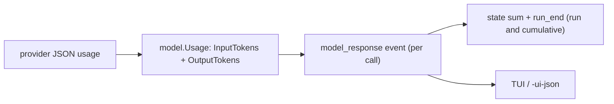

# aharness agent tooling, limits, and measurement research

- **Date:** 2026-11-11
- **Status:** research complete; no code changed. Input to
  [agent tooling and measurement build plan](agent-tooling-build.md).
- **Snapshot:** repository `450dec3`; live catalog queried 2026-11-11.
  `deepseek-v4.1-flash` is 1,000,000 context / 384,000 advertised output,
  Chat Completions, efforts `low,high,max`.
- **Scope:** the builtin tool set, tool caps and paging, token accounting, and
  how to measure changes.
- **Related:** [architecture](architecture.md), [limits](limits.md),
  [testing strategy](testing-strategy.md), and
  [bare-minimum harness research](agent-harness-minimum.md).

## 1. Summary

Three conclusions drive the build plan:

1. **The four-tool surface is correct.** `read_file`, `edit_file`, `search`,
   and `run_command` cover the shell → read → edit → verify loop. Current
   evidence argues against adding tools preemptively; the weakness is the read
   interface, not the tool count.
2. **The caps are stale for current models.** `100` default / `500` max lines
   and a `32 KiB` result cap are sized for 2024-era windows. On a 1M-context
   model, a routine 1,175-line file takes 12 calls at defaults and 3 at max;
   a 500-line page can still be truncated non-contiguously while the header
   claims a contiguous range.
3. **Token totals are provider-reported, not guessed.** Both adapters parse
   usage and persist it per response; only the pre-call context projection is
   estimated (`bytes/4`). The measurement gaps are cached-input and
   reasoning-output detail, cost, failed attempts, and silent zero usage on
   buffered responses.

The recommended order is: measurement first, then the read contract, then a
30-task A/B, then search/command polish. The
[build plan](agent-tooling-build.md) implements that order.

## 2. Method

- Source audit of `internal/model`, `internal/agent`, `internal/tools`,
  `internal/session`, `internal/tui`, and `cmd/aharness`.
- Live catalog check with `-list-models` and the models.dev API on 2026-11-11.
- Primary-source review of provider documentation and 2025–2026 harness,
  tool-design, benchmark, and evaluation research. Sources are in §9.
- Arithmetic for call counts uses the actual repository files and the current
  token estimator (`ceil(bytes/4) + 8/message + 16/tool schema`).

## 3. Essential tool set

### 3.1 Current surface

| Tool | Implementation | Judgment |
|---|---|---|
| `read_file` | Bounded, numbered lines; offset/limit; 2 MiB file cap | Essential capability; interface needs repair |
| `edit_file` | Exact unique byte replacement; empty `old_string` creates | Essential; keep as the primary editor |
| `search` | RE2 over workspace files; path/glob filter; result cap | Essential; keep, fix false negatives and glob semantics |
| `run_command` | `/bin/sh -c` in its own process group; timeout; output cap | Essential |

`write`, `glob`, `todo`, subagents, LSP, and web access are absent. That is
consistent with the evidence: each is optional, and shell/file tools cover the
minimum loop.

### 3.2 Evidence for a small surface

- The 2026 source-code study of eleven production harnesses spans one bash
  tool (Mini-SWE-Agent) to 109 tools (OpenClaw). Its minimum-viable harness is
  **bash, read, write, and search/replace**, and its first tool recommendation
  is to start with bash and add tools only in response to observed failures.
- The same study reports **0/11** systems using vector embeddings for code
  retrieval; all use ripgrep, glob, tree-sitter, and filesystem traversal.
- A 2026 enterprise study found bash alone outperformed typed tools by
  21.8–24.5 pp on TheAgentCompany, with 19–72% fewer tokens. This is
  enterprise work, not coding, so it supports minimalism rather than proving
  it for SWE tasks.
- Mistral Vibe migrated from fuzzy SEARCH/REPLACE **to** exact unique
  substring replacement in 2026; Claude Code and OpenHands use the same
  contract. Exact-match `edit_file` is the right default for strong models.
- Claude Code omits `Grep` and `Glob` by default on Linux/macOS and relies on
  its Bash tool. A `glob` tool is convenience, not a capability gap.

### 3.3 Dated research that no longer generalizes

| Older claim | Origin | Current status |
|---|---|---|
| A 100-line read window is optimal; whole-file reads are worse | SWE-agent ACI ablation, 2024, GPT-4 Turbo | Stale as a universal default. Current harnesses use token-capped reads: Claude Code returns up to 25,000 tokens per read, refuses whole files over 256 KB, and pages with `offset`/`limit`; the 2026 minimal harness scaffold defaults `read_file` to 2,000 lines. Context rot still justifies a bound, not a 100-line bound. |
| Unified diff is the best edit format | Aider, 2024 | Model-specific. Exact search/replace wins for larger models; Codex trains `apply_patch` natively. Keep exact match primary. |
| Agents need XML tool syntax | 2023–2024 agent scaffolding | Native JSON function calling is standard. DeepSeek’s OpenAI-compatible API documents ordinary `tools` / `tool_calls` JSON. |
| More tools and broader toolkits are better | Pre-2025 assumption | Contradicted by the minimal-harness evidence and by production systems deferring or scoping tools. |
| Embeddings should retrieve code | RAG-era assumption | 0/11 production coding harnesses use them; grep plus filesystem structure wins for code literals. |

### 3.4 DeepSeek V4.1 Flash specifics

- **Identity and limits.** DeepSeek’s pricing page names the served model
  `DeepSeek-V4.1-Flash-1017` (API alias `deepseek-flash`); 1M context, 384K
  maximum output, tool calls and the Responses API supported.
- **Thinking is on by default**, default effort `high`; the advertised efforts
  are `low`, `high`, and `max`. Omitting `max_tokens` gives an 8K default in
  non-thinking mode, 64K in thinking mode, and 128K at `max` effort.
- **Reasoning continuation is required with tools.** With `tools` present, all
  prior `reasoning_content` must be passed back on subsequent requests or the
  API returns 400. aharness currently drops reasoning text by design
  (`docs/architecture.md:228-230`; the Chat adapter has no
  `reasoning_content` field). The recorded Chat tool-call smoke passed through
  the `opencode-go` gateway, but no multi-round thinking-effort tool smoke is
  recorded. This must be tested before claiming portability to a direct
  DeepSeek endpoint.
- **Cache pricing dominates cost.** Cache-hit input is `$0.003` vs `$0.15`
  per 1M off-peak — a 50× difference; peak doubles both. Output is
  `$0.60/$1.20`. Peak hours are 01:00–04:00 and 06:00–10:00 UTC, Monday–Friday.
- **Cache is prefix-unit based.** Changing the system prompt, tool schemas, or
  early messages invalidates the cache prefix, so tool changes affect cost per
  turn as well as token count.

## 4. Builtin limit audit

### 4.1 Current caps

| Limit | Value | Code | Behavior |
|---|---:|---|---|
| `read_file` default lines | 100 | `internal/tools/read.go:15` | A 101-line file needs a second call |
| `read_file` max lines | 500 | `read.go:16` | Larger values silently clamp |
| `read_file` max file | 2 MiB | `read.go:17` | `too_large`; no partial read |
| `read_file` result | 32 KiB | `internal/tools/output.go:11` | Head+tail retained; middle dropped |
| `search` results | 100 / max 200 | `internal/tools/search.go:19-20` | Count cap marked |
| `search` result bytes | 32 KiB | `search.go:118` | Head+tail |
| `search` per-file | 1 MiB | `search.go:21` | Silently skipped |
| `run_command` output | 64 KiB combined | `output.go:13` | Head+tail |
| `edit_file` resulting file | 2 MiB | `internal/tools/edit.go:25` | `too_large` |

### 4.2 Call-count arithmetic

| File / shape | Size | Default 100 lines | Max 500 lines | 2,000-line default / 60 KiB |
|---|---:|---:|---:|---:|
| `internal/model/openai_chat.go` | 389 lines, 11.5 KB | 4 calls | 1 call | 1 call |
| `internal/agent/runner.go` | 1,175 lines, 42 KB | **12 calls** | 3 calls | **1 call** |
| 1,000 lines at 80 B/line | ~80 KB | 10 calls | 3+ calls; 42.5 KB page truncates | 2 calls, contiguous |
| 2 MiB at 80 B/line | ~24.7k lines | 247 calls | 65 calls minimum | paged; no whole-file read |

On this model, `32 KiB ≈ 8.2k tokens = 0.86%` of the 950k input budget. A
default 100-line read is roughly 0.1%. A 100 KB source file is ~25.6k tokens
(2.7%) but needs at least four current calls. The result cap is ~29× smaller
than the window; the default read is ~446× smaller.

### 4.3 Defects

1. **The read header describes the requested window, not the delivered
   content.** `readFile` writes `lines A-B of Z`, then `capOutput` keeps the
   head and tail of that rendered page. The model sees line numbers jump
   across the truncation marker and is told it received a contiguous range.
2. **Head+tail is wrong for file content.** It is appropriate for command
   output, where both the beginning and the failure tail matter. For a file,
   the model needs contiguous lines.
3. **No continuation cursor.** Markers are deterministic
   (`[truncated N bytes]`, `[output truncated]`, `[results capped at N]`) but
   never give `offset=N`. Anthropic recommends steering truncation with
   actionable instructions; Claude Code returns a `PARTIAL view` notice with
   `offset`/`limit`.
4. **Line and byte caps are uncoordinated.** Five hundred lines at 80 B/line
   cannot fit 32 KiB. Raising only one cap leaves the other binding.
5. **`search` can return false “no matches.”** Files over 1 MiB, binaries, and
   symlinks are silently skipped; there is no skipped-file count. The
   `Truncated` flag also conflates count-capping with byte truncation.
6. **Every page re-reads the whole file.** `readFile` loads the file with
   `io.ReadAll` even when returning a 100-line window.

### 4.4 Candidate changes

| Priority | Change | Tradeoff |
|---|---|---|
| P0 | Contiguous, line-aware read output; report the actual delivered range; append `continue with offset=N`; head+tail only for command output | Requires line-aware truncation and test updates; no token increase |
| P1 | Default 2,000 lines, max 4,000, read result cap 60 KiB (100 KiB as a second step) | One call for most files; 60 KiB ≈ 15k tokens = 1.6% of the DeepSeek input budget, ~12% of a 128k model window. The 60 KiB value also leaves room for the header and truncation marker under the existing 64 KiB tool-result event cap. Measure before going to 100 KiB |
| P1 | Search result cap 60 KiB; skipped-file counts; real `**` glob or documented lack thereof | Removes false negatives; more result bytes |
| P2 | Spill full command output to a per-run file; return path + inline head/tail | Recoverable output; adds ephemeral path and cleanup semantics |
| P2 | Stream or page file reads instead of reloading the file; optionally raise the 2 MiB cap | Removes repeated I/O; more code |

Do not remove bounds entirely. More context is not monotonically better, and
every result is replayed on later turns. The right shape is larger contiguous
reads, explicit continuation, and cache-aware measurement.

## 5. Token accounting

### 5.1 Data flow

### 5.2 What is reported today

| Path | Provider-reported? | Behavior |
|---|---|---|
| Chat buffered | Yes, if present | `prompt_tokens` / `completion_tokens` mapped (`internal/model/openai_chat.go:337-340`); absent usage silently becomes zero |
| Chat streaming | Yes, required | Missing usage is `protocol_error` (`openai_chat.go:285-287`) |
| Responses buffered | Yes, if present | Optional pointer; nil leaves zero (`openai_responses.go:326-333`) |
| Responses streaming | Yes, required | Missing usage on the terminal event is `protocol_error` (`openai_responses.go:280-282`) |
| Totals | Sum of per-response usage | `model_response` events, `run_end.run_usage`, `run_end.usage`; resume sums `model_response` (`state.go:125-128`) |
| Pre-call input budget | **Estimated** | `ceil(bytes/4) + 8/message + 16/tool schema` (`context.go:22-24,190-205`); not authoritative |

`docs/limits.md` already states that provider usage is authoritative for
totals. The “guess” is the pre-call projection, used for compaction and the
input-limit check.

### 5.3 Gaps

| Gap | Consequence |
|---|---|
| Cached input tokens dropped | Cost is overstated; cache-hit rate cannot be measured. Chat and Responses usage structs have only two fields (`internal/model/types.go:68-75`) |
| Reasoning tokens dropped | Output composition is invisible; `completion_tokens` includes reasoning, but the split is not recorded |
| Cost not computed | No `cost per solved task`; catalog `cost` fields are not decoded |
| Failed attempts not recorded | Retries and partial-stream failures contribute zero even if billed; docs claim totals include retries |
| Silent zero usage | Buffered Chat/Responses and non-SSE fallbacks accept missing usage as `{0,0}`; experiments can average in zeros |
| `run_end` vs durable events | Usage accumulation happens after `emit(ResponseCompleted)` (`runner.go:626-640`); a display failure can leave `run_end` below the sum of `model_response` events |
| Per-tool attribution | Provider usage is per model call; no tokenizer or per-tool split exists |

Provider field mapping to add:

| Provider field | Meaning |
|---|---|
| Chat `prompt_tokens_details.cached_tokens` | Cached subset of prompt tokens |
| Chat `completion_tokens_details.reasoning_tokens` | Reasoning subset of completion tokens |
| DeepSeek `prompt_cache_hit_tokens` / `prompt_cache_miss_tokens` | Cache split; hit + miss = prompt tokens |
| Responses `input_tokens_details.cached_tokens` | Cached subset of input tokens |
| Responses `output_tokens_details.reasoning_tokens` | Reasoning subset of output tokens |

Inclusive-field rule: `InputTokens` remains the total prompt/input count;
`CachedInputTokens` is a subset. `OutputTokens` remains the total completion
count; `ReasoningOutputTokens` is a subset. `Total()` stays
`InputTokens + OutputTokens`; adding the breakdowns must never double-count.

### 5.4 Experiment logging schema

Log one record per HTTP attempt, including failed and aborted attempts:

- Identity: run, task, arm, attempt, logical request/turn, provider request ID.
- Request: provider, API, requested and returned model, stream, max tokens,
  thinking effort, timestamps, latency, status.
- Usage: normalized input, cached input, cache write (if applicable), output,
  reasoning output, total; plus a `reported` flag.
- Cost: currency, price-table ID/date, input/cache/output components, total.
- Tools: call IDs, names, duration, success, truncation.
- Outcome: verifier result, tests passed/failed.

Retries must be deduplicated by provider request ID or logical request plus
attempt; never count a retry as a new turn. Keep raw usage long enough to
recompute normalized fields.

## 6. Evaluation methodology

### 6.1 Benchmarks

| Benchmark | Status | Fit |
|---|---|---|
| SWE-bench Verified | **Compromised.** OpenAI’s February 2026 audit found 59.4% of audited hard tasks have flawed tests and all tested frontier models could reproduce the gold patch or verbatim task specifics; OpenAI stopped reporting it | Not a decision instrument |
| SWE-bench Pro | Harder successor recommended by OpenAI; verify the current split and tests | Secondary at most |
| Terminal-Bench 2.0 / 4.1 | 89 hand-written terminal tasks; frontier agents below 65% at release; the harness is part of the run; current leaderboard is 4.1 and uses `-k 5` | Best public anchor; GPU/Modal cost |
| Internal suite | Uncontaminated, verifiable, refreshable | **Primary decision instrument** |

SWE-bench-style suites are still useful for **relative** harness comparisons
if contamination is arm-independent, but they have little headroom and can
reward benchmark-specific behavior.

### 6.2 A/B design

- Pin the model snapshot (`deepseek-v4.1-flash`) and thinking effort; record
  the returned model.
- DeepSeek thinking mode ignores `temperature`, `presence_penalty`, and
  `frequency_penalty`, so determinism cannot be bought with temperature 0.
  Use repeated runs.
- Same tasks, environment, limits, network policy, and timeouts in both arms.
- Pair by task; randomize/interleave arm order; add a small canary set.
- k = 3–5 repeats per task/arm. Treat the task as the sampling unit; aggregate
  repeats to a per-task mean; cluster standard errors by repository.
- Bootstrap paired differences; report the 95% CI, not just the mean.
- Report actual cost and uncached-equivalent cost; cache-hit rate is a noisy
  covariate because it depends on prefix stability and machine cache state.

### 6.3 Metrics

| Metric | Definition |
|---|---|
| pass@1 | Per-task success over k trials |
| pass@k / pass^k | At least one success / all k succeed |
| Solves | Verifier-passing tasks |
| Tokens per solved task | Input uncached + cache read + output + reasoning, divided by solves |
| Cost per solved task | All attempts, including unsolved tasks, divided by solves |
| Turns / tool calls | Per task and per solve |
| Read calls per file | Correlates directly with the limit change |
| Repeat-read rate | Same path/offset read again without an intervening edit |
| Truncation / continuation rate | Tool results with byte truncation or a continuation footer |
| Tool error / retry rate | Per attempt, not per run |
| Wall time / TTFT | Operational cost |

For the limit change specifically, the primary metrics are **read calls per
file**, **tokens per solved task**, and **turns to solve**; solve rate is the
guardrail. Anthropic’s tool guidance makes the same point: redundant tool
calls indicate that pagination or token limits need rightsizing.

### 6.4 Sample size

For a paired two-proportion comparison (two-sided α = 0.05, 80% power,
p ≈ 0.5, correlation ρ ≈ 0.5), the minimum detectable effect is roughly:

| Tasks | MDE |
|---:|---:|
| 89 | 14.8 pp |
| 108 | 13.5 pp |
| 150 | 11.4 pp |
| 300 | 8.1 pp |
| 500 | 6.3 pp |
| 1,000 | 4.4 pp |

Cost and token effects are far better powered: about 10% relative at n = 150
and about 6% at n = 500. A 30-task smoke detects only catastrophic breakage
and large call-count/token shifts; it is suitable for the limit change, not
for a 5 pp solve-rate claim.

### 6.5 Minimum viable plan

1. **30–50 task internal suite**, 3 repetitions, paired arms. Use it to verify
   the read change and catch regressions.
2. **150-task suite** for a solve-rate decision. Tasks should sit at 30–70%
   baseline solve rate, use executable verifiers, and be held out/refreshed.
3. **Terminal-Bench 2.0/4.1 subset** as an external anchor when budget allows;
   run with k = 5.
4. Budget per full experiment: roughly 150 tasks × 3 repeats × 2 arms = 900
   runs. At $0.30–$2 per run this is $270–$1,800, plus the public benchmark.
5. Cadence: 30-task smoke per change; full suite before release; re-baseline
   quarterly and when the benchmark version changes.

## 7. Recommendations

| Order | Work | Why first |
|---:|---|---|
| 1 | Usage detail (`cached_input_tokens`, `reasoning_output_tokens`, `reported`), catalog price snapshot and per-response cost, fail-closed eval mode, multi-round thinking-tool smoke | Without trustworthy measurement, limit experiments are guesswork. Cost is dominated by cache hits; reasoning continuation is a portability risk |
| 2 | Read continuation/contiguity, then raise limits behind a toolset-version bump | The current read interface causes the extra calls; raising caps without fixing truncation makes the failure less visible |
| 3 | Eval driver and 30-task A/B | Converts the limit change into a measured decision; the session log already has most metrics |
| 4 | Search skipped counts/glob semantics; command output spill | Lower-frequency pain; do after the core read/cost loop is measured |

## 8. Open questions

- Does the `opencode-go` gateway require `reasoning_content` echo for
  `deepseek-v4.1-flash` in thinking mode with multiple tool rounds? The
  recorded Chat smoke was a tool-call round trip, but no multi-round
  thinking-effort smoke is recorded.
- Should the read cap be static (60 KiB) or model-relative (for example 5% of
  the input budget)? Static is simpler and matches Claude Code’s fixed 25k
  token cap; model-relative avoids over-reading on 100k windows.
- Does adding `**` to `search` belong in the tool or should the model use
  `find`/`rg --files`? The current `path.Match` semantics are documented but
  easy for models to over-assume.
- Is a separate `write` tool worth it once `read_file`/`edit_file` are fixed?
  Current evidence says no.
- Should cost be a runtime feature or eval-only? The build plan records
  catalog-priced cost for observability and keeps tier-aware cost in the eval
  driver.

## 9. Sources

Repository:

- `internal/tools/read.go`, `output.go`, `search.go`, `command.go`,
  `edit.go`, `schemas.go`
- `internal/model/types.go`, `openai_chat.go`, `openai_responses.go`
- `internal/agent/context.go`, `events.go`, `runner.go`, `state.go`
- `docs/limits.md`, `docs/architecture.md`, `docs/testing-strategy.md`

External (accessed 2026-11-11):

- Anthropic, [Writing effective tools for agents](https://www.anthropic.com/engineering/writing-tools-for-agents),
  2025-09-11 (updated 2026-10-13).
- Anthropic, [Effective context engineering for AI agents](https://www.anthropic.com/engineering/effective-context-engineering-for-ai-agents),
  2025-09-29.
- Claude Code, [Tools reference](https://code.claude.com/docs/en/tools-reference)
  (Read: 25,000 tokens per call, 256 KB whole-file refusal, `PARTIAL view`).
- Barbaste et al., [Harness Engineering: Anatomy, Architecture, and Evolution of Coding Agents](https://arxiv.org/abs/2609.00006),
  2026-07-15.
- Mak et al., [Is Bash All You Need?](https://arxiv.org/abs/2609.11999),
  2026-09-10.
- DeepSeek, [Tool Calls](https://api-docs.deepseek.com/guides/tool_calls),
  [Thinking Mode](https://api-docs.deepseek.com/guides/thinking_mode),
  [Context Caching](https://api-docs.deepseek.com/guides/kv_cache), and
  [Models & Pricing](https://api-docs.deepseek.com/quick_start/pricing).
- OpenAI, [Why we no longer evaluate SWE-bench Verified](https://openai.com/index/why-we-no-longer-evaluate-swe-bench-verified),
  2026-02-23.
- Yu et al., [SWE-ABS](https://arxiv.org/abs/2603.00520), 2026-02-28.
- Merrill et al., [Terminal-Bench 2.0](https://arxiv.org/abs/2601.11868),
  2026-01-17; [Terminal-Bench leaderboard](https://www.tbench.ai/).
- Jimenez et al., [SWE-bench](https://arxiv.org/abs/2310.06770), 2024.
- Yang et al., [SWE-agent ACI](https://arxiv.org/abs/2405.15793), 2024
  (source of the 100-line ablation; retained as historical context only).
