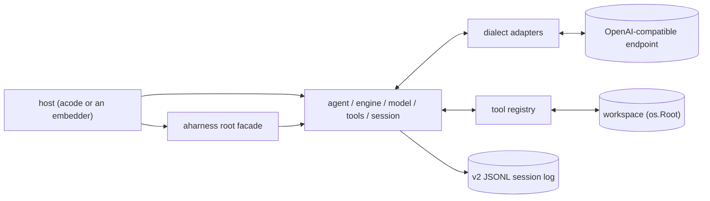

# aharness architecture

- **Date:** 2026-11-18
- **Status:** normative for the aharness SDK after the acode extraction: the
  root facade and the `agent`, `engine`, `model`, `tools`, and `session`
  packages
- **Related:** [Go coding standard](coding-standard.md),
  [bare-minimum harness research](research/agent-harness-minimum.md),
  [limits](limits.md), [testing strategy](testing-strategy.md)
- **Agent entry point:** [AGENTS.md](../AGENTS.md)

[`coding-standard.md`](coding-standard.md) defines Go practice. This document
defines the SDK structure, component contracts, tool behavior, protocols, and
runtime contracts. The coding agent that ships on this SDK is
[acode](https://github.com/eddiectc/acode); its CLI, TUI, configuration, and
presentation docs live there. If the documents conflict on Go practice, the
coding standard wins; on structure and runtime contracts, this document wins.

## 1. System overview

aharness is a headless Go SDK for a single-workspace coding agent. It runs a
model/tool loop against the files and commands the caller grants, appends every
event to a durable JSONL session log, and ends a run with a final answer or a
typed stop reason. It adds no CLI, TUI, environment, config-file, TTY, signal,
or approval layer; the first-party coding agent, acode, is a separate module
built on these packages.



One process, one active session, no daemon, no worker pool. The runner owns
turn state and is the only component that advances the loop. Tools do not call
the model. Model adapters do not touch the workspace. The v2 event log is
append-only and is the only persisted truth. A session is the durable
conversation. A run is one model/tool loop over that session; a host may run
several runs over the same log and may fork or resume a session. Display
events are observation only. The SDK never writes a terminal; the host owns
all presentation, configuration, signals, and process exit.

## 2. Provider and model


aharness supports one provider, `opencode-go`, through two OpenAI wire
dialects: Chat Completions and Responses. The SDK supports the single
provider `opencode-go`; an unknown provider is a configuration error. The usable model set, display names, context/input limits, advertised
output ceilings, status, dialect, base URL, reasoning support, and per-model
reasoning effort levels are discovered from the
[models.dev](https://models.dev) catalog and normalized in `model`.
Deprecated models are selectable and labeled. Models without tool calls, text
output, a positive context window, or a supported SDK are retained in the
catalog with an `Unavailable` reason and omitted from the usable set. A new
session requires a usable model in `ModelSpec`; there is no hardcoded default model, fallback, routing, or provider matrix.

The harness opens network connections only through the dialect adapters, the
catalog source, the configured SearXNG instance, the builtin `web_fetch`
client, and the operator-configured `web_fetch` provider endpoint.
`web_search` contacts only the operator-configured base URL; it never fetches a
model-supplied URL. `web_fetch` contacts the model-supplied URL through the
builtin client, whose dial-time address guard refuses private, loopback,
link-local, metadata, and other special-purpose addresses; with a non-builtin
provider it contacts only the operator endpoint and moves target egress there.
`run_command` may use whatever network the host allows. Provider-specific
request and response shapes stay behind `model.OpenAIChat` and
`model.OpenAIResponses`.
The host supplies the provider token when it constructs the adapter. The token
is optional: when set, the selected adapter sends it as a Bearer token; when
unset or empty, it omits `Authorization`, which supports local no-auth endpoints
and `httptest` servers. An endpoint that requires auth surfaces a missing token
as `provider_error` (401); local no-auth endpoints run without one. The token is
kept in memory, redacted from logs, and excluded from tool environments.
Credential handling stays in the adapters; v1 does not scan unrelated host
configuration or discover credentials implicitly.

### 2.1 Wire format and SDKs

The two dialect adapters use plain HTTP against the resolved catalog base URL.
For `opencode-go`, a discovered base URL must be HTTPS with host `opencode.ai`
and no userinfo, query, or fragment; the documented new-session OpenAI base is
`https://opencode.ai/inference/go/openai/v1`. An explicit
`ModelSpec.BaseURL` wins over discovery and may use any valid HTTP(S) host,
including loopback test servers. Existing sessions
keep their recorded base URL.

- **Chat Completions:** `POST <base>/chat/completions`.
- **Responses:** `POST <base>/responses`.

The dialect comes from the model's AI SDK package (`model.provider.npm`,
falling back to `provider.npm`):

| SDK package | Native protocol | Effective dialect |
|---|---|---|
| `@ai-sdk/openai-compatible` | `chat-completions` | `openai-chat` |
| `@ai-sdk/openai` | `responses` | `openai-responses` |
| `@ai-sdk/anthropic` | `messages` | `openai-chat` (translated) |
| `@ai-sdk/google` | `generate-content` | `openai-chat` (translated) |
| anything else | unknown | unavailable |

Anthropic- and Google-native models use the OpenAI Chat base URL and adapter;
OpenCode documents that every text model also works through the other APIs, so
the harness translates through Chat rather than adding native adapters. Unknown
SDKs fail closed: the model is unavailable and an explicit selection reports
the SDK. The native protocol and SDK are retained on the catalog record for
display and diagnostics. If a model misbehaves through a dialect, fix that
adapter or add its native dialect behind the same canonical model; do not change
the loop. The wire dialect is not the internal schema; both adapters map into
the canonical model (Section 2.2).

Do not use an OpenCode SDK at this boundary. The published Go SDKs
(`opencode-sdk-go` and its community forks) are generated clients for the
OpenCode server REST API; adopting one would move the loop, tools, and session
state into OpenCode, which is the architecture this harness rejects. There is no official
Go SDK for the OpenCode Go inference endpoint: it is OpenAI-compatible HTTP, and
the stdlib adapters are smaller than the mapping layer an SDK would require. An
inference SDK would also own retries, error bodies, and decoding, hiding the
`model_retry` events and redaction the session log depends on. The available Go
clients also fit poorly as dependencies: the Stainless-generated client targets
an older server API, and the community fork that tracks upstream has no license.

Each adapter is constructed with the base URL, provider token, session ID, and
harness version. It sends `Authorization: Bearer <token>`,
`Content-Type: application/json`, `x-opencode-session: <session-id>`, and a
self-identifying `User-Agent: aharness/<version>`. An empty token omits the
`Authorization` header, supporting local no-auth endpoints and tests. OpenCode
Go requires the session header; the value is the run's UUIDv7 session ID. The
base URL is a constructor argument so tests and local deployments can point the
adapters at another OpenAI-compatible server. The caller resolves the base URL from an explicit `ModelSpec.BaseURL`, then
the catalog entry; the override also supports integration tests and local
endpoints.
Production runs use the catalog URL.

Both adapters send the full projected input on every call and keep no
server-side conversation state. The Responses adapter sets `store: false`,
never uses `previous_response_id`, and asks for
`reasoning.encrypted_content` so a stateless tool round can replay reasoning;
servers that return plaintext reasoning (DeepSeek's Responses API) ignore the
include field and are covered by the same raw-item replay. Continuation is
adapter-owned in both dialects; the canonical model never carries raw provider
shapes.

### 2.2 Canonical model and dialect adapters

The `model` package defines one internal canonical model. Every provider
dialect is an adapter that maps its wire format into these types; the loop sees
only the canonical model. The canonical model covers what the loop can act on:
system and user text, assistant text, display-only thinking text, tool calls and
results correlated by ID, one optional request-side control (the
provider-neutral thinking effort), a normalized finish reason, token usage, and
normalized errors.

Canonical does not mean lossless. Provider-specific material — encrypted
reasoning items, reasoning identifiers, citations, safety metadata, cache
controls, opaque options, and streaming events — stays in the adapter and is
dropped unless the loop or the dialect's continuation needs it. Thinking text is
the one exception: it is mapped into the typed display-only
`model.Response.Reasoning` field so a host can display it, and it is never logged
or projected. A dialect adapter may separately retain the provider's own
continuation material in memory; that is adapter state, not a canonical field.
If a future feature needs another provider field, add a typed canonical field
when the loop consumes it; do not add a raw provider-shaped field. A lossless
union schema for OpenAI Responses, OpenAI Chat, Anthropic, and Gemini would push
provider-specific optional fields and invalid states into the loop; that is the
thing to avoid. OpenAI Chat is a dialect, not a neutral standard, so it is not
the canonical model either.

Each adapter owns the wire format, authentication, tool-schema translation, and
the mapping of finish reasons, usage, and errors. It uses one `http.Client` with
a timeout and `http.NewRequestWithContext`, always closes and caps the response
body at 1 MiB, and never uses `http.DefaultClient`. The client timeout defaults
to 15 minutes and is selectable on the adapter. Provider error bodies are capped and redacted before logging.

| Layer | Owns |
|---|---|
| Canonical `model` types | System/text messages, display-only thinking text, tool calls/results, optional request-side thinking effort, normalized finish reason, usage, normalized errors. |
| `model.OpenAIChat` | Chat Completions wire format, nested function schemas, `tool_calls[].id`, `reasoning_content`/`reasoning` thinking text and tool-round continuation, prompt/completion usage. |
| `model.OpenAIResponses` | Responses wire format, flat function tools, `function_call.call_id`, reasoning summaries and raw reasoning-item continuation, input/output usage, `store: false` full replay. |
| Shared `model` HTTP helper | Request execution, auth/session headers, 1 MiB body cap, typed error decoding. |

Normalization rules:

- The canonical system prompt is the first message. Adapters place it in the
  dialect's system slot (`system` message, top-level `system`, or
  `systemInstruction`).
- Every canonical tool call has a non-empty ID and raw JSON arguments. If a
  dialect omits call IDs (Gemini function calls may), the adapter synthesizes a
  deterministic ID for that response and uses it for the matching result. For a
  dialect that supplies IDs, a missing or duplicate wire ID is `protocol_error`;
  the adapter does not repair it. The Responses adapter uses
  `function_call.call_id` for correlation, not the output item `id`.
- Canonical finish reasons are `stop`, `length`, `tool_calls`,
  `content_filter`, and `other`; adapters map dialect-specific stop reasons.
- Canonical usage has input and output totals plus three additive subsets:
  cached input, cache-write input, and reasoning output. Cached and cache-write
  tokens are disjoint subsets of input; reasoning tokens are a subset of
  output. `Total()` remains input+output and never adds a subset. `Reported`
  distinguishes a provider-supplied usage object (including an all-zero
  object) from an absent one. Adapters reject a usage object whose subsets
  exceed their totals as `protocol_error`. The Chat adapter prefers
  `prompt_tokens_details.cached_tokens` and falls back to
  `prompt_cache_hit_tokens`; both dialects map cache-write and reasoning
  details when present. Old v2 logs decode with `reported=false` and zero
  subsets.
- Canonical errors are typed (`HTTPError`, `TransportError`, `ProtocolError`,
  and context overflow); adapters map HTTP statuses and provider error bodies.
- Both adapters replay the canonical projection; the Responses adapter sets
  `store: false` and never uses `previous_response_id`. Each adapter also keeps
  a bounded, adapter-owned copy of its native reasoning continuation material
  and replays that material with the matching assistant output; it is not a
  canonical message and is not projected from the log.

**Thinking effort.** The public name is *thinking effort*; the provider and
catalog call the same control *reasoning effort*. `model.Request` carries one
optional provider-neutral field:

```go
type Request struct {
	Model           string
	Messages        []Message
	Tools           []ToolSchema
	MaxOutputTokens int
	ThinkingEffort  string // empty means the provider/model default
}
```

| Canonical | Chat Completions | Responses | Empty |
|---|---|---|---|
| `ThinkingEffort` | top-level `reasoning_effort` | `reasoning: {"effort": "<value>"}` | Field omitted in both dialects. |

- Both adapters construct buffered and streaming requests with the same
  `payload` function, so the mapping cannot diverge between paths. Tool-call
  rounds reuse the run configuration, so every model call in a run carries the
  same value.
- The value is sent unchanged; adapters do not rename it between providers,
  do not validate catalog membership, and never synthesize a value from a
  toggle or token-budget control. Resolution and membership checks happen in
  `cmd` before the run (Section 9).
- The catalog supplies the capability: only `reasoning_options` entries whose
  type is `effort` contribute values. Values are trimmed, validated against
  `[a-z][a-z0-9_-]*` and at most 32 bytes, the reserved clear sentinel
  `default` is dropped, duplicates are removed, the list is ordered `none`,
  `minimal`, `low`, `medium`, `high`, `xhigh`, `max`, then unknown values
  lexicographically, and it is capped at 16 values. `reasoning` is retained
  separately so the host can distinguish a model that supports reasoning
  without an effort control from one that does not reason at all.
- Thinking text is display-only. `model.Response.Reasoning` carries the
  provider's thinking: Chat reads `reasoning_content` (DeepSeek-compatible) and
  falls back to `reasoning`; Responses concatenates `reasoning` item summary
  and content text and ignores encrypted content for display. It is capped at
  64 KiB, never counted against the canonical response cap, and never written
  to the log or projected. Usage already counts reasoning tokens as output
  tokens, so no accounting change is needed. Both adapters additionally retain
  the provider's own continuation material in a bounded in-memory cache (4 MiB
  per response, 16 MiB per adapter) and replay it before the matching assistant
  output when the loop sends a tool result. Chat replays thinking text as
  `reasoning_content`; Responses replays the raw `reasoning` output items,
  including encrypted content or plaintext `reasoning_text`. A Responses
  summary without encrypted content or plaintext reasoning is display-only and
  is not replayed. The cache is keyed by the canonical assistant message, is
  never logged, lives only as long as the adapter (one run), and is not a
  reason to add a canonical reasoning message shape.
- A provider rejection of a value the catalog advertised (for example 400 or
  422) is a normal typed `provider_error`. The harness does not retry without
  the field or fall back to the provider default.

Provider responses are decoded with `encoding/json/v2` defaults: duplicate
object names and invalid UTF-8 are rejected and map to `protocol_error`; unknown
members are ignored for forward compatibility. Tool arguments are stricter:
typed decoding uses `RejectUnknownMembers(true)` (Section 5). Do not set
`RejectUnknownMembers(true)` for provider responses.

v1 has no opaque provider options or per-adapter capability knobs. Catalog
reasoning support and effort values are discovery metadata resolved by the host,
not adapter options. Add adapter-specific knobs only when a dialect requires
them, and keep them out of the loop.

v1 ships `model.OpenAIChat` and `model.OpenAIResponses` over the `opencode-go`
base URL. Add `anthropic` or `gemini` adapters when a real provider requires
them; each maps into the same canonical model without changing the loop. Share
HTTP, retry, and fixture plumbing; do not share a universal request/response
schema beyond the canonical model.

### 2.3 Streaming

Each adapter optionally implements:

```go
type StreamHandler struct {
	Text      func(string) error // assistant text
	Reasoning func(string) error // thinking text
}

type StreamCompleter interface {
	CompleteStream(ctx context.Context, req Request, stream StreamHandler) (Response, error)
}
```

`CompleteStream` is used when streaming is requested. Batch enables it through
`Start`; `Run` is buffered, and an explicit request not to stream
there is a config error. The agent keeps `Completer` and falls back to `Complete`
when the adapter does not implement streaming. A nil callback discards that
kind. Both callbacks are display-only; the returned canonical `Response` is
authoritative and is the only transcript record. Tool calls are assembled inside
the adapter and are never exposed as deltas.

- Chat Completions sends `stream: true` and
  `stream_options: {"include_usage": true}`. It assembles text, thinking text
  (`reasoning_content` then `reasoning`), tool-call fragments by index, finish
  reason, and usage from the chunks.
- Streaming requests use the same adapter `payload` builder as buffered
  requests, so `max_output_tokens` and `thinking_effort` mapping is identical
  on both paths; the only additions are `stream` and the dialect's stream
  options.
- Responses consumes `response.output_text.delta`,
  `response.reasoning_summary_text.delta`, `response.reasoning_text.delta`,
  `response.function_call_arguments.delta`, and the terminal
  `response.completed`/`response.incomplete`/`response.failed` events. The
  completed response is authoritative; its reasoning item, when present,
  replaces the accumulated streamed thinking.
- A 2xx response whose content type is not `text/event-stream` is decoded as a
  normal JSON response, so local OpenAI-compatible servers keep working.
- Final usage is required. A completed stream without usage is a
  `protocol_error`; the harness does not silently undercount tokens.
- Retries happen only before the first display output. After the first text or
  thinking delta, any failure is terminal and is wrapped in `PartialError`
  carrying capped partial text and the emitted byte count; it is never retried,
  because a retry would duplicate the display and could duplicate tool calls.
- Caps: 4 MiB per SSE event, 1 MiB for the assembled canonical response, 8 MiB
  for the total stream, and 64 KiB for partial text on an interrupt or failed
  stream. The event cap is larger than the response cap because a terminal
  `response.completed` event wraps the full response in JSON. A response over
  1 MiB is a `protocol_error` before any tool executes. Invalid JSON, duplicate
  object names, and invalid UTF-8 are `protocol_error`. Error bodies are capped,
  redacted, and never logged whole.
- The durable transcript keeps the executed response: the `model_response`
  payload is capped at 1 MiB total canonical content, and the session line cap
  is 4 MiB so JSON escaping and envelope fields fit. Tool results remain at
  64 KiB. This avoids a mismatch where a large response is executed but its
  logged fields are truncated, which would break resume.
- A failed stream after deltas appends one `error` event with the partial byte
  count and capped partial text; no `model_response` is written and the partial
  text is not projected. An interactive interrupt appends `interrupt` instead.
- No per-delta events are written. The log size and projection behavior stay
  proportional to complete responses.

With `Start`, text and thinking deltas are emitted as they arrive; a response's
final text is not re-emitted if any delta for it was emitted. If the adapter
falls back to non-streaming, the response text is emitted once. With `Run`, the
final assistant text is returned in `Result.FinalText`.

### 2.4 Continuation for a new dialect

Reasoning continuation is an adapter obligation, not a loop or log feature.
When adding a dialect adapter that serves reasoning models, or enabling a
native provider that already has one, the adapter MUST:

- Retain the provider's exact continuation material — thinking text, raw
  reasoning items, signed thinking blocks, or whatever opaque state the
  provider requires — never the display summary and never a reconstructed
  string.
- Request the dialect-specific switch that exposes replayable material:
  Responses sets `include: ["reasoning.encrypted_content"]` for `store: false`;
  Anthropic enables thinking and receives signed `thinking` /
  `redacted_thinking` blocks; Gemini returns `thought` parts with
  `thoughtSignature`. Chat needs no request-side switch.
- Key the material with `continuationKey` (assistant content or tool-call IDs)
  and replay it in provider order, immediately before the assistant output it
  explains. Never append it at the end of the input: DeepSeek's Responses API
  rejects input that ends with an assistant or reasoning item, and OpenAI
  expects the item to precede the corresponding output.
- Bound the cache (4 MiB per response, 16 MiB per adapter), never log it or add
  it to `model.Message`, and drop it with the adapter (one run). A new run or a
  resumed process starts empty.
- Add a two-round test for both buffered and streaming paths. The second wire
  request must contain the native material unchanged, in order, and before the
  matching tool call; the first request must carry the dialect's
  `include`/thinking switch. Chat and Responses have template tests in
  `model/*_continuation_test.go`. Add a real-provider smoke before
  claiming support.
- Do not add a raw provider field to the canonical model or session log. If a
  provider eventually requires continuation across runs, that is a separate
  durable-reasoning decision, not an adapter cache extension.

Native Anthropic and Gemini adapters are not shipped; those models are
currently translated through the Chat adapter, and the gateway owns the
signature round trip. If a native adapter replaces that path, the checklist
above applies to its SDK types, not to `reasoning_content`.

## 3. Packages and contracts


### 3.1 Package layout

| Path | Responsibility |
|---|---|
| `aharness` (module root) | Public high-level facade: `Config`, `Agent`, `New`/`Resume`/`Fork`, runs, events, results, state, model and tool DTOs, OpenAI/catalog helpers, delegation, and errors. Copies DTOs at the boundary; imports the component packages only. |
| `agent/` | Runner, run lifecycle, turn execution, stop policy, retry policy, display events, history reconstruction, operation interrupts, state reconstruction, repeated-failure detection, projection/compaction, agent definitions and prompt templates, the subagent spawner, tool policy, and custom-tool projection. |
| `engine/` | Host-agnostic composition layer: new/resume/fork resolution, workspace/state/work-dir setup, `session_start` recording, fork contract overrides, per-run registry/spawner/runner wiring, and lock-free session inspection/listing. |
| `model/` | Canonical types; Chat Completions and Responses adapters; buffered and SSE transport; shared HTTP plumbing; typed transport errors; models.dev catalog discovery, cache, and SDK-to-dialect mapping. |
| `tools/` | Registry, argument validation, result shape, workspace containment policy, the seven workspace/web tools, and the `delegate` spawn interface. |
| `session/` | Event envelope, v2 JSONL store, locking, torn-line repair, fork copy, replay-ready reader. |

The root facade and the five component packages are the SDK. The root is the
recommended embedding API and the stable public facade; the component packages
are the lower-level API used by the first-party coding agent (acode) and by
advanced hosts that need the engine, display events, history, catalog, or
session store directly. The SDK contains no CLI, TUI, flags, environment
parsing, config file, terminal I/O, signals, or `os.Exit`; acode owns those.

Dependency direction:

- `session` is a leaf.
- `model` and `tools` import `session` only where needed and never `agent`,
  `engine`, the root package, or an application.
- `agent` imports `model`, `tools`, and `session`.
- `engine` composes `agent`, `model`, `tools`, and `session`.
- The root facade imports the component packages; no component imports the
  root.
- No package imports an application package. A host depends on the SDK, never
  the reverse.

Dependencies stay deliberately small: the Go standard library by default, plus
`github.com/markusmobius/go-trafilatura/v2` for `web_fetch` content extraction
and its `golang.org/x/net` parser dependency. The TUI stack is not an SDK
dependency; it belongs to acode. The dependency justification rules and the
measured binaries are in [coding-standard.md §3](coding-standard.md#3-dependencies).

```text
go.mod
aharness.go     # Config, Agent, New/Resume/Fork, lifecycle
run.go          # Run, RunOptions, event iterator, interrupt/cancel/steer
events.go       # public Event interface and concrete events
result.go       # Result, StopReason, Usage, Limits, State, SessionInfo
model.go        # public model DTOs, Model/StreamingModel, OpenAI and catalog helpers
tool.go         # Tool, ToolResult, ToolName, ToolsConfig, policy
delegate.go     # AgentDefinition, DelegationConfig, DefaultAgents
errors.go       # sentinels and typed errors
doc.go          # package documentation and boundary
version.go      # Version()
agent/
  runner.go     # run lifecycle, loop, stop policy, repair, interrupts
  display.go    # display-only event contract
  history.go    # capped transcript reconstruction
  state.go      # durable state reconstruction and pending calls
  events.go     # event payloads and caps
  context.go    # projection, token estimate, compaction
  agents.go     # strict definition parser, bundled set, discovery, precedence
  prompt.go     # frozen prompt versions, environment block, catalog
  spawn.go      # subagent spawner: child sessions, budgets, display, accounting
  retry.go      # retry policy and streaming-aware model calls
  types.go
engine/
  engine.go     # Spec, Open/new/resume/fork, inheritance, contract overrides
  runner.go     # per-run registry, spawner, and runner construction
  sessions.go   # lock-free Inspect/List snapshots
  workdir.go    # per-session work directory lifecycle
model/
  types.go            # canonical types, StreamCompleter
  catalog.go          # catalog types, lookup/usable filtering, cache path, source contract
  catalog_source.go   # models.dev decode/normalize/eligibility, HTTP load/revalidate/refresh, cache
  openai_chat.go      # Chat Completions buffered + SSE adapter
  openai_responses.go # Responses buffered + SSE adapter
  http.go             # shared request, body cap, SSE decoder, errors
  errors.go
tools/
  registry.go
  root.go        # os.Root wrapper and path policy
  read.go
  edit.go
  search.go
  web_search.go  # SearXNG JSON client, base-URL validation, dedupe, sanitization
  web_fetch.go   # provider dispatch, URL/address guard, redirects, paging, details
  web_fetch_provider.go  # fetcher interface, provider selection, endpoint validation
  web_fetch_crawl4ai.go  # Crawl4AI /crawl adapter and streaming decode
  web_extract.go # trafilatura extraction, DOM fallback, challenge detection, sanitization
  command.go
  command_spill.go # per-run oversized-output capture
  command_unix.go
  todo.go       # per-run checklist state and validation
  delegate.go   # delegate arguments, spawn interface, report caps and marking
  schemas.go    # frozen v0/v1 sets and the current v2 set
  output.go
session/
  event.go       # v2 envelope and event types
  reader.go      # replay, validation, torn-line offsets
  store.go       # create/open/lock/repair/copy/append
  lock_unix.go   # flock helpers
  errors.go
```

The root facade plus the five component packages is the normative layout.
`config` belongs to the host, projection and durable-state interpretation live in
`agent`, and workspace policy lives in `tools`. `session` remains a leaf; event
payloads are `json.RawMessage`, decoded by their producers. `agent` is the only
orchestrator. Add a package only when a second consumer or a clear boundary
justifies it; do not add `pkg/`, `util`, `common`, or `types`.

### 3.2 Core contracts

- `model.CatalogSource` — the discovery seam. `Load(ctx, provider)` honors the
  24-hour cache TTL and performs a conditional GET when stale;
  `Revalidate(ctx, provider)` bypasses the TTL but still falls back to a stale
  valid cache; `Refresh(ctx, provider)` performs an unconditional GET with no
  stale fallback. `Load` backs implicit resolution, `Revalidate` backs an
  explicit listing action, and `Refresh` backs a forced host refresh. A returned `model.Catalog` carries normalized entries, the source
  URL, `FetchedAt`, the ETag, and non-fatal `Warnings`; `Lookup` returns
  `ErrModelNotFound`, and `Usable` filters unavailable entries and sorts by ID.
  The host constructs the models.dev implementation with the HTTP client, state
  directory, clock, and TTL; tests inject a fake `CatalogSource` or an
  `httptest` server.
- `model.OpenAIChat` and `model.OpenAIResponses` — concrete dialect adapters
  with `Complete(ctx, model.Request) (model.Response, error)`. `model.Request`
  carries the projected messages with the versioned system prompt first, tool
  schemas, an optional `max_output_tokens` (zero omits the wire field), an
  optional `thinking_effort` (empty omits the wire field and means the
  provider/model default), and model name. `model.Response` carries assistant
  text, display-only thinking text, zero or more tool calls (canonical call ID,
  name, raw JSON arguments), a normalized finish reason (`stop`, `length`,
  `tool_calls`, `content_filter`, or `other`), usage, and display-only
  `Reasoning`/`Streamed` fields. Adapters guarantee a
  non-empty call ID; for a dialect that supplies IDs, a missing or duplicate ID
  is `protocol_error` and is not repaired. Typed errors (`HTTPError`,
  `TransportError`, `ProtocolError`, `PartialError`, and context overflow) keep
  retry policy in `agent`. The host resolves the catalog entry to its dialect,
  base URL, and limits and wires the corresponding adapter. `WithSessionID` and
  `WithUserAgent` return copied adapters; a host uses the latter to send its own
  product identity, and an empty value keeps `aharness/<version>`.
- `model.StreamCompleter` — optional `CompleteStream(ctx, req, StreamHandler)`
  contract. The handler receives display-only text and thinking deltas; the
  returned `Response` is authoritative. The agent falls back to `Complete` when
  an adapter does not implement it.
- `tools.Registry` — concrete registry with `Schemas() []model.ToolSchema`,
  `Execute(ctx, name, args) tools.Result`, and
  `ExecuteCall(ctx, tools.Call, name, args) tools.Result`. The dispatcher
  validates arguments and converts errors into `tools.Result`; a panic is
  paired with a result and then stops the run with `internal_error`. `SetGrant`
  narrows the registry to a recorded tool-name allowlist; `Schemas` returns only
  granted declarations and `Execute` rejects an ungranted name with
  `unknown_tool` without running it, so a grant is enforced twice. `Call`
  carries the parent tool-call ID (recorded as a child's `parent_call_id`), the
  parent turn, and the parent's cumulative usage. The package exports sentinel
  errors for caller decisions: `ErrOutsideWorkspace`, `ErrGitProtected`,
  `ErrEditAmbiguous`, `ErrEditNotFound`, `ErrBinaryFile`, and `ErrTooLarge`.
- `tools.Spawning` — the `delegate` seam:
  `Spawn(ctx, Call, []SubagentSpec) SpawnResult` plus `Agents() []AgentInfo`.
  `SpawnResult` carries one report per task in array order plus the call's
  `Execution` mode and, when sequential, a reason. `agent.Spawner` implements it
  and owns the child stores. A nil implementation keeps `delegate` registered
  and returns `unavailable`; `-batch` never wires one.
- `session.Create(stateDir, id)` — creates a new v2 log with mode 0600 and an
  exclusive non-blocking `flock`. `session.Open(stateDir, id)` opens an existing
  log for resume, takes an exclusive `flock`, validates it, truncates only a
  torn final line (recording `session_repair`), and terminates a valid final
  line that lacks a newline. `session.OpenShared(stateDir, id)` takes a shared
  `flock` for a fork and never modifies the parent. `Store` exposes
  `Append(Event) error`, `CopyHistory([]Event) error`, `Events() []Event`,
  `Sync() error`, `Close() error`, `ID()`, and `Path()`. One writer.
  `Append` assigns `v=2`, `seq`, `ts`, and `session`; forked copies preserve the
  source timestamps and payloads while renumbering `seq` and the session ID.
  `seq` starts at 1 and increments by 1. `Sync` flushes the file; `Close` syncs,
  unlocks, and closes. `session.Read(path)` replays a whole log;
  `session.ReadHead(path, maxEvents)` validates and returns only its prefix for
  metadata listing without reading whole logs; `session.ReadSnapshot(path)`
  replays the log as of a byte length captured before the read, so a focused
  child view can read a log another process still appends to without treating a
  just-completed line as corruption.
- `agent.Inspect(events) (State, error)` — pure function of the durable log. It
  reconstructs session metadata, cumulative turns and usage, the last run's
  effective configuration (including the latest recorded thinking effort) and
  terminal status, and every unpaired tool call.
  It also folds every recorded `delegate` result's `details` into
  `SubagentTurns`, `SubagentUsage`, and `SubagentCostMicroUSD`, so a resumed
  parent keeps the spend those children already incurred. Unknown event types
  and fields within v2 are ignored.
- `agent.Summarize(events) (SessionSummary, error)` — decodes only the
  `session_start` metadata and first user message from a log head for the
  `/resume` picker. It is not a substitute for `Inspect`.
- `agent.WriteSessionStart(store, cfg, parent)` — writes and syncs the
  once-per-session `session_start` event for a new, forked, or delegated
  session. It records the resolved `system_prompt`, the optional `agent` name,
  the recorded tool grant (`tools`, nil meaning every tool of the version), and
  `parent_session`/`parent_seq` plus `parent_call_id` for a delegated child.
- `agent.Project(events []session.Event, limits Limits) (Projection, error)` —
  pure function of events plus limits; no hidden state. `Limits` carries the
  per-call input budget and the compaction target; the
  prompt is the `system_prompt` recorded in `session_start` used verbatim, or
  the frozen template for the recorded prompt version when the log predates that
  field; tool schemas are selected from the recorded toolset version and
  narrowed by the recorded tool grant. Run/control events
  (`run_start`, `run_end`, `interrupt`, `session_repair`, `final`, `limit`,
  `error`, and unknown types) are ignored. The returned `Projection` carries the
  canonical messages, the input-token estimate, and the elided-result count; the
  runner logs `compaction` when the count changes.

- `agent.ProjectWithTools(events, limits, availableCustomTools)` — projection
  for a session that records caller tools. It verifies the supplied declarations
  against `session_start.custom_tools` (names, descriptions, canonical JSON
  parameters, and `concurrency_safe`), appends the recorded schemas, and then
  applies the recorded grant. `agent.Project` remains the built-in-only entry
  point and returns `agent.ErrToolMismatch` when the session records custom
  tools.
- `agent.CustomTool{Schema, ConcurrencySafe}` — the single internal carrier for
  a caller tool. Registration, projection, `session_start` recording, and the
  spawner read this value so they cannot disagree.
- `agent.Config.ToolPolicy` — called by the runner after `ToolStarted` and
  before dispatch. A non-context error becomes a `permission_denied` result and
  continues; a context cancellation follows the operation-interrupt path. The
  engine serializes one policy closure across the parent and delegated children,
  so `Authorize` is never entered concurrently within one session.

### 3.2.1 Public library facade

The module root is `package aharness`, the recommended embedding surface. It
copies DTOs at the boundary instead of aliasing component types, so component
fields remain free to change. The five component packages are public for hosts
that need the lower-level contracts; the root facade is the stable API most
callers should use. The shipped surface, by area:

- Construction: `Config`, `New`, `Resume`, `Fork`, `Agent.ID/SessionPath/
  Workspace/State/Close`. `New` requires workspace, state directory, and model;
  `Resume`/`Fork` take the caller's model implementation and inherit the
  recorded identity when `ModelConfig.Spec.ID` is empty. `Resume` rejects prompt
  and tool-contract changes; `Fork` applies explicit prompt or tool overrides
  and records `contract_override`.
- Runs: blocking `Agent.Run(ctx, task, RunOptions) (Result, error)` and
  streaming `Agent.Start(...) *Run` with `Events() iter.Seq2[Event, error]`,
  `Interrupt`, `Cancel`, `Steer`, `SteerChild`, `Done`, `Result`, and `Close`.
  `Result.Status` is authoritative and `Result.Err` is the same cause returned
  by `Agent.Run`. Breaking the iterator cancels and drains the run.
- Models: public canonical `Request`/`Response` DTOs, `Model`,
  `StreamingModel`, `ModelSpec`, `ModelConfig`, `CustomModel`, `OpenAIModel`,
  `DiscoverModel`, `ListModels`, and `CatalogListing`. The built-in adapters are
  wrappers over `model`; a caller implementation is wrapped for the
  loop. API keys are held in memory and never recorded.
- Tools: `Tool`, `ToolResult`, `ToolName`, `ToolsConfig`, `WebSearchConfig`,
  `WebFetchConfig`, `ToolRequest`, and `Deny`. The facade normalizes an explicit
  grant (enabled built-ins plus custom names, minus disabled, including
  `delegate` only with delegation), registers custom tools in a per-run
  registry, and records their schemas and `ConcurrencySafe` declarations.
- Delegation: `AgentDefinition`, `DelegationConfig`, `DefaultAgents`. The
  library takes definitions and a resolver; it never reads `<state>/agents`.
  Child grants are intersected with the parent's authority, a child can never
  delegate, and `ConcurrencySafe` extends concurrent child fan-out only.
- State and discovery: `State`, `SessionInfo`, `InspectSession`, `Sessions`,
  `SchemaVersion`, `Version`, sentinel errors, `ConfigError`, and
  `ProviderError`. `InspectSession` canonicalizes the ID and reads a snapshot
  without the exclusive lock; `Sessions` lists newest first and tolerates a live
  writer.

**Field-level contract.** The exported surface is listed here; the `go doc`
comment on a field narrows these rules but never widens them.

| Group | Types and fields |
|---|---|
| Construction | `Config`: `Workspace`, `StateDir`, `Model`, `Tools`, `Limits`, `MaxTurns`, `MaxTotalTokens`, `RunTimeout`, `ModelTimeout`, `ThinkingEffort`, `Instructions`, `SystemPrompt`, `Authorize`, `RequireUsage`, `LogModelRequests`, `Logger` |
| Lifecycle | `Agent`: `ID`, `SessionPath`, `Workspace`, `State`, `Run`, `Start`, `Close`; `RunOptions`: `Model`, `ThinkingEffort`, `MaxTurns`, `MaxTotalTokens`, `Timeout`; `Run`: `Events`, `Interrupt`, `Cancel`, `Steer`, `SteerChild`, `Done`, `Result`, `Close` |
| Outcome | `Result`: `Status`, `Session`, `Err`, `FinalText`, `RunTurns`, `RunUsage`, `CumulativeTurns`, `CumulativeUsage`, `ContextTokens`, `RunCostMicroUSD`, `CostMicroUSD`, `RunCostComplete`, `CostComplete`, `SubagentTurns`, `SubagentUsage`, `SubagentCostMicroUSD`, `SubagentCostComplete` |
| Session state | `State`: `ID`, `Workspace`, `StateDir`, `Model`, `SystemPrompt`, `Tools`, `CustomTools`, `ConcurrencySafe`, `ContractOverride`, `Limits`, `Turns`, `Usage`, `ContextTokens`, `CostMicroUSD`, `CostComplete`, `ThinkingEffort`, `LastRunStatus`, `Pending`, `Parent`, `CreatedAt`, `UpdatedAt`; `SessionInfo`: `ID`, `Workspace`, `Model`, `FirstMessage`, `CreatedAt`, `UpdatedAt`, `Turns`, `Status`, `Parent`; `Limits`: `MaxContextTokens`, `MaxOutputTokens`, `SafetyMargin`, `MaxInputTokens`, `CompactionTarget`; `PendingCall`: `CallID`, `Name`, `Turn`; `ParentRef`: `Session`, `Seq`, `CallID`; `ContractOverride`: `ParentSession`, `Prompt`, `Tools` |
| Events | `EventMeta`: `Time`, `Session`, embedded in each event; `RunStarted`: `Turn`, `ResumedFromSeq`, `Model`, `Dialect`, `ThinkingEffort`; `TextDelta` and `ReasoningDelta`: `Text`; `ResponseCompleted`: `Turn`, `Text`, `Reasoning`, `ToolCalls`, `FinishReason`, `Usage`, `Latency`, `Streamed`; `ToolStarted`: `Turn`, `Call`; `ToolCompleted`: `Turn`, `CallID`, `Name`, `OK`, `Code`, `Output`, `Error`, `ExitCode`, `Duration`, `TimedOut`, `Truncated`, `Details`; `MessageRecorded`: `Turn`, `Source`, `Text`; `Notice`: `Turn`, `Kind`, `Text`; `SubagentStarted`: `Turn`, `CallID`, `Index`, `Agent`, `Intent`, `ChildSession`, `Model`, `Effort`, `Tools`; `SubagentProgress`: `Turn`, `CallID`, `Index`, `Agent`, `ChildSession`, `ChildTurns`, `ContextTokens`, `Usage`, `CostMicroUSD`, `CostComplete`, `LastTool`; `SubagentFinished`: `Turn`, `CallID`, `Index`, `Agent`, `ChildSession`, `Status`, `ChildTurns`, `ContextTokens`, `Usage`, `CostMicroUSD`, `CostComplete`, `Duration`; `RunFinished`: `Result`, `Reason`, `Duration` |
| Models | `Model`: `Complete`; `StreamingModel`: `Complete`, `CompleteStream`; `StreamHandler`: `Text`, `Reasoning`; `Request`: `Model`, `Messages`, `Tools`, `MaxOutputTokens`, `ThinkingEffort`; `Response`: `Text`, `ToolCalls`, `FinishReason`, `Usage`, `Reasoning`, `Streamed`; `Message`: `Role`, `Content`, `ToolCalls`, `ToolCallID`, `Name`; `ToolCall`: `ID`, `Name`, `Arguments`, `Intent`, `Session`, `Agent` |
| Model identity | `ModelSpec`: `ID`, `Provider`, `Dialect`, `BaseURL`, `ContextWindow`, `MaxOutputTokens`, `InputLimit`, `ThinkingEfforts`, `Pricing`; `ModelConfig`: `Spec`, `Completer`, `NewCompleter`; `Pricing`: `Available`, `Currency`, `Unit`, `InputMicroUSD`, `OutputMicroUSD`, `CacheReadMicroUSD`, `CacheWriteMicroUSD`, `Source`, `FetchedAt`; `Usage`: `InputTokens`, `OutputTokens`, `CachedInputTokens`, `CacheWriteInputTokens`, `ReasoningOutputTokens`, `Reported` |
| Discovery | `OpenAIModelOptions`: `Spec`, `APIKey`, `HTTPClient`, `Timeout`; `DiscoverModelOptions`: `Catalog`, `Provider`, `Model`, `APIKey`, `BaseURL`, `HTTPClient`, `Timeout`; `CatalogConfig`: `URL`, `StateDir`, `HTTPClient`, `TTL`, `Timeout`, `UserAgent`; `CatalogModel`: `ID`, `Name`, `Provider`, `Dialect`, `BaseURL`, `ContextWindow`, `InputLimit`, `MaxOutputTokens`, `ToolCall`, `Reasoning`, `ThinkingEfforts`, `Deprecated`, `Status`, `Unavailable`, `Pricing`; `CatalogListing`: `Provider`, `FetchedAt`, `Models`, `Warnings` |
| Tools | `Tool`: `Name`, `Description`, `InputSchema`, `Run`, `ConcurrencySafe`; `ToolResult`: `OK`, `Code`, `Output`, `Error`, `ExitCode`, `TimedOut`, `Truncated`, `Details`; `ToolSchema`: `Name`, `Description`, `Parameters`; `ToolsConfig`: `Disable`, `Extra`, `WebSearch`, `WebFetch`, `Delegation`; `ToolRequest`: `Tool`, `Call`, `Intent`, `Turn`, `Session`, `Agent`, `Path`; `Deny`: `Reason`; `WebSearchConfig`: `BaseURL`, `Timeout`; `WebFetchConfig`: `Provider`, `Endpoint`, `Key`, `Timeout`, `UserAgent`; helpers `TextResult`, `ErrorResult` |
| Delegation | `AgentDefinition`: `Name`, `Description`, `Prompt`, `Tools`, `Model`, `ThinkingEffort`, `MaxTurns`; `DelegationConfig`: `Agents`, `MaxSubagents`, `ResolveModel`; `DefaultAgents()` |
| Enumerations | `Role`: `RoleSystem`, `RoleUser`, `RoleAssistant`, `RoleTool`; `FinishReason`: `FinishStop`, `FinishLength`, `FinishToolCalls`, `FinishContentFilter`, `FinishOther`; `StopReason`: `StopCompleted`, `StopMaxTurns`, `StopTokenLimit`, `StopTimeLimit`, `StopProviderError`, `StopProtocolError`, `StopStuck`, `StopInterrupted`, `StopInternalError`; `Dialect`: `DialectChat`, `DialectResponses`, `DialectCustom`; `ToolName`: the seven built-in names plus `ToolDelegate`; `NoticeKind`: `NoticeRetry`, `NoticeCompaction`, `NoticeLimit`, `NoticeInterrupt`, `NoticeRepair`, `NoticeWarning`, `NoticeError`; `WebFetchProvider`: `WebFetchBuiltin`, `WebFetchCrawl4AI` |
| Errors and versions | Sentinels `ErrClosed`, `ErrBusy`, `ErrEmptyTask`, `ErrIteratorConsumed`, `ErrSessionNotFound`, `ErrSessionLocked`, `ErrInvalidSessionID`, `ErrModelRequired`, `ErrToolConflict`, `ErrToolMismatch`, `ErrSteeringFull`, `ErrNoSuchChild`; `ConfigError`: `Field`, `Value`, `Detail`; `ProviderError`: `StatusCode`, `Retryable`, `Err`; `SchemaVersion`, `Version()` |

Behavioral rules that the field lists do not show:

- `Config.Workspace` is required for `New` and inherited when empty on
  `Resume`/`Fork`; `StateDir` and `Model` are always required; a zero
  `Model.Spec` inherits the recorded identity. `MaxTurns` and `MaxTotalTokens`
  are cumulative across the agent's runs and are not inherited from the log;
  `RunTimeout` bounds one run and `ModelTimeout` one model attempt.
  `ThinkingEffort` uses nil to inherit, `""` to clear, and a value to set.
  `Instructions` and `SystemPrompt` are mutually exclusive and invalid on
  `Resume`. A nil `Logger` discards.
- `RunOptions` applies to one run and never rewrites the session; its `Timeout`
  replaces `Config.RunTimeout`. `Run.Events` applies backpressure, can be
  consumed once, and breaking the iterator cancels and drains the run.
  `Interrupt` keeps the run alive; `Cancel` ends it; `Steer` and `SteerChild`
  enqueue input at turn boundaries.
- `Result.Status` is authoritative and `Result.Err` is the same cause
  `Agent.Run` returns. `EventMeta.Time` is observation time, not a durable
  timestamp; events are display-only and the session log is the only durable
  truth.
- `Pricing` is an observational snapshot and never a billing authority.
  `Usage.Reported` distinguishes provider-reported totals from estimates.
- `Authorize` errors deny with a `permission_denied` result unless they are
  context cancellations. `Deny.Reason` is shown to the model.
- `Tool.Run` and `Authorize` receive the calling session in `ToolCall.Session`
  and the delegated definition name in `ToolCall.Agent` (empty at the session
  root). `Session` is the unique identity because one definition may run more
  than once. Both fields are empty on model request, response, and event DTOs.
- `ToolRequest.Path` is the absolute, lexically cleaned target of `read_file`,
  `edit_file`, or `search`; a relative argument is joined to the workspace and
  `search` defaults to the workspace root. It is empty for every other tool and
  when the arguments carry no usable path. It is not symlink-resolved, and
  `run_command` has no `Path` because its writes are not constrained by `cwd`.
  The built-in tools still perform containment and symlink checks; `Path` is
  policy input, not validation.
- `Tool.ConcurrencySafe` remains a static, recorded grant-level declaration.
  The spawner chooses concurrent or sequential execution from the child grant
  before any child tool call exists, so an argument-dependent predicate could
  not affect the choice. A tool that shares resources across concurrently
  running children must serialize internally or declare false.

**Compatibility rules.** These constrain every future change to the facade:

- Adding a field to `Config`, `RunOptions`, `ModelSpec`, `Tool`, `ToolResult`,
  `ToolCall`, `ToolRequest`, `State`, `Result`, or an event struct is backward
  compatible. Adding a concrete event type is also compatible; consumers keep a
  default branch.
- Adding a method to `Model` or `StreamingModel` is a breaking change; both are
  caller-implemented interfaces. A new capability is a new optional interface or
  a `Config` field. `StreamHandler` is a struct, so an added callback field is
  additive.
- Renaming or removing an exported identifier requires a major module version.
  `SchemaVersion` is independent of the module version and stays 2 across
  library minor versions.
- A session that records `custom_tools` cannot be resumed without matching
  `Tools.Extra`; it fails with `ErrToolMismatch` rather than replaying a
  different contract. A recorded toolset version the binary does not support is
  rejected, not approximated.

**Large child reports.** The 16 KiB task and child-report caps are part of the
parent-context budget and stay fixed. To return more, the child writes a
host-routed report file and returns its path in the bounded report:

1. Register a custom `write_report` tool whose `Run` derives the target from
   `call.Session` (and optionally `call.Agent`) under a host-owned directory,
   writes it, and returns a short result naming the workspace-relative path.
   The path must not come from model-supplied arguments.
2. Grant the tool only to the child definitions that need it.
3. Keep the delegated task and the child's final report at or below 16 KiB; the
   report names the file and carries the summary.
4. Read the file with `read_file` (60 KiB per page with `offset` continuation)
   or host-side. A file under `Workspace` is reachable by the built-in tool; a
   file under `StateDir` is not when the state directory is outside the
   workspace.

The report file is auxiliary. The child session log is the durable record, and
the `delegate` result still carries only the bounded report into the parent
context. A per-session report path lets `write_report` declare
`ConcurrencySafe` for concurrent children; a shared ledger needs internal
locking or a false declaration.

**State directory inside the workspace.** The default state directory is
outside `Workspace`. A host may colocate it, for example as
`<workspace>/.aharness`, so the logs are visible to another workspace tool. The
built-in file tools are workspace-contained, so the agent can then reach its own
logs. Deny writes with the normalized policy path:

```go
stateDir := filepath.Join(workspace, ".aharness")
authorize := func(ctx context.Context, req aharness.ToolRequest) error {
    if req.Tool == aharness.ToolEditFile && within(stateDir, req.Path) {
        return &aharness.Deny{Reason: "the state directory is read-only to the agent"}
    }
    return nil
}

func within(dir, path string) bool {
    rel, err := filepath.Rel(dir, path)
    return err == nil && rel != ".." && !strings.HasPrefix(rel, ".."+string(filepath.Separator))
}
```

Deny `read_file` and `search` as well when session logs must not be readable.
`Path` is lexical, not symlink-resolved; `edit_file` independently rejects
symlink components. This is policy, not a sandbox: `run_command` has no `Path`
and is not confined, so deny `run_command` or isolate the process when writes
must be impossible. The log supports debugging and resume; it is not a
tamper-proof audit trail against a same-UID process.

The agent MAY define unexported consumer interfaces (`completer`, `toolset`,
`eventStore`) so loop tests use fakes. Keep each interface to one or two
methods; split append/sync from read/close rather than defining one wide
`eventStore`. Production wires the selected dialect adapter
(`*model.OpenAIChat` or `*model.OpenAIResponses`), `*tools.Registry`, and
`*session.Store`. Keep consumer interfaces unexported; do not export them solely for tests.

### 3.3 Host observation contracts

`agent.Config.Display func(DisplayEvent) error` is the single runner-to-host
observation path. Events are `RunStarted`, `ModelStarted`, `ReasoningDelta`,
`TextDelta`, `ResponseCompleted`, `ToolStarted`, `SubagentStarted`,
`SubagentProgress`, `SubagentFinished`, `ToolCompleted`, `MessageRecorded`,
`Notice`, and `RunFinished`, emitted in that contract order around the matching
durable events. The three subagent events carry counters and names only; child
text, arguments, and tool output stay in the child's own transcript.
`SubagentProgress` is emitted at child model-response boundaries and throttled
to one event per second per child. Read-only fan-out runs children on separate
goroutines, so the spawner serializes their display callbacks before forwarding
them; the callback is never entered concurrently, and each child's
`SubagentStarted` precedes its own progress and finish events. They are
display-only and carry no provider token or ANSI. `ToolCompleted` also carries
the structured tool result `details`, which a host uses to maintain derived UI
such as a todo widget without parsing rendered output. A display failure before
`RunFinished` is an internal error; during a tool round it pairs the current and
unstarted calls with `canceled`. `ReasoningDelta` and
`ResponseCompleted.Reasoning` carry thinking text that is never logged.

`agent.History(events)` reconstructs a capped, display-only transcript from the
log: run headers with effective model/dialect and terminal status, user
messages, assistant markdown source, tool calls/results paired by call ID
(anomalies retained), hints, notices, and partial text. `final` does not
duplicate the assistant text. Unknown events/fields are ignored; malformed known
payloads are errors. A host may use the same function for a child log read
without taking the child's session lock so a running child stays viewable; a
torn final line is ignored.

The SDK defines no `Host` interface, key bindings, terminal protocol, or
rendering safety layer. Those are host responsibilities; acode owns the shipped
TUI, `-ui-json` protocol, sanitizer, and image handling.
## 4. Agent loop

### 4.1 Turn sequence

1. Validate configuration before creating new session state. A new session
   requires a model identity. A resume or fork resolves the session under
   `<state>/sessions`, validates the v2 log, inherits the recorded
   provider/model/dialect/base URL/context/output values unless explicitly
   overridden, ignores the recorded run budgets (`max_turns`,
   `max_total_tokens`, `session_timeout_ms`, and `model_timeout_ms`), and
   requires the workspace to match. Resume/fork without an explicit model uses
   the recorded values and skips the catalog; an explicit model is resolved
   through the catalog, and an explicit provider that differs from the record is
   a configuration error. Construction failures return typed errors and write
   no session events.
2. Prepare durable state. A new session creates the store and appends
   `session_start`. A resume takes an exclusive `flock`, validates the log,
   repairs only a torn final line (recording `session_repair`), and pairs every
   unpaired tool call with `tool_result` carrying `code=canceled` and an
   outcome-unknown message. A fork takes a shared `flock` on the parent,
   validates and inherits, creates a new session ID and store, appends a new
   `session_start` with `parent_session`/`parent_seq`, copies the parent events
   (skipping its `session_start`) with the new session ID and renumbered `seq`,
   and repairs unpaired calls in the copy. The parent is never modified.
3. Remove and recreate `<state>/work/<session-id>` before the run. A failure to
   clear a stale directory is a startup failure, not a silent reuse. Cleanup
   restores owner access before retrying once, so read-only directories left by
   a child cannot wedge later runs.
4. Append `run_start` with a UUIDv7 `run_id`, `resumed_from_seq`, effective
   model/dialect/base URL/context/output values, the recorded run budgets
   (`0` unless explicitly set), prompt/toolset/harness versions, and the
   host's `interactive`/`stream` flags; sync. Append the task `user_message`
   when this run has one, with its source, and sync.
5. Consume any already-pending steering lines as `user_message` events with
   `source=steer` (or `source=subagent-steer` inside a delegated child, where
   the line was routed from a child-focus view), then check the cumulative
   turn/token budgets and the per-run wall clock only when the corresponding
   budget is explicit and positive. A reached explicit limit appends `limit`
   and terminates; otherwise those budgets are unlimited.
6. Rebuild the model input from the event log through `agent.Project`.
7. Call the model with retries (Section 8). With `Start`, use the adapter's
   `CompleteStream` and emit display-only text and thinking deltas; otherwise
   use `Complete` and emit any thinking once before the assistant text. Each
   failed transport attempt that will be retried appends `model_retry` with its
   attempt number, error class, HTTP status, and delay. The successful attempt
   appends exactly one `model_response`, including text, tool calls, finish
   reason, usage, latency, attempt number, and `streamed`; thinking text is
   never included. Failed attempts do not append `model_response`. A response
   over 1 MiB is `protocol_error` before any tool executes.
8. If there are no tool calls, act on the normalized finish reason: `stop` (or
   absent) consumes any steering line already pending and continues if one was
   appended, otherwise terminates with `completed`; `length` appends a
   `user_message` with source `continuation-hint` and continues, but a second
   consecutive `length` response without tool calls terminates with
   `token_limit`; `content_filter` terminates with `provider_error`; any other
   value terminates with `protocol_error`. A host operation interruption of the
   model call appends `interrupt` and a `user_message` with source
   `interrupt-hint`, then continues without counting a turn.
9. Before executing, reject a response with missing or duplicate tool-call IDs
   (`protocol_error`, Section 8). For each tool call, in response order: resolve
   the tool, validate arguments, execute with a timeout, append exactly one
   `tool_result` carrying a stable `code`, and sync. A delegated task is an
   ordinary tool call: `delegate` runs its tasks each in its own child store and
   returns one consolidated result whose `details` record the per-task turns,
   usage, and cost plus the call's execution mode. A call whose every task holds
   a grant within `read_file`, `search`, `web_search`, and `web_fetch` runs its
   tasks concurrently under a cap of four; any other call keeps array order and
   runs sequentially. The runner folds those totals into the
   run's subagent counters before the next turn, so `checkLimits` evaluates
   parent plus child tokens. A failure is still a result
   with the original call ID. A recovered panic is paired before the run stops
   with `internal_error`. A host tool interruption pairs the interrupted
   call and every unstarted call in that response with `code=canceled`, appends
   `interrupt`, and continues; the model sees the results.
10. Increment the turn counter and repeat from step 5. Stop when an explicit
    limit is reached, a fatal error occurs, or the run is canceled.
11. On termination of an initialized run, emit exactly one `final` event with
    the terminal status and the last assistant text emitted in this run, if any,
    then append `run_end` with the run and cumulative turns/usage, the folded
    subagent turns/usage/cost, and the run duration. Sync and close the log, then remove
    `<state>/work/<session-id>` best-effort; a cleanup failure is reported to the
    host and does not change the terminal status. If the log write itself
    fails, still attempt cleanup and return `internal_error` without claiming
    durability.

The loop never batches multiple assistant turns, never skips a tool call, and
never sends a tool result without a preceding call. Multiple tool calls execute
sequentially in the order returned; correctness does not depend on provider-side
`parallel_tool_calls` support. `seq` and `turn` continue across runs. A host may
use steering for interactive submissions; it is consumed only at turn boundaries
and never interrupts a tool round. A child-focus view may route steering to that
child's channel instead, and the child records it with `source=subagent-steer`;
the parent transcript gains nothing. A headless host need not use steering. The
host maps signals and keys to `Interrupt` and `Cancel`; the SDK owns neither.

### 4.2 Terminal states

| Status | Meaning |
|---|---|
| `completed` | Model returned a final message with no tool calls and a `stop`/absent finish reason. |
| `max_turns` | Explicit positive `MaxTurns` reached (`turns >= max_turns`). |
| `token_limit` | Explicit positive `MaxTotalTokens` reached, repeated consecutive output-length truncation, or an unrecoverable context overflow. |
| `time_limit` | Explicit positive `RunTimeout` reached. A parent context deadline without an explicit budget also stops with `time_limit` but emits no `limit` event. |
| `provider_error` | Non-retryable provider failure, content filter, or retries exhausted. |
| `protocol_error` | Model response cannot be paired or parsed safely, including missing or duplicate tool-call IDs, malformed streams, missing usage, or an over-cap response. |
| `stuck` | Repeated identical tool failures (same tool, canonical arguments, stable result code) crossed the threshold. |
| `interrupted` | A host canceled the run through `Cancel` after an in-flight operation; the child process group is killed. |
| `internal_error` | Post-validation disk or harness invariant failure, or a recovered tool panic. Construction failures occur before a session exists. |

Every terminal state of an initialized run emits exactly one `final` event with
the status and the last assistant text emitted in that run, if any, followed by
one `run_end` event with a human-readable reason, run and cumulative totals, and
the run duration. Terminal statuses recorded by older logs (`max_turns`,
`time_limit`) remain decodable and renderable even when the current invocation
sets no budget. v1 does not emit `session_end`. If the log write itself fails,
the run returns `internal_error`; the harness does not claim durability.
Construction failures produce no session events. A resumed or forked run's
`final` event and `Result.FinalText` carry only that run's assistant text; prior
final text stays in the log and is not reprinted. The host maps `StopReason` to
its own exit code or UI state in one place; the SDK does not choose an exit
code.

### 4.3 System prompt


The system prompt is versioned and recorded in `session_start`. `prompt-v0` and
`prompt-v1` are frozen for replay. `prompt-v2` keeps the v0 clauses, adds
guidance for `todo` and `delegate`, and, as in `prompt-v1`, carries the
available-agents catalog for a parent session (one `- name: description` line
per agent, capped at 4 KiB with an `[N agents omitted]` marker). `prompt-v1`
remains replayable as the previous parent contract; its template still renders
the shorter delegation paragraph and the catalog. A child's prompt is its agent
body plus the environment block and shared rules. A child gets no catalog and no
delegation guidance because it cannot delegate; a prompt-v2 child whose grant
includes `todo` also gets the todo guidance. The recorded text is authoritative
for projection, so editing an agent file never rewrites an existing session's
prompt. New sessions record `prompt-v2` and `toolset-v2`. It states, briefly:

- The workspace root, and that tools are the only way to act.
- Search and read before editing; keep changes minimal; run the relevant tests.
- Commands run with the harness's privileges; the harness adds no sandbox or
  approval step.
- Tool errors are data; adapt rather than escalate.
- Stop by replying without a tool call when the task is complete or blocked.
- Use `todo` for multi-step work: write the checklist first, keep one item in
  progress, and mark items completed as they finish.
- Use `delegate` for independent, self-contained work that would otherwise
  flood the conversation with tool output; state the goal, constraints, and
  required report because the child has no history.

Tool mechanics belong in tool descriptions; the system prompt states only when a
coordination tool is worth a turn. Steering instructions are user messages and
recovery notes are tool results, not prompt changes. Any prompt change bumps the
version and must keep the old version replayable or explicitly refuse
resume/fork for it.

## 5. Tools


All tools share these rules:

- Canonicalize the workspace to an absolute path once at startup, then open
  `os.OpenRoot(workspace)` and reuse it. Normalize tool paths relative to the
  workspace root; convert absolute inputs with `filepath.Rel`, then require
  `filepath.IsLocal`.
- `os.Root` enforces containment: it rejects `..`, absolute names, and symlink
  escapes. It rejects absolute symlinks even if they point inside. It is an
  accident guard, not a sandbox; bind mounts, `/proc`, and device files remain
  reachable.
- Writes to any path with a `.git` component are rejected by the edit tool,
  including `sub/.git/config`. This is an accident guard, not a security
  boundary.
- Symlink policy: `read_file` MAY follow in-root symlinks; `search` does not
  descend into symlinked directories and requires a real directory root;
  `edit_file` rejects a symlink anywhere in the path.
- File tools restrict reach to the workspace. This is not isolation; the shell
  still runs with the harness's privileges.
- `run_command` executes with the harness's privileges. It does not create a
  sandbox; use external isolation when commands are untrusted.
- Do not rely on path deny-lists for secrets. The real boundary is running
  without credentials and with external isolation.
- Invalid arguments, missing files, ambiguous edits, timeouts, and non-zero
  command exits are model-visible results, not loop exceptions. Every result
  carries a stable `code`: `ok` on success, and `invalid_args`, `unknown_tool`,
  `not_found`, `ambiguous`, `outside_workspace`, `git_protected`, `binary_file`,
  `too_large`, `timeout`, `canceled`, `panic`, `spawn_failed`, `unavailable`,
  `http_error`, `fetch_failed`, `subagent_limit`, `permission_denied`,
  `tool_error`, or `internal` on failure. A
  `subagent_limit` result means at least one delegated child stopped at its own
  budget, so its report is partial; the per-task `status` says which
  (`max_turns`, `token_limit`, or `time_limit`). A non-zero command
  exit is `ok=true` with an `exit_code`; `ok=false` is reserved for dispatch,
  validation, timeout, cancellation, panic, spawn failures, network failures,
  and file restrictions such as binary or too large.
- Every current tool schema declares a shared `intent` string argument: one
  short sentence naming why the call is needed. It is display-only. A host
  uses it as the tool block title and falls back to the raw argument preview
  when it is absent. Tools decode it for strict argument agreement but never
  act on it, and it is recorded only as part of the model response's tool-call
  arguments. A missing intent is never an execution error, so replayed
  `toolset-v0`/`toolset-v1` calls and non-compliant models still run.
- Tool results are capped before entering the transcript. File-content results
  are head-only and contiguous: `read_file` never keeps a head and tail that
  hide middle lines, and `search` keeps a head window. Command output keeps head
  and tail with an explicit `[truncated N bytes]` marker; oversized command
  output is also spilled to a harness-owned file. The full raw output is not
  sent to the model. Command output is sanitized to valid UTF-8 before
  encoding.
- Tool calls are never automatically retried. Side effects are not idempotent;
  the model decides whether to retry after seeing the error.

Path normalization:

```go
// rel normalizes a tool path. Root performs the real containment check.
func (w *Workspace) rel(p string) (string, error) {
	if filepath.IsAbs(p) {
		var err error
		if p, err = filepath.Rel(w.dir, p); err != nil {
			return "", err
		}
	}
	p = filepath.Clean(p)
	if !filepath.IsLocal(p) {
		return "", ErrOutsideWorkspace
	}
	for _, part := range strings.Split(p, string(filepath.Separator)) {
		if part == ".git" {
			return "", ErrGitProtected
		}
	}
	return p, nil
}
```

| Tool | Inputs | Behavior and limits |
|---|---|---|
| `read_file` | `intent`, `path`, `offset` (1-based, default 1), `limit` (default 2000, max 4000) | Returns one contiguous numbered line window plus a `lines X–Y of Z` header describing the lines actually delivered; line counting splits on `\n` (a trailing newline adds no line, an empty file has zero lines), and bytes are preserved. When `B < Z`, the result ends with `continue with offset=B+1`. A byte-capped page keeps whole lines and sets `truncated`; a single line that cannot fit is delivered as a rune-safe prefix with `[line N truncated at X bytes]` and no misleading continuation. Result cap 60 KiB, chosen so the rendered result and marker stay under the 64 KiB tool-result field cap. Rejects binary/non-UTF-8 files and files over 2 MiB. |
| `edit_file` | `intent`, `path`, `old_string`, `new_string`, `replace_all` (default false) | Requires a unique exact byte match unless `replace_all`; zero or multiple matches are actionable errors; `old_string == new_string` is an error. Rejects a symlink anywhere in the path. Writes atomically via an `O_EXCL` temp file in the same directory plus rename; preserves mode with fchmod; preserves bytes, including CRLF. Creates a file only when it does not exist and `old_string` is empty, using mode 0644 and requiring the parent directory to exist; an existing file with an empty `old_string` is an error. Rejects an edit whose resulting file would exceed 2 MiB. Returns a short diff summary. |
| `todo` | `intent`, `items` (optional array; each item is `content` plus `status` = `pending`, `in_progress`, or `completed`) | Maintains one in-memory checklist for multi-step work, seeded at run start from the last successful `todo` result in the session log. A present `items` replaces the whole list, an empty list clears it, and an omitted `items` reads it; the full list is returned after every call and the same items are recorded in `details` so a later run can restore them without parsing the rendered text. A host may render the current list in a persistent capped widget, updated from those details and restored on resume, fork, and session switch. At most 50 items, at most 500 bytes per normalized item, and at most one `in_progress` item; violations are `invalid_args`. Content is sanitized to valid UTF-8 with controls replaced and whitespace collapsed to one line. Rendering is `[ ]`, `[~]`, and `[x]` with per-status counts. The list is harness state, not a workspace file; it is not a durable event of its own and does not survive a log without the recorded `details`. |
| `delegate` | `intent`, `tasks` (1–4 items; each is `agent`, a self-contained `task`, and an optional child `session`) | Runs each task in its own child session under `<state>/sessions`, recording `parent_session`, `parent_seq`, and `parent_call_id`. A child is a normal run: fresh store, own `run_start`/`run_end`, exactly one `final`, recorded prompt, recorded tool grant, resolved model/effort, inherited workspace. A call whose every task's effective grant is a subset of `read_file`, `search`, `web_search`, and `web_fetch` runs its tasks concurrently under a cap of four; any other call keeps array order and runs sequentially, and `details` records `execution` (`concurrent` or `sequential`) plus an `execution_reason` when sequential. The consolidated result has one `[task N agent=… status=… session=…]` section per task in array order and a `details` table with agent, intent, model, effort, turns, context tokens, usage, cost, and report size. `OK` is true when at least one task produced a report. Precedence: `invalid_args`/`not_found` before any task runs (unknown agent, bad or duplicate `session`, over-cap `task`), else `canceled`, else `subagent_limit`, else the failure code when every task failed, else `ok`. A child cannot call `delegate`: the tool is absent from its schemas and its registry grant rejects the call with `unknown_tool`. Depth is one. The report is sanitized, marked once when it matches an instruction-shaped pattern, and capped at 16 KiB; `details` is capped at 4 KiB. |
| `search` | `intent`, `pattern` (Go RE2 regex), `path` (default `.`), `glob` (optional, matched against workspace-relative paths), `case_sensitive` (default false), `max_results` (default 100, max 200) | Walks the workspace, skipping `.git`, binary files, symlinks, and files over 1 MiB, and reports skipped counts by reason. Returns `path:line: text`, with long lines clipped. Requires a real directory root. Invalid regex, invalid glob, and no matches are distinct results. `**` matches zero or more whole path segments; `*` does not cross `/`. Output is capped at 60 KiB head-only. A result-count cap is marked `[results capped at N]` and does not set `truncated`; dropped bytes do. |
| `web_search` | `intent`, `query`, `max_results` (default 5, max 10), `categories`, `language`, `time_range` (`day`/`month`/`year`) | Sends one GET to `<searxng_url>/search?format=json` with a fixed 15-second timeout and a 2 MiB response cap. Filters to absolute http(s) result URLs with no userinfo, strips fragments for deduplication, and sanitizes title/URL/snippet: invalid UTF-8 replaced, entities decoded, tags stripped, control characters removed, whitespace collapsed; snippets are capped at 1,200 characters. Returns title/URL/snippet only and never fetches a result page. Output is capped at 60 KiB head-only; when the cap drops results the header count reflects what was delivered and `truncated` is set. A 403 is `unavailable` with JSON-format guidance, other non-2xx is `http_error`, transport/decode failures are `fetch_failed`, and an oversized body is `too_large`. An unset backend returns `unavailable` with the setting names. `details` records delivered results, truncation, and unresponsive engines. |
| `web_fetch` | `intent`, `url`, `offset` (byte offset into the extracted UTF-8 text, default 0) | One GET through the configured provider. Builtin: absolute http(s) only, no userinfo or fragment, max 8 KiB; every address is resolved and checked at dial time and refused when any is not globally routable unicast (loopback, private, link-local, shared, multicast, documentation, benchmarking, metadata, IPv4-mapped, NAT64). At most 5 redirects; same-host hops are revalidated and followed, HTTPS-to-HTTP and cross-host hops stop and return the target as successful data. The request sends `Accept` and `User-Agent` supplied by the host (the SDK default is `aharness/<version>`), no cookie jar, no `Authorization`, no `Referer`, and no proxy environment. Body 2 MiB after decompression, headers 64 KiB, timeout from `WebFetchConfig.Timeout` (30s default, 120s max). HTML is decoded (Content-Type/meta charset/BOM, UTF-8 default), stripped of script/style/nav/header/footer/aside/form/hidden nodes, and extracted with `go-trafilatura` (conservative DOM fallback); text/markdown/JSON/XML/CSV pass through as text; images, audio, video, PDF, and octet-stream are `unsupported_content_type`; a missing type is sniffed. An app shell, bot challenge, or empty extraction is `content_unavailable`, never empty success. Text is sanitized (valid UTF-8, LF, no controls or ANSI escapes) and capped at 60 KiB per call with `[truncated at 61440 bytes; continue with offset=N]`. The Crawl4AI provider posts one URL to `<endpoint>/crawl` with `cache_mode: "disabled"` and `check_robots_txt: false`, stream-decodes `results[0].html` (2 MiB cap, 16 MiB response cap), and applies the same extraction, caps, and paging. A provider failure is `fetch_failed` and is never retried against the builtin path. |

| `run_command` | `intent`, `command`, `cwd` (default workspace root), `timeout_ms` (default 120000, max 600000) | Runs `/bin/sh -c` in its own process group with `Setpgid`, a `Cancel` that kills the group, and `WaitDelay`; stdin is nil. Captures stdout and stderr separately, sanitizes to valid UTF-8, and caps at 64 KiB combined with head+tail. When combined output exceeds the cap, the full combined stream is written to a unique `<state>/work/<session-id>/tool-output/*.log` file (directory 0700, file 0600, `O_EXCL`, no symlink following); the inline result ends with `full output: <absolute path>` and `details` records `spilled`/`path`. The per-run work cleanup removes the file; after resume the path is historical and its content is gone. Returns `exit_code`, `timed_out`, and labeled streams. Non-zero exit is a normal result (`ok=true`). On timeout or cancellation, kills the whole process group. Rejects `cwd` outside the workspace. |

`search` is implemented with a Go walk; the harness does not shell out to `rg`;
measure before adding it.

Tool descriptions are versioned prompt material. New sessions record
`toolset-v2`. The sets are frozen per version: `toolset-v0` (four tools),
`toolset-v1` (`web_search`, `web_fetch`, `todo`, and the shared `intent`
argument added under the earlier no-backward-compatibility decision), and
`toolset-v2` (v1 plus `delegate`). Adding `delegate` is the one bump this plan
pays for; per-role tool grants are recorded session data (`session_start.tools`)
rather than new versions, so a child narrows its recorded set without creating
a version per role. `tools.SchemasFor(version)` selects the set,
`tools.Filter` narrows it to the recorded grant in recorded order,
`agent.Project` carries the result in `Projection.Schemas`, and the runner sends
that set. An unknown version or a granted name the version does not define is a
replay error. A session that recorded v0 or v1 keeps its frozen descriptions
and, because `delegate` is absent from both, cannot delegate. Read-only
concurrent fan-out is execution behavior, not new prompt material, so the
`toolset-v2` descriptions stay unchanged and no version bump was needed; the
per-call `details.execution` records what ran.
The `web_search` description carries the untrusted-snippet warning and the
`web_fetch` description labels fetched content as untrusted data.

`edit_file` writes atomically: create a temp file in the same directory with
`O_CREATE|O_EXCL` and a random name, write, call `f.Chmod(existingMode)` through
the open file (fchmod, not path-based `Chmod`), `f.Sync`, close, then
`Root.Rename`; remove the temp file on error. New files use mode 0644.

`run_command` receives an explicit allowlist, never `os.Environ`: `PATH`,
`LANG`, `LC_ALL`, `TERM`, `HOME`, and a harness-set `TMPDIR`. `HOME` is
inherited unchanged: it is where git, ssh, and language toolchains find user
identity and configuration, and replacing it silently breaks `git commit` with
no `user.email`. A harness-owned `HOME` would buy no containment anyway, because
the child runs with the harness's privileges and can read any path by absolute
name; the boundary is external isolation. `TMPDIR` points at a harness-owned
directory under the state dir, `<state>/work/<session-id>/tmp`, created with mode
0700 when the session starts, because the host `/tmp` may be mounted `noexec`,
size-limited, or cleaned while a long session runs.
It is session scratch, not durable storage: the runner removes
`<state>/work/<session-id>` after the session log is synced and closed, on every
terminal path including signal and internal error. Cleanup is best-effort; if
removal fails, the run reports the leftover path to the host and leaves it for
inspection, and because a child may leave directories without owner write
permission, cleanup restores owner access before retrying once. The workspace is
the intended place for durable task artifacts; child `TMPDIR` is ephemeral. An
explicit denylist rejects any allowlisted name matching `*_TOKEN`, `*_SECRET`,
`*_KEY`, or `*_PASSWORD` (case-insensitive); this is defense in depth, not a
boundary. The child never inherits provider credentials or unrelated host
variables. This is hygiene, not isolation; a child process can still inspect the
harness process and read the user's home by absolute path. Use external
isolation when that matters, and run the harness inside bwrap, a container, or a
VM with a container-scoped home when the child needs config isolation. The state
dir is configurable; point it at fast local disk if needed.

The tool descriptions and JSON schemas are versioned prompt material, not
afterthoughts. Schemas are hand-written `json.RawMessage` constants. Arguments
are decoded into typed structs with `RejectUnknownMembers(true)`; tests assert
that each schema and its argument struct agree. `read_file` returns line
numbers so the model can reference what it saw; `search` returns locations so
the model can page; `edit_file` errors state whether the match was absent or
ambiguous. These ACI choices are the highest-leverage prompt work in v1.

Caller tools are registered through the public facade. Their declarations are
recorded in `session_start.custom_tools` (at most 32 tools, 64 KiB total,
2 KiB description, 32 KiB parameters) and projected by
`agent.ProjectWithTools`; a resume must supply the identical declarations in the
same order, and a missing or changed declaration is `ErrToolMismatch`. Names are
lowercase ASCII letters, digits, `_`, and `-`, at most 64 bytes, and cannot
collide with a built-in (enabled or disabled) or with `delegate`. A custom tool
panic is recovered like a built-in panic; a returned error becomes
`tool_error`, a returned `*aharness.Deny` becomes `permission_denied`, and a
returned context error follows the operation-interrupt path. `Details` is capped
at 64 KiB before recording.

`Config.Authorize` (public) becomes `agent.Config.ToolPolicy` and runs after
`ToolStarted` and before dispatch, for built-ins and custom tools, parent and
children. A denial is a model-visible `tool_result` with
`code=permission_denied`; it is excluded from the repeated-failure key and never
becomes `StopStuck`. The hook is policy, not a sandbox. The engine serializes it
with one mutex shared by the parent run and its delegated children.

Tool calls within one model response execute strictly sequentially in arrival
order. That fixes log order, replay order, authorization order, canonical-
argument stuck detection, and the guarantee that two `edit_file` calls in one
response cannot race. `Tool.ConcurrencySafe` (public) is recorded per custom tool
and only permits concurrent *delegated children*; it never changes in-run order.
A batch custom tool is the supported way to parallelize inside one call.

## 6. Context budget


The event log is append-only. The model input is a lossy projection rebuilt from
it on every turn. Compaction never mutates the log.

### 6.1 Projection invariants

1. The system prompt is always first.
2. The original task is always retained.
3. The last four turns are retained verbatim.
4. Every assistant tool call is followed by its matching tool result. Tool-call
   IDs are never dropped, and a result is never emitted without its call.
5. Older tool-result bodies may be replaced by a one-line stub; the call ID,
   tool name, and original byte count remain.
6. The projection fits the configured input budget; the input cap does not
   reserve or subtract an output budget.
7. If the projection cannot fit after compaction, the run stops with
   `token_limit` before the model call.
8. The tool schemas are selected from the session's recorded toolset version
   and narrowed to the recorded tool grant, carried in `Projection.Schemas`, and
   used both for the request and for the per-schema token estimate. A resumed
   v0/v1 session never silently receives v2 descriptions, and a child never
   receives a schema outside its grant.
9. The system prompt is the text recorded in `session_start`. A log that
   predates the recorded prompt renders the frozen template for its recorded
   version, so replay never depends on the current agent files.

### 6.2 Budget policy

- Before each call, estimate input tokens from the projected messages and tool
  schemas. Use a conservative `ceil(bytes/4)` estimate plus 8 tokens per message
  and 16 tokens per tool schema; treat provider-reported usage as authoritative
  for totals after each response. These constants are part of the projection
  contract and are covered by tests.
- The per-call limit is `min(model.limit.input, context - safety_margin)` when
  the catalog supplies an input ceiling, otherwise `context - safety_margin`,
  where `safety_margin` defaults to 5% of the context window (minimum 1,000
  tokens) to absorb estimator error. The output budget is not subtracted.
- There is no harness-imposed per-call output budget by default. The request
  omits `max_tokens` / `max_output_tokens`, leaving the ceiling to the
  provider/model; an explicit `Limits.MaxOutputTokens` is sent unchanged. The
  catalog's advertised output limit is display metadata, not a request budget.
- A `length` finish reason uses the continuation hint; two consecutive
  `length` responses without a tool round stop with `token_limit`. A provider
  context-overflow error rebuilds against 90% of the failed per-call input limit
  and retries once; if that retry fails or nothing can be elided, the run stops
  with `token_limit`.
- Tool results are truncated at capture, then elided from old turns in the
  projection. The initial task, system prompt, and recent turns are never
  elided.
- Compaction is deterministic: elide oldest tool-result bodies first, in order,
  until the estimate fits. Log a `compaction` event with before/after estimates
  and the number of elided results.
- Model-based summarization is deferred. Dropping old tool output satisfies the
  source's Tier 1 requirement and is easier to reason about.
- Cumulative totals include every model response's input and output tokens,
  including retries, and are recorded regardless of whether a budget is set.
  Context occupancy is tracked separately: `State.ContextTokens` and
  `Result.ContextTokens` hold the latest response's input plus output tokens —
  the size the next call starts from — while `Usage` remains the
  session-cumulative sum. The two diverge as soon as a run makes more than one
  model call, so only occupancy is comparable to a context window; a host
  status line reports occupancy and the details overlay reports both.
  The session additionally records an observational dollar estimate from the
  catalog price snapshot; it is not a billing authority and never changes a
  budget decision. When `Config.MaxTotalTokens` is explicit, a 1,000,000-token
  context can consume that cumulative budget in roughly two full-context
  calls.
- `run_start` records the effective `pricing` snapshot (`available`,
  `currency=USD`, `unit=per_million_tokens`, the four integer micro-USD rates,
  source URL, and fetch time). `model_response` records `cost_micro_usd` only
  when the snapshot can price that response. `run_end` records
  `run_cost_micro_usd`, cumulative `cost_micro_usd`, and separate
  `run_cost_complete`/`cost_complete` flags; a response without a price makes
  the corresponding flag false. Cache-read falls back to the input rate when
  the catalog omits it; reasoning is already inside output tokens and is not
  charged twice. The runtime does not model provider time-of-day tiers; the
  estimate uses the flat catalog rates.

## 7. Session log


- **Location:** `Config.StateDir`; a host chooses the default, for example
  `~/.aharness`. The log is `<state>/sessions/<session-id>.jsonl`; session IDs
  are UUIDv7 and are validated before a path is built. `run_command` gets a
  harness-owned `TMPDIR` at `<state>/work/<session-id>/tmp`, created with mode
  0700 at the start of every run; `HOME` is inherited. The whole
  `<state>/work/<session-id>` subtree is removed at run start and best-effort at
  run end; `sessions/` is the only durable record.
- **Creation:** create the state directory with mode 0700 and the session file
  with `O_CREATE|O_RDWR|O_APPEND|O_EXCL`, mode 0600, then take an exclusive
  non-blocking `flock`. If the state directory is not writable, start-up fails
  with a clear error. The default is outside the workspace; avoid
  pointing it into the workspace, where the log becomes part of the task diff.
- **Resume:** open the log read-write, take `LOCK_EX|LOCK_NB`, verify mode 0600,
  validate every line, truncate only a torn/undecodable final line (append
  `session_repair` with the discarded byte count and last good `seq`), and
  terminate a valid final line that lacks a newline by appending one. A
  decodable final line that fails sequence or session validation is
  corruption and refuses resume. A version mismatch is rejected as an
  unsupported schema. Then pair every unpaired tool call with
  `tool_result` carrying `code=canceled` and the outcome-unknown message, append
  a new `run_start`, and continue. The session ID is unchanged.
- **Fork:** open the parent read-only with `LOCK_SH|LOCK_NB`, verify mode 0600,
  validate it, and leave it unchanged. Create a new session ID and log, append a
  new `session_start` with `parent_session`/`parent_seq`, copy the parent events
  (skipping its `session_start`) with the new session ID and renumbered `seq`
  while preserving payloads and timestamps, repair unpaired calls in the copy,
  and append the new run. A fork is self-contained; it never reads the parent
  again.
- **Format:** one JSON object per line, encoded with `encoding/json/v2` through
  `jsontext.NewEncoder` (`jsonv2.MarshalEncode`). Common fields:
  `v` (schema version, 2 for v1), `seq` (starts at 1 and increments by 1),
  `ts` (RFC3339Nano), `session`, `turn`, `type`, `role` (message events only),
  and `data`. Keep the envelope stable and versioned. Use `omitzero` for zero
  scalars; v2 `omitempty` means “encodes as empty JSON”. Every event in a file
  has the same `v`; a v0 (`v=1`) or unknown version is rejected with a clear
  error, and there is no migration.
- **Durability:** `jsontext.Encoder` flushes each top-level value;
  `Store.Append` assigns `v`, `seq`, `ts`, and `session`, and `Store.Sync`
  flushes the file. Sync points are after `session_start`, `run_start`, each
  user message, each `model_response` before any tool executes, each
  `tool_result`, and `final`/`run_end`. `Close` syncs, unlocks, and closes. The
  single runner goroutine is the only writer; a signal handler only cancels
  contexts and never appends from another goroutine. The reader accepts a valid
  final line without a trailing newline, treats only a torn/undecodable final
  line as a crash artifact, validates that `seq` starts at 1 and increments by 1
  on replay, and never rewrites the log except for the documented torn-line
  repair.
- **Session ID:** `uuid.NewV7().String()` from the Go 1.27 standard library. No
  reuse. The provider's `x-opencode-session` header uses this ID; resume keeps
  it, fork uses the new ID.
- **Lock:** `resume` uses an exclusive non-blocking `flock`; `fork` uses a
  shared non-blocking `flock`. The lock is the session log file itself, not a
  separate lock file. Locking is advisory and local-filesystem only. A busy
  session is a config error naming the trace path.
- **Truth:** the log is the durable record; the context window is a projection.
  The log contains enough information to rebuild every model input except the
  exact provider wire format. With `Config.LogModelRequests`, an additional
  `model_request` event stores the exact projected messages, capped at 1 MiB.
  It is off by default. Secrets are redacted; the log never contains full
  environments, HTTP headers, or credentials. Tool arguments and results appear
  only as capped event payloads, never in host output.

| Event type | Scope | Payload |
|---|---|---|
| `session_start` | once per session | Prompt version, toolset version, workspace, state dir, provider, dialect, model, base URL, context/output limits, max turns/total tokens, timeouts (all four run budgets recorded as `0` for unlimited), harness version, optional `thinking_effort`, the resolved `system_prompt` (32 KiB cap), optional `agent` (a child's definition name), the recorded `tools` grant (omitted means every tool of the version; `[]` means none), optional `custom_tools` (ordered `{name, description, parameters, concurrency_safe}` declarations, now additive in v2), optional `contract_override` (`parent_session`, `prompt`, `tools`) on a fork that changed the inherited contract, and optional `parent_session`/`parent_seq` plus `parent_call_id` for a delegated child (a fork has no call ID). |
| `run_start` | once per run | `run_id` (UUIDv7), `resumed_from_seq`, effective provider, model, dialect, base URL, context/output limits, optional `thinking_effort`, recorded run budgets, prompt/toolset/harness versions, `interactive`, `stream`, `require_usage`, and the effective `pricing` snapshot. |
| `user_message` | as needed | Task/hint/steering text and source (`-task`, `-task-file`, `continuation-hint`, `stuck-hint`, `steer`, `subagent-steer`, `interrupt-hint`). |
| `model_request` | debug only | Exact projected messages, capped at 1 MiB; one per distinct projected request; includes `thinking_effort` when one was sent. |
| `model_response` | per successful call | Text, tool calls (ID, name, arguments), finish reason, usage with cached/cache-write/reasoning subsets and `reported`, optional `cost_micro_usd`, latency, attempt, `streamed`; 1 MiB total canonical content. |
| `model_retry` | per retried attempt | Attempt number, error class, HTTP status, delay before the next attempt. |
| `tool_result` | per call | Call ID, tool name, `ok`, stable code, output, error message, exit code, duration, truncated flag. |
| `compaction` | as needed | Before/after token estimate, elided result count, policy. |
| `limit` | as needed | Limit kind, configured value, observed value. |
| `interrupt` | as needed | Operation (`model`/`tool`), call ID/name for a tool, capped partial text, reason. |
| `error` | as needed | Fatal error class and message; optional capped partial text and partial byte count for a failed stream. |
| `session_repair` | on resume | Discarded bytes, last good `seq`, reason. |
| `final` | once per run | Terminal status and last assistant text for this run, if any. |
| `run_end` | once per run | Status, reason, run turns/usage, cumulative turns/usage, duration, estimated run/cumulative cost, cost-completeness flags, and the folded `subagent_turns`/`subagent_usage`/`subagent_cost_micro_usd`/`subagent_cost_complete` totals. Child turns are excluded from the parent's turn budget; child tokens are included in the token budget. |

v1 uses `run_end` and does not emit `session_end`. The projection ignores every
run/control event. `seq` and `turn` continue across runs. A run without a
`run_end` is a crash artifact; resume does not fabricate a terminal event for it,
and the new `run_start` records `resumed_from_seq`.

`thinking_effort` is additive and omitted when empty. It records the effective
value after resolution; empty means the provider/model default and no wire
field. `agent.Inspect` uses the latest `run_start` value as the resume/fork
default, falling back to `session_start` before any run. A fork writes a new
`session_start` with the fork's effective value and keeps the copied parent
events' historical values unchanged. Old v2 logs without the field reconstruct
as empty and resume with the provider default; the schema version stays 2 and
old readers ignore the added field.

The log is for debugging and resume, not a tamper-proof audit trail. A shell
running as the same user can reach the state directory. Separating the log from
the shell would require a separate UID or process boundary and is out of scope.

## 8. Failure handling


| Failure | Policy |
|---|---|
| HTTP 429, 5xx, connection reset before response | Retry up to 5 attempts total (the initial call plus up to 4 retries) with exponential backoff plus jitter; honor `Retry-After` (seconds or HTTP-date) up to 60 seconds. Each failed transport attempt that will be retried appends `model_retry` before the backoff sleep. Backoff sleeps are context-aware. Before each retry, check the operation and run contexts; a canceled run is not retried. When attempts are exhausted, append `error` and stop with `provider_error`. |
| HTTP 4xx other than 429, auth failure, invalid request | No retry. Append `error`, end with `provider_error`. |
| Malformed or schema-invalid provider JSON (including duplicate object names or invalid UTF-8) | Append `error`; stop with `protocol_error`. Do not retry. |
| Stream failure before the first display delta | Retry within the normal transport attempt budget. No output has been written. |
| Stream failure after the first display delta | Terminal; wrap in `PartialError`, append one `error` with capped partial text and byte count, write no `model_response`, and do not retry. `provider_error` for transport failures, `protocol_error` for malformed events or missing usage. |
| Completed stream without final usage | `protocol_error`; if output began, the error carries partial diagnostics. The harness does not undercount tokens. |
| SSE event, assembled response, or total stream over cap | `protocol_error` before any tool executes; after output began, the error is terminal. |
| Context-length error from provider | Rebuild with the same deterministic compactor against a target 10% below the failed per-call limit, log `compaction` with policy `provider-overflow`, and retry once; this retry is separate from the transport attempt budget. If no further tool results can be elided or the retry fails, stop with `token_limit`. |
| Model call timeout | Counts as a retryable transport failure up to the attempt limit. A canceled run context is not a model call timeout. |
| Unknown tool or invalid arguments | One `tool_result` with `ok=false`, a stable `code` (`unknown_tool` for an unregistered name, `invalid_args` for a registered tool with bad arguments), and a short corrective message naming the tool and the problem. |
| Tool timeout | Kill the process group, return a result with `ok=false`, `timed_out=true`, and `code=timeout`. |
| Tool panic | Recover at the dispatcher boundary, append a result with `code=panic` and a capped stack, then stop with `internal_error`. Pairing completes before the stop. |
| Tool process fails to start | Return an error result with `code=spawn_failed` and the spawn error. |
| Model response with a tool call missing or duplicating its ID | Append `error`; stop with `protocol_error`. Do not invent an ID or execute any call in that response. |
| Model response over 1 MiB of canonical content | Append `error`; stop with `protocol_error` before logging a response or executing a tool. |
| Repeated identical tool failure | Counts only `ok=false` results; "identical" means the same tool, canonical arguments, and stable result code. Canonical arguments are computed from the provider-supplied JSON by recursively sorting object members by name, preserving array order and numeric literals, and rejecting duplicate names; whitespace differences are ignored. The display-only `intent` member is removed before comparison, so calls that differ only in their title still count as identical. The message is for display, not identity. After 3 consecutive identical failures, append a `user_message` event with source `stuck-hint` and include it in the next projection. After 5, stop with `stuck`. |
| Cumulative turn/token or per-run time limit | Append `limit`, then terminate; the terminal path emits `final` and `run_end` with the corresponding status. |
| Host interrupts a model call (`Run.Interrupt`) | Cancel only that operation context. Append `interrupt` (`operation=model`, capped partial text when available) and a `user_message` with source `interrupt-hint`; continue without counting a turn. |
| Host interrupts a tool call (`Run.Interrupt`) | Kill the whole process group, record `interrupt` (`operation=tool`), pair the interrupted call and every unstarted call in that response with `code=canceled` and an outcome-unknown message, and continue. |
| Host cancels the run (`Run.Cancel`) | Cancel the run; write `final` and `run_end`, sync, remove the work directory, and return the terminal `Result`. The host restores its UI and chooses its exit code. |
| Host terminates on a signal | Cancel the run; kill the child process group; write `final` and `run_end`; sync; remove the work directory. The host restores the terminal and chooses its exit code. |
| Resume with an unpaired call | Pair it before `run_start` with `code=canceled` and a message stating the harness restarted and the side effect may or may not have occurred. The model must verify. Resume is not transactional. |
| Resume/fork with a torn final line | Truncate only the torn line and append `session_repair`; a decodable final line failing sequence or session validation is corruption and refuses resume. |
| Resume with a locked session | Configuration error naming the trace path. The lock is advisory and local-filesystem only. |
| v0 (`v=1`) or unknown schema | Configuration error with a clear message; no migration. |
| Corrupt or unreadable existing log | State failure; no new session events are written. |
| Disk write failure for the log | Fail fast with `internal_error`; still attempt work-directory removal; the run cannot be made durable. |
| Work-directory cleanup failure | Report the leftover path to the host and leave it for inspection; the terminal status is unchanged. A surviving child or a read-only filesystem can cause this; use external isolation for hard containment. Directories that lost owner write permission are restored and retried once, so a child that leaves a read-only tree does not wedge later runs. |

Model requests are retried; tool executions are not. This distinction prevents
duplicate file edits and commands after a transient failure. Streaming retries
are further restricted to the pre-output window because host output is not
transactional.

Errors wrap with `%w`; branch with `errors.Is`/`errors.As`; never match error
strings. Error strings are lowercase and have no trailing punctuation.

## 9. Limits and timeouts

The complete reference for caps, limits, and timeouts is
[limits.md](limits.md). Limits are part of the runtime contract; changing one
requires updating that reference and the code constant.

SDK-owned values include: the per-call context budget and safety margin, the
retained-turn and compaction policy, the provider transport attempt/backoff and
`Retry-After` cap, the response/SSE/stream caps, debug and event payload caps,
the session line cap, file/command tool output caps, web search/fetch caps, and
delegation report caps. The host owns its CLI/TUI input caps, display caps, and
protocol caps; acode documents those separately.
