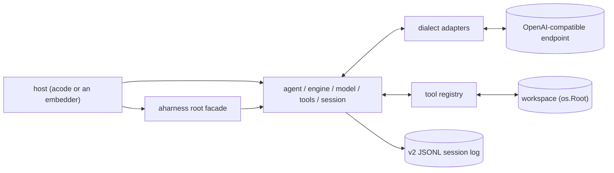

# aharness architecture

- **Date:** 2026-11-18
- **Status:** normative for the aharness SDK after the acode extraction: the
  root facade and the `agent`, `engine`, `model`, `tools`, and `session`
  packages
- **Related:** [Go coding standard](coding-standard.md), [limits](limits.md),
  [testing strategy](testing-strategy.md)
- **Agent entry point:** [AGENTS.md](../AGENTS.md)

[`coding-standard.md`](coding-standard.md) defines Go practice. This page is the
index of the SDK architecture: the system overview, the precedence rules, the
recorded boundary, and one page per area. Read the area page for the contract
you are changing; a fact has one home. The coding agent that ships on this SDK
is [acode](https://github.com/eddiectc/acode); its CLI, TUI, configuration, and
presentation docs live there.

## 1. System overview

aharness is a headless Go SDK for a single-workspace coding agent. It runs a
model/tool loop against the files and commands the caller grants, appends every
event to a durable JSONL session log, and ends a run with a final answer or a
typed stop reason. It adds no CLI, TUI, environment, config-file, TTY, signal,
or approval layer; the first-party coding agent, acode, is a separate module
built on these packages.

One process, one active session, no daemon, no worker pool. The runner owns
turn state and is the only component that advances the loop. Tools do not call
the model. Model adapters do not touch the workspace. The v2 event log is
append-only and is the only persisted truth. A session is the durable
conversation. A run is one model/tool loop over that session; a host may run
several runs over the same log and may fork or resume a session. Display
events are observation only. The SDK never writes a terminal; the host owns
all presentation, configuration, signals, and process exit.

## Area pages

Each area is one page and is normative for its sections. The section numbers,
heading text, and anchor of every heading are unchanged by the split, so
`§3.2.1` and `#321-public-library-facade` still name the same heading. Links
and heading anchors in these pages are checked by `make docs-check`.

| Section | Page | Read it for |
|---|---|---|
| §2 | [provider.md](architecture/provider.md) | Provider setup, wire dialects, the canonical model, streaming, and reasoning continuation. |
| §3.1, §3.2, §3.3 | [packages.md](architecture/packages.md) | Package layout, the file map, core component contracts, and host observation. |
| §3.2.1 | [facade.md](architecture/facade.md) | The public facade surface, its field-level contract, and the compatibility rules. |
| §4 | [loop.md](architecture/loop.md) | The turn sequence, terminal states, and the versioned system prompt. |
| §5 | [tools.md](architecture/tools.md) | Where a tool belongs, the shared tool rules, and every builtin contract. |
| §6, §7 | [session.md](architecture/session.md) | The context budget, projection invariants, and the v2 session log schema. |
| §8, §9 | [failures.md](architecture/failures.md) | The retry and failure policy, and the pointer to the limits reference. |

## Precedence

- [coding-standard.md](coding-standard.md) wins on Go practice.
- The area pages win on structure and runtime contracts. [limits.md](limits.md)
  owns every cap, timeout, and default value.
- [definition-of-done.md](definition-of-done.md) gates every change, and
  [testing-strategy.md](testing-strategy.md) owns the test layers.
- A plan issue records intent and evidence and never overrides these pages; a
  record the code has outgrown is corrected, not preserved.

## Recorded boundary

The API has two levels. The module root is the stable facade: it copies DTOs at
the boundary and never exposes a component type as an alias, so component
fields stay free to change. The five component packages are public for
first-party hosts and advanced integrations; no component imports the root. The
shipped surface and the compatibility rules are in
[facade.md §3.2.1](architecture/facade.md#321-public-library-facade).

The SDK does not grow into these, and a change that does is a different
product, not an extension: no provider matrix, graph/workflow orchestration,
memory/RAG, session-store seam, background or nested delegation, in-run
parallel tool execution, structured-output/report DTOs, prompt templating, or
public TUI package. A change that alters a recorded contract - session schema,
prompt, tool grant, projection, or concurrency model - is a different product
too.

## Where to start

- Provider field, dialect, or continuation rule:
  [provider.md](architecture/provider.md).
- Public type, field, event, or error: [facade.md](architecture/facade.md),
  then [packages.md](architecture/packages.md).
- Loop, stop reason, or prompt: [loop.md](architecture/loop.md).
- Tool behavior: [tools.md](architecture/tools.md).
- Log schema, projection, or budget: [session.md](architecture/session.md).
- Retry, timeout, or error mapping: [failures.md](architecture/failures.md),
  then [limits.md](limits.md).
