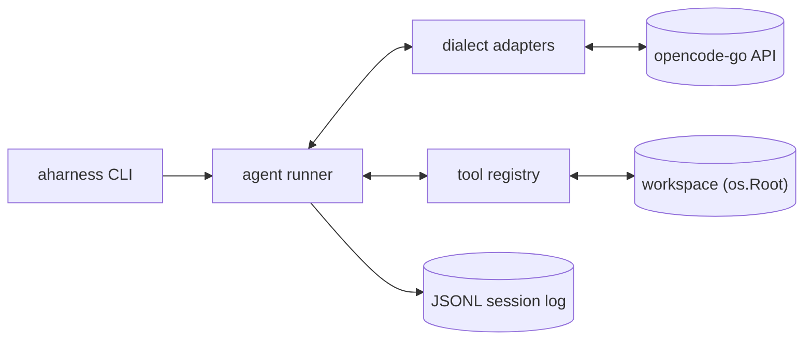

# aharness architecture

- **Date:** 2026-11-09
- **Status:** normative for v0 structure and runtime contracts
- **Related:** [Go coding standard](coding-standard.md),
  [bare-minimum harness research](agent-harness-minimum.md)
- **Agent entry point:** [AGENTS.md](../AGENTS.md)

[`coding-standard.md`](coding-standard.md) defines Go practice. This document
defines the system structure, component contracts, tool behavior, protocols,
and CLI/config contracts. If the documents conflict on Go practice, the coding
standard wins; on structure and runtime contracts, this document wins.

## 1. System overview



One process, one loop, no daemon, no worker pool. The runner owns turn state and
is the only component that advances the loop. Tools do not call the model. The
model adapters do not touch the workspace. The event log is append-only and is
the only persisted truth.

## 2. Provider and model

v0 supports one provider, `opencode-go`, through two OpenAI wire dialects:
Chat Completions and Responses. The initial models are `crouton-alpha-free` and
`deepseek-v4.1-flash`; the model registry assigns each to one dialect. `-model`
(or `AHARNESS_MODEL`) is required; there is no automatic fallback, routing, or
provider matrix.

The harness opens network connections only through the dialect adapters; tools
may use whatever network the host allows. Provider-specific request and
response shapes stay behind `model.OpenAIChat` and `model.OpenAIResponses`.
Provider credentials are read from `AHARNESS_PROVIDER_TOKEN` when set. The token
is optional: when set, the selected adapter sends it as a Bearer token; when
unset or empty, it omits `Authorization`, which supports local no-auth endpoints
and `httptest` servers. An endpoint that requires auth surfaces a missing token
as `provider_error` (401); local no-auth endpoints run without one. The token is
kept in memory, redacted from logs, and excluded from tool environments.
Credential handling stays in the adapters; v0 does not scan unrelated host
configuration or discover credentials implicitly.

### 2.1 Wire format and SDKs

v0 ships two dialect adapters over plain HTTP against the same `opencode-go`
base URL:

- **Chat Completions:** `POST <base>/chat/completions`.
- **Responses:** `POST <base>/responses`.

The model registry assigns each initial model to one dialect; the exact mapping
is an open prerequisite. It is a small table in `cmd`, not user-configurable in
v0. Anthropic and Gemini are deferred. If a model misbehaves through a dialect,
fix that adapter or add its native dialect behind the same canonical model; do
not change the loop. The wire dialect is not the internal schema; both adapters
map into the canonical model (Section 2.2).

Do not use an OpenCode SDK at this boundary. The published Go SDKs
(`opencode-sdk-go` and its community forks) are generated clients for the
OpenCode server REST API; adopting one would move the loop, tools, and session
state into OpenCode, which is the architecture v0 rejects. There is no official
Go SDK for the OpenCode Go inference endpoint: it is OpenAI-compatible HTTP, and
the stdlib adapters are smaller than the mapping layer an SDK would require. An
inference SDK would also own retries, error bodies, and decoding, hiding the
`model_retry` events and redaction the session log depends on. The available Go
clients also fit poorly as dependencies: the Stainless-generated client targets
an older server API, and the community fork that tracks upstream has no license.

Each adapter is constructed with the base URL, provider token, session ID, and
harness version. It sends `Authorization: Bearer <token>`,
`Content-Type: application/json`, `x-opencode-session: <session-id>`, and a
self-identifying `User-Agent: aharness/<version>`. An empty token omits the
`Authorization` header, supporting local no-auth endpoints and tests. OpenCode
Go requires the session header; the value is the run's UUIDv7 session ID. The
base URL is a constructor argument so tests and local deployments can point the
adapters at another OpenAI-compatible server; the v0 CLI keeps the hosted URL.

Both adapters send the full projected input on every call and keep no
server-side conversation state. The Responses adapter sets `store: false` and
never uses `previous_response_id`. If its model requires reasoning items or
encrypted content across tool rounds, that continuation is adapter-owned and
remains an open v0 prerequisite
([v0-build.md §4.3](v0-build.md#43-open-prerequisites)); the canonical model
never carries raw provider shapes.

### 2.2 Canonical model and dialect adapters

The `model` package defines one internal canonical model. Every provider
dialect is an adapter that maps its wire format into these types; the loop sees
only the canonical model. The canonical model covers what the loop can act on:
system and user text, assistant text, tool calls and results correlated by ID,
a normalized finish reason, token usage, and normalized errors.

Canonical does not mean lossless. Provider-specific material — reasoning or
thinking blocks, citations, safety metadata, cache controls, opaque options,
and streaming events — stays in the adapter and is dropped unless the loop or
the dialect's continuation needs it. If a future feature needs one of those, add
a typed canonical field when the loop consumes it; do not add a raw
provider-shaped field. A lossless union schema for OpenAI Responses, OpenAI
Chat, Anthropic, and Gemini would push provider-specific optional fields and
invalid states into the loop; that is the thing to avoid. OpenAI Chat is a
dialect, not a neutral standard, so it is not the canonical model either.

Each adapter owns the wire format, authentication, tool-schema translation, and
the mapping of finish reasons, usage, and errors. It uses one `http.Client` with
a timeout and `http.NewRequestWithContext`, always closes and caps the response
body at 1 MiB, and never uses `http.DefaultClient`. Provider error bodies are
capped and redacted before logging.

| Layer | Owns |
|---|---|
| Canonical `model` types | System/text messages, tool calls/results, normalized finish reason, usage, normalized errors. |
| `model.OpenAIChat` | Chat Completions wire format, nested function schemas, `tool_calls[].id`, prompt/completion usage. |
| `model.OpenAIResponses` | Responses wire format, flat function tools, `function_call.call_id`, input/output usage, `store: false` full replay. |
| Shared `model` HTTP helper | Request execution, auth/session headers, 1 MiB body cap, typed error decoding. |

Normalization rules:

- The canonical system prompt is the first message. Adapters place it in the
  dialect's system slot (`system` message, top-level `system`, or
  `systemInstruction`).
- Every canonical tool call has a non-empty ID and raw JSON arguments. If a
  dialect omits call IDs (Gemini function calls may), the adapter synthesizes a
  deterministic ID for that response and uses it for the matching result. For a
  dialect that supplies IDs, a missing or duplicate wire ID is `protocol_error`;
  the adapter does not repair it. The Responses adapter uses
  `function_call.call_id` for correlation, not the output item `id`.
- Canonical finish reasons are `stop`, `length`, `tool_calls`,
  `content_filter`, and `other`; adapters map dialect-specific stop reasons.
- Canonical usage is input and output tokens; adapters map dialect usage fields.
- Canonical errors are typed (`HTTPError`, `TransportError`, `ProtocolError`,
  and context overflow); adapters map HTTP statuses and provider error bodies.
- Both adapters replay the canonical projection; the Responses adapter sets
  `store: false` and never uses `previous_response_id`. A bounded
  adapter-owned continuation for reasoning items is a v0 open prerequisite, not
  a canonical message.

Provider responses are decoded with `encoding/json/v2` defaults: duplicate
object names and invalid UTF-8 are rejected and map to `protocol_error`; unknown
members are ignored for forward compatibility. Tool arguments are stricter:
typed decoding uses `RejectUnknownMembers(true)` (Section 5). Do not set
`RejectUnknownMembers(true)` for provider responses.

v0 has no opaque provider options or capability flags. Add adapter-specific
knobs only when a dialect requires them, and keep them out of the loop.

v0 ships `model.OpenAIChat` and `model.OpenAIResponses` over the `opencode-go`
base URL. Add `anthropic` or `gemini` adapters when a real provider requires
them; each maps into the same canonical model without changing the loop. Share
HTTP, retry, and fixture plumbing; do not share a universal request/response
schema beyond the canonical model.

## 3. Packages and contracts

### 3.1 Package layout

| Path | Responsibility |
|---|---|
| `cmd/aharness/` | Flags, environment parsing, config validation, wiring, signal handling, exit codes. |
| `internal/agent/` | Runner, turn execution, stop policy, retry policy, repeated-failure detection, projection/compaction. |
| `internal/model/` | Canonical types; Chat Completions and Responses adapters; shared HTTP plumbing; typed transport errors. |
| `internal/tools/` | Registry, argument validation, result shape, workspace containment policy, the four tool implementations. |
| `internal/session/` | Event envelope, JSONL append-only store, session metadata, replay-ready reader. |

```text
go.mod
cmd/aharness/
  main.go        # flags/env, wiring, signals, exit codes
  config.go      # parsing, validation, model-to-dialect registry
  config_test.go
internal/agent/
  runner.go      # loop, stop policy, repeated-failure detection
  context.go     # projection, token estimate, compaction
  retry.go
  stop.go
internal/model/
  types.go            # canonical request/response/error types
  openai_chat.go      # Chat Completions adapter
  openai_responses.go # Responses adapter
  http.go             # shared request, body cap, error decoding
  errors.go
internal/tools/
  registry.go
  root.go        # os.Root wrapper and path policy
  read.go
  edit.go
  search.go
  command.go
  output.go
internal/session/
  event.go       # event envelope only
  store.go       # append-only JSONL store and reader
```

This five-package split is normative for v0. `config` lives in `cmd`,
projection lives in `agent`, and workspace policy lives in `tools`. `session`
remains a leaf; event payloads are `json.RawMessage`, decoded by their
producers. `cmd` is wiring and I/O only; `agent` is the only orchestrator, and
`model`, `tools`, and `session` MUST NOT import `agent` or `cmd`. Add a package
only when a second consumer or a clear boundary justifies it; do not add `pkg/`,
`util`, `common`, or `types`.

Dependencies stay deliberately small: Go standard library only at runtime. Typed
structs and explicit checks validate tool arguments; a JSON Schema validator is
not needed in v0. The provider adapters use `net/http` with the OpenAI Chat
Completions and Responses dialects; no provider SDK is used (Section 2.1). Dev
tools (`goimports`, `golangci-lint`, `govulncheck`) are not runtime dependencies.

### 3.2 Core contracts

- `model.OpenAIChat` and `model.OpenAIResponses` — concrete dialect adapters
  with `Complete(ctx, model.Request) (model.Response, error)`. `model.Request`
  carries the projected messages with the versioned system prompt first, tool
  schemas, `max_output_tokens`, and model name. `model.Response` carries
  assistant text, zero or more tool calls (canonical call ID, name, raw JSON
  arguments), a normalized finish reason (`stop`, `length`, `tool_calls`,
  `content_filter`, or `other`), and usage. Adapters guarantee a non-empty call
  ID; for a dialect that supplies IDs, a missing or duplicate ID is
  `protocol_error` and is not repaired. Typed errors (`HTTPError`,
  `TransportError`, `ProtocolError`, and context overflow) keep retry policy in
  `agent`. `cmd` maps the configured model to its dialect and wires the
  corresponding adapter.
- `tools.Registry` — concrete registry with `Schemas() []tools.Schema` and
  `Execute(ctx, name string, args json.RawMessage) tools.Result`. The dispatcher
  validates arguments and converts errors into `tools.Result`; a panic is
  paired with a result and then stops the run with `internal_error`. The package
  exports sentinel errors for caller decisions: `ErrOutsideWorkspace`,
  `ErrGitProtected`, `ErrEditAmbiguous`, `ErrEditNotFound`, `ErrBinaryFile`,
  and `ErrTooLarge`.
- `session.Store` — concrete append-only store with `Append(Event) error`,
  `Events() []Event`, `Sync() error`, and `Close() error`. One writer. `Append`
  assigns `v`, `seq`, `ts`, and `session`; callers leave those fields zero.
  `seq` starts at 1 and increments by 1. `Sync` flushes the file; `Close` syncs
  and closes. The runner calls `Sync` at every turn boundary and on exit.
- `agent.Project(events []session.Event, limits Limits) (Projection, error)` —
  pure function of events plus limits; no hidden state. `Limits` carries the
  per-call input budget, the next-output reserve, and the compaction target; the
  prompt and tool schemas are selected from the versions recorded in
  `session_start` using immutable package constants. The returned `Projection`
  carries the canonical messages, the input-token estimate, and the
  elided-result count; the runner logs `compaction` when the count changes.

The agent MAY define unexported consumer interfaces (`completer`, `toolset`,
`eventStore`) so loop tests use fakes. Keep each interface to one or two
methods; split append/sync from read/close rather than defining one wide
`eventStore`. Production wires the selected dialect adapter
(`*model.OpenAIChat` or `*model.OpenAIResponses`), `*tools.Registry`, and
`*session.Store`. Because the packages are `internal`, do
not export interfaces solely for tests.

## 4. Agent loop

### 4.1 Turn sequence

1. Create the harness-owned work directories and the session store, then append
   `session_start` with the workspace, state directory, provider, dialect, model,
   limits, prompt version, toolset version, and harness version. Secrets are
   redacted. Append `user_message` with the task text and its source (`-task` or
   `-task-file`). Config/usage validation failures exit 2 before any session
   state is created; disk failures while creating the session state exit 1
   (`internal_error`) without a `final` event. If setup fails after the work
   directory is created, remove it before exiting.
2. Check all limits: the turn count (`turns >= max_turns`), the session
   wall-clock deadline, and the cumulative token budget. A reached limit appends
   `limit` and terminates.
3. Rebuild the model input from the event log through `agent.Project`.
4. Call the model with retries (Section 8). Each failed transport attempt that
   will be retried appends `model_retry` with its attempt number, error class,
   HTTP status, and delay. The successful attempt appends exactly one
   `model_response`, including text, tool calls, finish reason, usage, latency,
   and attempt number. Failed attempts do not append `model_response`.
5. If there are no tool calls, act on the normalized finish reason: `stop` (or
   absent) terminates with `completed`; `length` appends a `user_message` with
   source `continuation-hint` and continues, but a second consecutive `length`
   response without tool calls (no tool-call turn in between) terminates with
   `token_limit`; `content_filter` terminates with `provider_error`; any other
   value terminates with `protocol_error`.
6. Before executing, reject a response with missing or duplicate tool-call IDs
   (`protocol_error`, Section 8). For each remaining tool call, in response
   order: resolve the tool, validate arguments, execute with a timeout, and
   append exactly one `tool_result` carrying a stable `code`. A failure is still
   a result with the original call ID. A recovered panic is paired before the
   run stops with `internal_error`.
7. Increment the turn counter and repeat from step 2. Stop when a limit is
   reached, a fatal error occurs, or a signal arrives.
8. On termination of an initialized session, emit exactly one `final` event with
   the terminal status and the last assistant text emitted in the run, if any,
   then append `session_end` with status, totals, and final usage. Sync and close
   the log, then remove `<state>/work/<session-id>` best-effort; a cleanup
   failure is reported on stderr and does not change the terminal status. If the
   log write itself fails, still attempt cleanup and exit `internal_error`
   without claiming durability. Best-effort, including on signal; see Section 8
   for the shutdown budget.

The loop never batches multiple assistant turns, never skips a tool call, and
never sends a tool result without a preceding call. If a model response contains
multiple tool calls, v0 executes them sequentially in the order returned. It does
not rely on provider-side `parallel_tool_calls` support; correctness must not
depend on that flag.

### 4.2 Terminal states

| Status | Meaning | Exit code |
|---|---|---|
| `completed` | Model returned a final message with no tool calls and a `stop`/absent finish reason. | 0 |
| `max_turns` | Model-call limit reached (`turns >= max_turns`). | 2 |
| `token_limit` | Cumulative token budget reached, repeated consecutive output-length truncation, or an unrecoverable context overflow. | 2 |
| `time_limit` | Session wall-clock deadline reached. | 2 |
| `provider_error` | Non-retryable provider failure, content filter, or retries exhausted. | 3 |
| `protocol_error` | Model response cannot be paired or parsed safely, including missing or duplicate tool-call IDs. | 4 |
| `stuck` | Repeated identical tool failures (same tool, canonical arguments, stable result code) crossed the threshold. | 4 |
| `interrupted` | SIGINT/SIGTERM; child process group killed. | 130 |
| `internal_error` | Post-validation disk or harness invariant failure, or a recovered tool panic. Pre-session config/usage failures exit 2 without a session. | 1 |

Every terminal state of an initialized session emits exactly one `final` event
with the status and the last assistant text emitted in the run, if any, followed
by a `session_end` event with a human-readable reason and totals. If the log
write itself fails, the run exits `internal_error`; the harness does not claim
durability. Pre-session config/usage failures exit 2 and produce no session
events. The final assistant text, if any, is printed to stdout; progress and the
trace path go to stderr. Represent the terminal status as a typed string
(`StopReason`) and map it to the exit code in one function; do not scatter
exit-code decisions through the loop.

### 4.3 System prompt

The system prompt is versioned (`prompt-v0`) and recorded in `session_start`. It
must state, briefly:

- The workspace root, and that tools are the only way to act.
- Search and read before editing; keep changes minimal; run the relevant tests.
- Commands run with the harness's privileges; the harness adds no sandbox or
  approval step.
- Tool errors are data; adapt rather than escalate.
- Stop by replying without a tool call when the task is complete or blocked.

Tool-specific guidance belongs in tool descriptions, not duplicated in the
system prompt. Any prompt change bumps the version and should be checked against
raw traces.

## 5. Tools

All tools share these rules:

- Canonicalize the workspace to an absolute path once at startup, then open
  `os.OpenRoot(workspace)` and reuse it. Normalize tool paths relative to the
  workspace root; convert absolute inputs with `filepath.Rel`, then require
  `filepath.IsLocal`.
- `os.Root` enforces containment: it rejects `..`, absolute names, and symlink
  escapes. It rejects absolute symlinks even if they point inside. It is an
  accident guard, not a sandbox; bind mounts, `/proc`, and device files remain
  reachable.
- Writes to any path with a `.git` component are rejected by the edit tool,
  including `sub/.git/config`. This is an accident guard, not a security
  boundary.
- Symlink policy: `read_file` MAY follow in-root symlinks; `search` does not
  descend into symlinked directories and requires a real directory root;
  `edit_file` rejects a symlink anywhere in the path.
- File tools restrict reach to the workspace. This is not isolation; the shell
  still runs with the harness's privileges.
- `run_command` executes with the harness's privileges. It does not create a
  sandbox; use external isolation when commands are untrusted.
- Do not rely on path deny-lists for secrets. The real boundary is running
  without credentials and with external isolation.
- Invalid arguments, missing files, ambiguous edits, timeouts, and non-zero
  command exits are model-visible results, not loop exceptions. Every result
  carries a stable `code`: `ok` on success, and `invalid_args`, `unknown_tool`,
  `not_found`, `ambiguous`, `outside_workspace`, `git_protected`, `binary_file`,
  `too_large`, `timeout`, `canceled`, `panic`, `spawn_failed`, or `internal` on
  failure. A non-zero command exit is `ok=true` with an `exit_code`; `ok=false`
  is reserved for dispatch, validation, timeout, cancellation, panic, spawn
  failures, and file restrictions such as binary or too large.
- Tool results are capped before entering the transcript. Head and tail are kept
  with an explicit `[truncated N bytes]` marker; the full raw output is not sent
  to the model. Command output is sanitized to valid UTF-8 before encoding.
- Tool calls are never automatically retried. Side effects are not idempotent;
  the model decides whether to retry after seeing the error.

Path normalization:

```go
// rel normalizes a tool path. Root performs the real containment check.
func (w *Workspace) rel(p string) (string, error) {
	if filepath.IsAbs(p) {
		var err error
		if p, err = filepath.Rel(w.dir, p); err != nil {
			return "", err
		}
	}
	p = filepath.Clean(p)
	if !filepath.IsLocal(p) {
		return "", ErrOutsideWorkspace
	}
	for _, part := range strings.Split(p, string(filepath.Separator)) {
		if part == ".git" {
			return "", ErrGitProtected
		}
	}
	return p, nil
}
```

| Tool | Inputs | Behavior and limits |
|---|---|---|
| `read_file` | `path`, `offset` (1-based, default 1), `limit` (default 100, max 500) | Returns numbered lines plus a `lines X–Y of Z` header; line counting splits on `\n` (a trailing newline adds no line, an empty file has zero lines), and bytes are preserved. Rejects binary/non-UTF-8 files and files over 2 MiB. Result cap 32 KiB. |
| `edit_file` | `path`, `old_string`, `new_string`, `replace_all` (default false) | Requires a unique exact byte match unless `replace_all`; zero or multiple matches are actionable errors; `old_string == new_string` is an error. Rejects a symlink anywhere in the path. Writes atomically via an `O_EXCL` temp file in the same directory plus rename; preserves mode with fchmod; preserves bytes, including CRLF. Creates a file only when it does not exist and `old_string` is empty, using mode 0644 and requiring the parent directory to exist; an existing file with an empty `old_string` is an error. Rejects an edit whose resulting file would exceed 2 MiB. Returns a short diff summary. |
| `search` | `pattern` (Go RE2 regex), `path` (default `.`), `glob` (optional, matched against workspace-relative paths), `case_sensitive` (default false), `max_results` (default 100, max 200) | Walks the workspace, skipping `.git`, binary files, and files over 1 MiB. Returns `path:line: text`, with long lines clipped, and marks capped results. Requires a real directory root. Invalid regex, invalid glob, and no matches are distinct results. `path.Match` globs do not support `**`. |
| `run_command` | `command`, `cwd` (default workspace root), `timeout_ms` (default 120000, max 600000) | Runs `/bin/sh -c` in its own process group with `Setpgid`, a `Cancel` that kills the group, and `WaitDelay`; stdin is nil. Captures stdout and stderr separately, sanitizes to valid UTF-8, and caps at 64 KiB combined with head+tail. Returns `exit_code`, `timed_out`, and labeled streams. Non-zero exit is a normal result (`ok=true`). On timeout or cancellation, kills the whole process group. Rejects `cwd` outside the workspace. |

`search` is implemented with a Go walk; v0 does not shell out to `rg`; measure
before adding it.

`edit_file` writes atomically: create a temp file in the same directory with
`O_CREATE|O_EXCL` and a random name, write, call `f.Chmod(existingMode)` through
the open file (fchmod, not path-based `Chmod`), `f.Sync`, close, then
`Root.Rename`; remove the temp file on error. New files use mode 0644.

`run_command` receives an explicit allowlist, never `os.Environ`: `PATH`,
`LANG`, `LC_ALL`, `TERM`, and harness-set `HOME` and `TMPDIR`. `HOME` and
`TMPDIR` point at harness-owned directories under the state dir, not the user's
home, so child commands do not pick up the user's dotfiles, caches, or
credentials by default: `<state>/work/<session-id>/home` and
`<state>/work/<session-id>/tmp`, created with mode 0700 when the session starts.
They are session scratch, not durable storage: the runner removes
`<state>/work/<session-id>` after the session log is synced and closed, on every
terminal path including signal and internal error. Cleanup is best-effort; if
removal fails, the run reports the leftover path on stderr and leaves it for
inspection. The workspace is the intended place for durable task artifacts;
child `HOME`/`TMPDIR` are ephemeral. An explicit denylist rejects any allowlisted
name matching `*_TOKEN`, `*_SECRET`, `*_KEY`, or `*_PASSWORD`
(case-insensitive); this is defense in depth, not a boundary. The child never
inherits provider credentials or unrelated host variables. This is hygiene, not
isolation; a child process can still inspect the harness process. Use external
isolation when that matters. v0 deliberately does not use the host `/tmp` for
these paths: `/tmp` may be mounted `noexec`, size-limited, or cleaned while a
long session runs. The state dir is configurable; point it at fast local disk
if needed.

The tool descriptions and JSON schemas are versioned prompt material, not
afterthoughts. Schemas are hand-written `json.RawMessage` constants. Arguments
are decoded into typed structs with `RejectUnknownMembers(true)`; tests assert
that each schema and its argument struct agree. `read_file` returns line
numbers so the model can reference what it saw; `search` returns locations so
the model can page; `edit_file` errors state whether the match was absent or
ambiguous. These ACI choices are the highest-leverage prompt work in v0.

## 6. Context budget

The event log is append-only. The model input is a lossy projection rebuilt from
it on every turn. Compaction never mutates the log.

### 6.1 Projection invariants

1. The system prompt is always first.
2. The original task is always retained.
3. The last four turns are retained verbatim.
4. Every assistant tool call is followed by its matching tool result. Tool-call
   IDs are never dropped, and a result is never emitted without its call.
5. Older tool-result bodies may be replaced by a one-line stub; the call ID,
   tool name, and original byte count remain.
6. The projection fits the configured input budget with room reserved for the
   next output.
7. If the projection cannot fit after compaction, the run stops with
   `token_limit` before the model call.

### 6.2 Budget policy

- Before each call, estimate input tokens from the projected messages and tool
  schemas. Use a conservative `ceil(bytes/4)` estimate plus 8 tokens per message
  and 16 tokens per tool schema; treat provider-reported usage as authoritative
  for totals after each response. These constants are part of the projection
  contract and are covered by tests.
- The per-call limit is `max_context_tokens - max_output_tokens - safety_margin`,
  where `safety_margin` defaults to 5% of `max_context_tokens` (minimum 1,000
  tokens) to absorb estimator error.
- Tool results are truncated at capture, then elided from old turns in the
  projection. The initial task, system prompt, and recent turns are never
  elided.
- Compaction is deterministic: elide oldest tool-result bodies first, in order,
  until the estimate fits. Log a `compaction` event with before/after estimates
  and the number of elided results.
- Model-based summarization is deferred. Dropping old tool output satisfies the
  source's Tier 1 requirement and is easier to reason about.
- Cumulative totals include every model response's input and output tokens,
  including retries. The session logs token usage; dollar-cost tracking is out
  of scope in v0.

## 7. Session log

- **Location:** `-state-dir` or `AHARNESS_STATE_DIR`, defaulting to
  `$XDG_STATE_HOME/aharness` (fallback `~/.local/state/aharness`). The log is
  `<state>/sessions/<session-id>.jsonl`. `run_command` gets harness-owned `HOME`
  and `TMPDIR` at `<state>/work/<session-id>/home` and
  `<state>/work/<session-id>/tmp`, created with mode 0700 when the session
  starts. The whole `<state>/work/<session-id>` subtree is removed on
  termination; `sessions/` is the only durable record, and the empty `work/`
  container remains for later runs.
- **Creation:** create the state directory with mode 0700 and the session file
  with `O_CREATE|O_WRONLY|O_APPEND|O_EXCL`, mode 0600. If the state directory is
  not writable, start-up fails with a clear error (exit 2). The default is
  outside the workspace; avoid pointing it into the workspace, where the log
  becomes part of the task diff.
- **Format:** one JSON object per line, encoded with `encoding/json/v2` through
  `jsontext.NewEncoder` (`jsonv2.MarshalEncode`). Common fields:
  `v` (schema version, 1 for v0), `seq` (starts at 1 and increments by 1),
  `ts` (RFC3339Nano), `session`, `turn`, `type`, `role` (message events only),
  and `data`. Keep the envelope stable and versioned. Use `omitzero` for zero
  scalars; v2 `omitempty` means “encodes as empty JSON”.
- **Durability:** `jsontext.Encoder` flushes each top-level value; `Store.Append`
  assigns `v`, `seq`, `ts`, and `session`, and `Store.Sync` flushes the file. The
  runner calls `Sync` at every turn boundary and on exit; `Close` syncs before
  closing. The single runner goroutine is the only writer; a signal handler
  only cancels the context and never appends from another goroutine. The reader
  accepts a valid final line without a trailing newline, ignores only a
  torn/invalid final line, validates that `seq` starts at 1 and increments by 1
  on replay, and never rewrites the log.
- **Session ID:** `uuid.NewV7().String()` from the Go 1.27 standard library. No
  reuse.
- **Truth:** the log is the durable record; the context window is a projection.
  The log contains enough information to rebuild every model input except the
  exact provider wire format. With `AHARNESS_LOG_REQUESTS=1`, an additional
  `model_request` event stores the exact projected messages, capped at 1 MiB.
  It is off by default. Secrets are redacted; the log never contains full
  environments, HTTP headers, or credentials. Tool arguments and results appear
  only as capped event payloads, never in stderr.

| Event type | Payload |
|---|---|
| `session_start` | Prompt version, toolset version, workspace, state dir, provider, dialect, model, limits, harness version. |
| `user_message` | Task text or corrective hint, plus source (`-task`, `-task-file`, `stuck-hint`, or `continuation-hint`). |
| `model_request` | Debug only (`AHARNESS_LOG_REQUESTS=1`): exact projected messages, capped at 1 MiB. One per distinct projected request; transport retries reuse it, a compaction retry logs a new one. |
| `model_response` | Assistant text, tool calls (ID, name, arguments), finish reason, token usage, latency, attempt number. Exactly one per successful model call. |
| `model_retry` | Attempt number, error class, HTTP status, delay before the next attempt. One per failed transport attempt that will be retried. |
| `tool_result` | Call ID, tool name, `ok`, stable code (`ok` on success), output, error message, exit code, duration, truncated flag. |
| `compaction` | Before/after token estimate, elided result count, policy. |
| `limit` | Limit kind, configured value, observed value. |
| `error` | Fatal error class and message; no secrets. |
| `final` | Terminal status and last assistant text, if any; exactly one per initialized session. |
| `session_end` | Status, reason, turn count, total token usage, duration. |

The log is for debugging and resume-readiness, not a tamper-proof audit trail.
A shell running as the same user can reach the state directory. Separating the
log from the shell would require a separate UID or process boundary and is out
of scope for v0.

## 8. Failure handling

| Failure | Policy |
|---|---|
| HTTP 429, 5xx, connection reset before response | Retry up to 5 attempts total (the initial call plus up to 4 retries) with exponential backoff plus jitter; honor `Retry-After` (seconds or HTTP-date) up to 60 seconds. Each failed transport attempt that will be retried appends `model_retry` before the backoff sleep. Backoff sleeps are context-aware. Before each retry, check the session context; a canceled session is not retried and stops with `time_limit` or `interrupted`. All retries count toward the session deadline and token totals. When attempts are exhausted, append `error` and stop with `provider_error`. |
| HTTP 4xx other than 429, auth failure, invalid request | No retry. Append `error`, end with `provider_error`. |
| Malformed or schema-invalid provider JSON (including duplicate object names or invalid UTF-8) | Append `error`; stop with `protocol_error`. Do not retry. |
| Context-length error from provider | Rebuild with the same deterministic compactor against a target 10% below the failed per-call limit, log `compaction` with policy `provider-overflow`, and retry once; this retry is separate from the transport attempt budget. If no further tool results can be elided or the retry fails, stop with `token_limit`. |
| Model call timeout | Counts as a retryable transport failure up to the attempt limit. A canceled session context is not a model call timeout: stop with `time_limit` or `interrupted` without retrying. |
| Unknown tool or invalid arguments | One `tool_result` with `ok=false`, a stable `code` (`unknown_tool` for an unregistered name, `invalid_args` for a registered tool with bad arguments), and a short corrective message naming the tool and the problem. |
| Tool timeout | Kill the process group, return a result with `ok=false`, `timed_out=true`, and `code=timeout`. |
| Tool panic | Recover at the dispatcher boundary, append a result with `code=panic` and a capped stack, then stop with `internal_error`. Pairing completes before the stop. |
| Tool process fails to start | Return an error result with `code=spawn_failed` and the spawn error. |
| Model response with a tool call missing its ID | Append `error`; stop with `protocol_error`. Do not invent an ID or execute any call in that response. |
| Model response with duplicate tool-call IDs | Append `error`; stop with `protocol_error`. Do not execute any call in that response. |
| Repeated identical tool failure | Counts only `ok=false` results; "identical" means the same tool, canonical arguments, and stable result code. Canonical arguments are computed from the provider-supplied JSON by recursively sorting object members by name, preserving array order and numeric literals, and rejecting duplicate names; whitespace differences are ignored. The message is for display, not identity. After 3 consecutive identical failures, append a `user_message` event with source `stuck-hint` and include it in the next projection. After 5, stop with `stuck`. |
| Session turn/token/time limit | Append `limit`, then terminate; the terminal path emits `final` and `session_end` with the corresponding status. |
| SIGINT/SIGTERM | Kill the running child's process group; write final events and sync the log with a fresh 5-second shutdown budget; remove `<state>/work/<session-id>` best-effort; terminate with `interrupted`, exit 130. `Append`/`Sync` and cleanup are not context-aware, so a hung filesystem may exceed the budget; the shutdown path is still best-effort. |
| Disk write failure for the log | Fail fast with `internal_error`; still attempt work-directory removal; the run cannot be made durable. |
| Work-directory cleanup failure | Report the leftover path on stderr and leave it for inspection; the terminal status is unchanged. A surviving child or a read-only filesystem can cause this; use external isolation for hard containment. |

Model requests are retried; tool executions are not. This distinction prevents
duplicate file edits and commands after a transient failure.

Errors wrap with `%w`; branch with `errors.Is`/`errors.As`; never match error
strings. Error strings are lowercase and have no trailing punctuation.

## 9. CLI and configuration

```
aharness -task "..." -model deepseek-v4.1-flash
aharness -task-file task.md -model crouton-alpha-free -workspace /tmp/repo
```

The examples target the hosted `opencode-go` endpoint and assume
`AHARNESS_PROVIDER_TOKEN` is exported. Both dialect adapters also accept an
empty token for local no-auth endpoints and tests (Section 2.1).

- Use the standard `flag` package; no CLI framework in v0.
- Precedence: defaults, then environment, then flags. Parse environment errors
  as config errors; validate the effective config once before the loop.
- Exactly one of `-task` or `-task-file` is required. `-task-file` is read once
  before the loop; it may be outside the workspace.
- `-workspace` defaults to `AHARNESS_WORKSPACE`, then the current directory.
  Resolve it to an absolute path, require an existing directory, and open the
  root once.
- `-state-dir` defaults to `AHARNESS_STATE_DIR`, then
  `$XDG_STATE_HOME/aharness`, then `~/.local/state/aharness`. Reject a relative
  `XDG_STATE_HOME`. The harness creates the directory with mode 0700 if needed;
  it must be writable, or start-up fails with exit 2.
- `-model` or `AHARNESS_MODEL` is required. Accepted values:
  `crouton-alpha-free`, `deepseek-v4.1-flash`. The provider is fixed to
  `opencode-go` in v0. The model registry maps each accepted model ID to its
  dialect (`openai-chat` or `openai-responses`); the selected dialect is
  recorded in `session_start`. The exact mapping is an open prerequisite
  ([v0-build.md §4.3](v0-build.md#43-open-prerequisites)).
- Provider auth: `AHARNESS_PROVIDER_TOKEN`, read once at startup when set; it is
  optional. When set, the selected adapter sends it as a Bearer token; when
  unset or empty, it omits `Authorization`, supporting local no-auth endpoints
  and `httptest` adapters. An endpoint that requires auth surfaces a missing
  token as `provider_error` (401); local no-auth endpoints run without one.
  Never logged and never passed to tools. The adapter sends the run's session ID
  in the required `x-opencode-session` header and identifies itself as
  `aharness/<version>` in `User-Agent` (Section 2.1).
- `-version` prints build info from `runtime/debug.ReadBuildInfo` (module
  version, Go version, VCS revision/modified) and exits 0.
- `-max-turns`, `-max-total-tokens`, `-max-context-tokens`, `-session-timeout`,
  and `-max-output-tokens` override defaults. Validate positive values and
  `max-output-tokens + safety_margin < max-context-tokens`.
  `AHARNESS_MAX_CONTEXT_TOKENS` sets the per-call context window; it must match
  the model. The 200,000 default is provisional until the model context window
  is confirmed; acceptance runs MUST set the flag explicitly to the confirmed
  window. The harness logs a warning when the provisional default is used.
- Output contract: final assistant text on stdout only; one `log/slog` progress
  line per model call and per tool call plus the trace path on stderr.
  Pre-session config/usage validation errors exit 2 and produce no session
  events; `internal_error` (1) is reserved for post-validation failures. `main`
  calls `os.Exit(run())`; library code never exits.
- No config file in v0; flags and environment are enough. No interactive mode.

Defaults are deliberately conservative and easy to change:

| Setting | Default |
|---|---|
| Max turns | 30 |
| Max context tokens | 200,000 provisional; set explicitly to the confirmed model window for acceptance runs |
| Max output tokens per call | 8,192 |
| Max total tokens | 2,000,000 |
| Max session wall clock | 60 minutes |
| Model call timeout | 300 seconds |
| `run_command` timeout | 120 seconds (max 600) |
| Tool result cap | 32 KiB file tools; 64 KiB command output |
| `read_file` window | 100 lines (max 500) |
| `search` results | 100 (max 200) |

