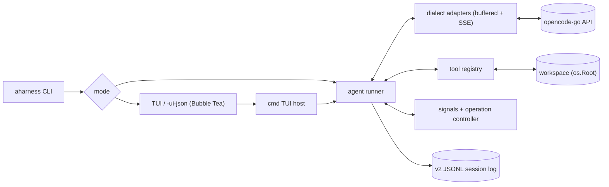

# aharness architecture

- **Date:** 2026-11-10
- **Status:** normative for v1 and the shipped TUI structure and runtime
  contracts
- **Related:** [Go coding standard](coding-standard.md),
  [bare-minimum harness research](research/agent-harness-minimum.md),
  [v1 build plan](plans/v1-build.md), [TUI build plan](plans/tui-build.md),
  [shipped TUI](tui.md), [slash commands](commands.md),
  [thinking effort build plan](plans/thinking-effort-build.md)
- **Agent entry point:** [AGENTS.md](../AGENTS.md)

[`coding-standard.md`](coding-standard.md) defines Go practice. This document
defines the system structure, component contracts, tool behavior, protocols,
and CLI/config contracts. If the documents conflict on Go practice, the coding
standard wins; on structure and runtime contracts, this document wins.

## 1. System overview



One process, one session, no daemon, no worker pool. The runner owns turn state
and is the only component that advances the loop. Tools do not call the model.
The model adapters do not touch the workspace. The v2 event log is append-only
and is the only persisted truth. A session is the durable conversation. In
batch mode a run is one process invocation; in TUI/`-ui-json` mode a run is one
submitted message and a process may execute several runs over the same session.
Resume appends to the same log; fork copies a session into a new self-contained
log. The TUI is a display-only front end over the same runner, host, and store;
it adds no durable event type.


## 2. Provider and model

aharness supports one provider, `opencode-go`, through two OpenAI wire
dialects: Chat Completions and Responses. `-provider` (or
`AHARNESS_PROVIDER`) defaults to `opencode-go`; an unknown provider is a config
error. The usable model set, display names, context/input limits, advertised
output ceilings, status, dialect, base URL, reasoning support, and per-model
reasoning effort levels are discovered from the
[models.dev](https://models.dev) catalog and normalized in `internal/model`.
Deprecated models are selectable and labeled. Models without tool calls, text
output, a positive context window, or a supported SDK are retained in the
catalog with an `Unavailable` reason and omitted from the usable set. A new
session requires `-model` (or `AHARNESS_MODEL`) naming a usable model; there is
no hardcoded default model, fallback, routing, or provider matrix.

The harness opens network connections only through the dialect adapters, the
catalog source, the configured SearXNG instance, the builtin `web_fetch`
client, and the operator-configured `web_fetch` provider endpoint.
`web_search` contacts only the operator-configured base URL; it never fetches a
model-supplied URL. `web_fetch` contacts the model-supplied URL through the
builtin client, whose dial-time address guard refuses private, loopback,
link-local, metadata, and other special-purpose addresses; with a non-builtin
provider it contacts only the operator endpoint and moves target egress there.
`run_command` may use whatever network the host allows. Provider-specific
request and response shapes stay behind `model.OpenAIChat` and
`model.OpenAIResponses`.
Provider credentials are read from `AHARNESS_PROVIDER_TOKEN` when set. The token
is optional: when set, the selected adapter sends it as a Bearer token; when
unset or empty, it omits `Authorization`, which supports local no-auth endpoints
and `httptest` servers. An endpoint that requires auth surfaces a missing token
as `provider_error` (401); local no-auth endpoints run without one. The token is
kept in memory, redacted from logs, and excluded from tool environments.
Credential handling stays in the adapters; v1 does not scan unrelated host
configuration or discover credentials implicitly.

### 2.1 Wire format and SDKs

The two dialect adapters use plain HTTP against the resolved catalog base URL.
For `opencode-go`, a discovered base URL must be HTTPS with host `opencode.ai`
and no userinfo, query, or fragment; the documented new-session OpenAI base is
`https://opencode.ai/inference/go/openai/v1`. An explicit
`-provider-base-url` / `AHARNESS_PROVIDER_BASE_URL` wins over discovery and may
use any valid HTTP(S) host, including loopback test servers. Existing sessions
keep their recorded base URL.

- **Chat Completions:** `POST <base>/chat/completions`.
- **Responses:** `POST <base>/responses`.

The dialect comes from the model's AI SDK package (`model.provider.npm`,
falling back to `provider.npm`):

| SDK package | Native protocol | Effective dialect |
|---|---|---|
| `@ai-sdk/openai-compatible` | `chat-completions` | `openai-chat` |
| `@ai-sdk/openai` | `responses` | `openai-responses` |
| `@ai-sdk/anthropic` | `messages` | `openai-chat` (translated) |
| `@ai-sdk/google` | `generate-content` | `openai-chat` (translated) |
| anything else | unknown | unavailable |

Anthropic- and Google-native models use the OpenAI Chat base URL and adapter;
OpenCode documents that every text model also works through the other APIs, so
the harness translates through Chat rather than adding native adapters. Unknown
SDKs fail closed: the model is unavailable and an explicit selection reports
the SDK. The native protocol and SDK are retained on the catalog record for
display and diagnostics. If a model misbehaves through a dialect, fix that
adapter or add its native dialect behind the same canonical model; do not change
the loop. The wire dialect is not the internal schema; both adapters map into
the canonical model (Section 2.2).

Do not use an OpenCode SDK at this boundary. The published Go SDKs
(`opencode-sdk-go` and its community forks) are generated clients for the
OpenCode server REST API; adopting one would move the loop, tools, and session
state into OpenCode, which is the architecture this harness rejects. There is no official
Go SDK for the OpenCode Go inference endpoint: it is OpenAI-compatible HTTP, and
the stdlib adapters are smaller than the mapping layer an SDK would require. An
inference SDK would also own retries, error bodies, and decoding, hiding the
`model_retry` events and redaction the session log depends on. The available Go
clients also fit poorly as dependencies: the Stainless-generated client targets
an older server API, and the community fork that tracks upstream has no license.

Each adapter is constructed with the base URL, provider token, session ID, and
harness version. It sends `Authorization: Bearer <token>`,
`Content-Type: application/json`, `x-opencode-session: <session-id>`, and a
self-identifying `User-Agent: aharness/<version>`. An empty token omits the
`Authorization` header, supporting local no-auth endpoints and tests. OpenCode
Go requires the session header; the value is the run's UUIDv7 session ID. The
base URL is a constructor argument so tests and local deployments can point the
adapters at another OpenAI-compatible server. The CLI resolves the base URL from
an explicit `-provider-base-url` / `AHARNESS_PROVIDER_BASE_URL`, then the
catalog entry; the flag also supports integration tests and local endpoints.
This is the resolution of
[v0-build.md §4.3 item 4](plans/v0-build.md#43-prerequisites-and-resolutions).
Production runs use the catalog URL.

Both adapters send the full projected input on every call and keep no
server-side conversation state. The Responses adapter sets `store: false`,
never uses `previous_response_id`, and asks for
`reasoning.encrypted_content` so a stateless tool round can replay reasoning;
servers that return plaintext reasoning (DeepSeek's Responses API) ignore the
include field and are covered by the same raw-item replay. Continuation is
adapter-owned in both dialects; the canonical model never carries raw provider
shapes.

### 2.2 Canonical model and dialect adapters

The `model` package defines one internal canonical model. Every provider
dialect is an adapter that maps its wire format into these types; the loop sees
only the canonical model. The canonical model covers what the loop can act on:
system and user text, assistant text, display-only thinking text, tool calls and
results correlated by ID, one optional request-side control (the
provider-neutral thinking effort), a normalized finish reason, token usage, and
normalized errors.

Canonical does not mean lossless. Provider-specific material — encrypted
reasoning items, reasoning identifiers, citations, safety metadata, cache
controls, opaque options, and streaming events — stays in the adapter and is
dropped unless the loop or the dialect's continuation needs it. Thinking text is
the one exception: it is mapped into the typed display-only
`model.Response.Reasoning` field so the TUI can show it, and it is never logged
or projected. A dialect adapter may separately retain the provider's own
continuation material in memory; that is adapter state, not a canonical field.
If a future feature needs another provider field, add a typed canonical field
when the loop consumes it; do not add a raw provider-shaped field. A lossless
union schema for OpenAI Responses, OpenAI Chat, Anthropic, and Gemini would push
provider-specific optional fields and invalid states into the loop; that is the
thing to avoid. OpenAI Chat is a dialect, not a neutral standard, so it is not
the canonical model either.

Each adapter owns the wire format, authentication, tool-schema translation, and
the mapping of finish reasons, usage, and errors. It uses one `http.Client` with
a timeout and `http.NewRequestWithContext`, always closes and caps the response
body at 1 MiB, and never uses `http.DefaultClient`. The client timeout defaults
to 15 minutes and is selectable with `-http-timeout` / `AHARNESS_HTTP_TIMEOUT` /
`http_timeout`. Provider error bodies are capped and redacted before logging.

| Layer | Owns |
|---|---|
| Canonical `model` types | System/text messages, display-only thinking text, tool calls/results, optional request-side thinking effort, normalized finish reason, usage, normalized errors. |
| `model.OpenAIChat` | Chat Completions wire format, nested function schemas, `tool_calls[].id`, `reasoning_content`/`reasoning` thinking text and tool-round continuation, prompt/completion usage. |
| `model.OpenAIResponses` | Responses wire format, flat function tools, `function_call.call_id`, reasoning summaries and raw reasoning-item continuation, input/output usage, `store: false` full replay. |
| Shared `model` HTTP helper | Request execution, auth/session headers, 1 MiB body cap, typed error decoding. |

Normalization rules:

- The canonical system prompt is the first message. Adapters place it in the
  dialect's system slot (`system` message, top-level `system`, or
  `systemInstruction`).
- Every canonical tool call has a non-empty ID and raw JSON arguments. If a
  dialect omits call IDs (Gemini function calls may), the adapter synthesizes a
  deterministic ID for that response and uses it for the matching result. For a
  dialect that supplies IDs, a missing or duplicate wire ID is `protocol_error`;
  the adapter does not repair it. The Responses adapter uses
  `function_call.call_id` for correlation, not the output item `id`.
- Canonical finish reasons are `stop`, `length`, `tool_calls`,
  `content_filter`, and `other`; adapters map dialect-specific stop reasons.
- Canonical usage has input and output totals plus three additive subsets:
  cached input, cache-write input, and reasoning output. Cached and cache-write
  tokens are disjoint subsets of input; reasoning tokens are a subset of
  output. `Total()` remains input+output and never adds a subset. `Reported`
  distinguishes a provider-supplied usage object (including an all-zero
  object) from an absent one. Adapters reject a usage object whose subsets
  exceed their totals as `protocol_error`. The Chat adapter prefers
  `prompt_tokens_details.cached_tokens` and falls back to
  `prompt_cache_hit_tokens`; both dialects map cache-write and reasoning
  details when present. Old v2 logs decode with `reported=false` and zero
  subsets.
- Canonical errors are typed (`HTTPError`, `TransportError`, `ProtocolError`,
  and context overflow); adapters map HTTP statuses and provider error bodies.
- Both adapters replay the canonical projection; the Responses adapter sets
  `store: false` and never uses `previous_response_id`. Each adapter also keeps
  a bounded, adapter-owned copy of its native reasoning continuation material
  and replays that material with the matching assistant output; it is not a
  canonical message and is not projected from the log.

**Thinking effort.** The public name is *thinking effort*; the provider and
catalog call the same control *reasoning effort*. `model.Request` carries one
optional provider-neutral field:

```go
type Request struct {
	Model           string
	Messages        []Message
	Tools           []ToolSchema
	MaxOutputTokens int
	ThinkingEffort  string // empty means the provider/model default
}
```

| Canonical | Chat Completions | Responses | Empty |
|---|---|---|---|
| `ThinkingEffort` | top-level `reasoning_effort` | `reasoning: {"effort": "<value>"}` | Field omitted in both dialects. |

- Both adapters construct buffered and streaming requests with the same
  `payload` function, so the mapping cannot diverge between paths. Tool-call
  rounds reuse the run configuration, so every model call in a run carries the
  same value.
- The value is sent unchanged; adapters do not rename it between providers,
  do not validate catalog membership, and never synthesize a value from a
  toggle or token-budget control. Resolution and membership checks happen in
  `cmd` before the run (Section 9).
- The catalog supplies the capability: only `reasoning_options` entries whose
  type is `effort` contribute values. Values are trimmed, validated against
  `[a-z][a-z0-9_-]*` and at most 32 bytes, the reserved clear sentinel
  `default` is dropped, duplicates are removed, the list is ordered `none`,
  `minimal`, `low`, `medium`, `high`, `xhigh`, `max`, then unknown values
  lexicographically, and it is capped at 16 values. `reasoning` is retained
  separately so the CLI can distinguish a model that supports reasoning
  without an effort control from one that does not reason at all.
- Thinking text is display-only. `model.Response.Reasoning` carries the
  provider's thinking: Chat reads `reasoning_content` (DeepSeek-compatible) and
  falls back to `reasoning`; Responses concatenates `reasoning` item summary
  and content text and ignores encrypted content for display. It is capped at
  64 KiB, never counted against the canonical response cap, and never written
  to the log or projected. Usage already counts reasoning tokens as output
  tokens, so no accounting change is needed. Both adapters additionally retain
  the provider's own continuation material in a bounded in-memory cache (4 MiB
  per response, 16 MiB per adapter) and replay it before the matching assistant
  output when the loop sends a tool result. Chat replays thinking text as
  `reasoning_content`; Responses replays the raw `reasoning` output items,
  including encrypted content or plaintext `reasoning_text`. A Responses
  summary without encrypted content or plaintext reasoning is display-only and
  is not replayed. The cache is keyed by the canonical assistant message, is
  never logged, lives only as long as the adapter (one run), and is not a
  reason to add a canonical reasoning message shape.
- A provider rejection of a value the catalog advertised (for example 400 or
  422) is a normal typed `provider_error`. The harness does not retry without
  the field or fall back to the provider default.

Provider responses are decoded with `encoding/json/v2` defaults: duplicate
object names and invalid UTF-8 are rejected and map to `protocol_error`; unknown
members are ignored for forward compatibility. Tool arguments are stricter:
typed decoding uses `RejectUnknownMembers(true)` (Section 5). Do not set
`RejectUnknownMembers(true)` for provider responses.

v1 has no opaque provider options or per-adapter capability knobs. Catalog
reasoning support and effort values are discovery metadata resolved by `cmd`,
not adapter options. Add adapter-specific knobs only when a dialect requires
them, and keep them out of the loop.

v1 ships `model.OpenAIChat` and `model.OpenAIResponses` over the `opencode-go`
base URL. Add `anthropic` or `gemini` adapters when a real provider requires
them; each maps into the same canonical model without changing the loop. Share
HTTP, retry, and fixture plumbing; do not share a universal request/response
schema beyond the canonical model.

### 2.3 Streaming

Each adapter optionally implements:

```go
type StreamHandler struct {
	Text      func(string) error // assistant text
	Reasoning func(string) error // thinking text
}

type StreamCompleter interface {
	CompleteStream(ctx context.Context, req Request, stream StreamHandler) (Response, error)
}
```

`CompleteStream` is used when streaming is requested. Batch enables it through
`-stream`; TUI and `-ui-json` always stream, and an explicit `-stream=false`
there is a config error. The agent keeps `Completer` and falls back to `Complete`
when the adapter does not implement streaming. A nil callback discards that
kind. Both callbacks are display-only; the returned canonical `Response` is
authoritative and is the only transcript record. Tool calls are assembled inside
the adapter and are never exposed as deltas.

- Chat Completions sends `stream: true` and
  `stream_options: {"include_usage": true}`. It assembles text, thinking text
  (`reasoning_content` then `reasoning`), tool-call fragments by index, finish
  reason, and usage from the chunks.
- Streaming requests use the same adapter `payload` builder as buffered
  requests, so `max_output_tokens` and `thinking_effort` mapping is identical
  on both paths; the only additions are `stream` and the dialect's stream
  options.
- Responses consumes `response.output_text.delta`,
  `response.reasoning_summary_text.delta`, `response.reasoning_text.delta`,
  `response.function_call_arguments.delta`, and the terminal
  `response.completed`/`response.incomplete`/`response.failed` events. The
  completed response is authoritative; its reasoning item, when present,
  replaces the accumulated streamed thinking.
- A 2xx response whose content type is not `text/event-stream` is decoded as a
  normal JSON response, so local OpenAI-compatible servers keep working.
- Final usage is required. A completed stream without usage is a
  `protocol_error`; the harness does not silently undercount tokens.
- Retries happen only before the first display output. After the first text or
  thinking delta, any failure is terminal and is wrapped in `PartialError`
  carrying capped partial text and the emitted byte count; it is never retried,
  because a retry would duplicate the display and could duplicate tool calls.
- Caps: 4 MiB per SSE event, 1 MiB for the assembled canonical response, 8 MiB
  for the total stream, and 64 KiB for partial text on an interrupt or failed
  stream. The event cap is larger than the response cap because a terminal
  `response.completed` event wraps the full response in JSON. A response over
  1 MiB is a `protocol_error` before any tool executes. Invalid JSON, duplicate
  object names, and invalid UTF-8 are `protocol_error`. Error bodies are capped,
  redacted, and never logged whole.
- The durable transcript keeps the executed response: the `model_response`
  payload is capped at 1 MiB total canonical content, and the session line cap
  is 4 MiB so JSON escaping and envelope fields fit. Tool results remain at
  64 KiB. This avoids a mismatch where a large response is executed but its
  logged fields are truncated, which would break resume.
- A failed stream after deltas appends one `error` event with the partial byte
  count and capped partial text; no `model_response` is written and the partial
  text is not projected. An interactive interrupt appends `interrupt` instead.
- No per-delta events are written. The log size and projection behavior stay
  proportional to complete responses.

With `-stream`, stdout carries assistant text from every turn as it arrives; a
response's final text is not reprinted if any delta for it was emitted. If the
adapter fell back to non-streaming, the response text is printed once. Without
`-stream`, stdout remains the final assistant text printed at the end.

### 2.4 Continuation for a new dialect

Reasoning continuation is an adapter obligation, not a loop or log feature.
When adding a dialect adapter that serves reasoning models, or enabling a
native provider that already has one, the adapter MUST:

- Retain the provider's exact continuation material — thinking text, raw
  reasoning items, signed thinking blocks, or whatever opaque state the
  provider requires — never the display summary and never a reconstructed
  string.
- Request the dialect-specific switch that exposes replayable material:
  Responses sets `include: ["reasoning.encrypted_content"]` for `store: false`;
  Anthropic enables thinking and receives signed `thinking` /
  `redacted_thinking` blocks; Gemini returns `thought` parts with
  `thoughtSignature`. Chat needs no request-side switch.
- Key the material with `continuationKey` (assistant content or tool-call IDs)
  and replay it in provider order, immediately before the assistant output it
  explains. Never append it at the end of the input: DeepSeek's Responses API
  rejects input that ends with an assistant or reasoning item, and OpenAI
  expects the item to precede the corresponding output.
- Bound the cache (4 MiB per response, 16 MiB per adapter), never log it or add
  it to `model.Message`, and drop it with the adapter (one run). A new run or a
  resumed process starts empty.
- Add a two-round test for both buffered and streaming paths. The second wire
  request must contain the native material unchanged, in order, and before the
  matching tool call; the first request must carry the dialect's
  `include`/thinking switch. Chat and Responses have template tests in
  `internal/model/*_continuation_test.go`. Add a real-provider smoke before
  claiming support.
- Do not add a raw provider field to the canonical model or session log. If a
  provider eventually requires continuation across runs, that is a separate
  durable-reasoning decision, not an adapter cache extension.

Native Anthropic and Gemini adapters are not shipped; those models are
currently translated through the Chat adapter, and the gateway owns the
signature round trip. If a native adapter replaces that path, the checklist
above applies to its SDK types, not to `reasoning_content`.

## 3. Packages and contracts

### 3.1 Package layout

| Path | Responsibility |
|---|---|
| `cmd/aharness/` | Flags, environment parsing, mode/config validation, session selection, TUI host, wiring, signal handling, exit codes. |
| `internal/agent/` | Runner, run lifecycle, turn execution, stop policy, retry policy, display events, history reconstruction, operation interrupts, state reconstruction, repeated-failure detection, projection/compaction. |
| `internal/tui/` | Bubble Tea app/model/view, overlays and widgets, composer slash commands and autocomplete, markdown, workspace images, terminal sanitizer, headless `x/vt` driver and `-ui-json` protocol. |
| `internal/model/` | Canonical types; Chat Completions and Responses adapters; buffered and SSE transport; shared HTTP plumbing; typed transport errors; models.dev catalog discovery, cache, and SDK-to-dialect mapping. |
| `internal/tools/` | Registry, argument validation, result shape, workspace containment policy, the five tool implementations. |
| `internal/session/` | Event envelope, v2 JSONL store, locking, torn-line repair, fork copy, replay-ready reader. |

`cmd/aharness-eval/` is development measurement tooling, not shipped runtime.
It is a separate `main` package that imports only the standard library and
`internal/session`; it is outside the runtime package graph and does not add a
provider, tool, or agent dependency. Its task fixtures, price file, and results
live under the top-level `eval/` tree. The shipped `cmd/aharness` binary never
imports the eval driver.

```text
go.mod
cmd/aharness/
  main.go        # os.Exit(run())
  run.go         # mode selection, batch wiring, exit codes, work directories
  models.go      # catalog wiring, model resolution, list/refresh terminal actions
  config.go      # parsing, validation, inheritance, discovery resolution
  fileconfig.go  # optional JSON config file: schema, load, layered resolution
  control.go     # operation controller and batch signal delivery
  tui.go         # TUI host, session shell, -ui-json wiring, summary
  textsink.go    # streamed stdout newline handling
  version.go
internal/agent/
  runner.go      # run lifecycle, loop, stop policy, repair, interrupts
  display.go     # display-only event contract
  history.go     # capped transcript reconstruction
  state.go       # durable state reconstruction and pending calls
  events.go      # event payloads and caps
  context.go     # projection, token estimate, compaction
  retry.go       # retry policy and streaming-aware model calls
  types.go
internal/tui/
  app.go         # tea.Model, Host/Run contracts, modes, key handling, lifecycle
  commands.go    # composer slash-command parser, completion, dispatch, and help
  model.go       # transcript, composer, status, steering, caps
  view.go        # Lip Gloss layout, transcript/tool/notice views
  markdown.go    # Glamour rendering, raw/rich toggle, table extraction
  widgets.go     # table/file/model overlays and focus
  image.go       # workspace image resolver, ntcharts picture, viewer
  protocol.go    # -ui-json v1 commands, events, frames, snapshots
  headless.go    # Bubble Tea + fake input/output + x/vt driver
  screen.go      # x/vt cell/style/cursor projection and SVG snapshot
  sanitize.go    # terminal-safe text sanitizer
internal/model/
  types.go            # canonical types, StreamCompleter
  catalog.go          # catalog types, lookup/usable filtering, cache path, source contract
  catalog_source.go   # models.dev decode/normalize/eligibility, HTTP load/revalidate/refresh, cache
  openai_chat.go      # Chat Completions buffered + SSE adapter
  openai_responses.go # Responses buffered + SSE adapter
  http.go             # shared request, body cap, SSE decoder, errors
  errors.go
internal/tools/
  registry.go
  root.go        # os.Root wrapper and path policy
  read.go
  edit.go
  search.go
  web_search.go  # SearXNG JSON client, base-URL validation, dedupe, sanitization
  web_fetch.go   # provider dispatch, URL/address guard, redirects, paging, details
  web_fetch_provider.go  # fetcher interface, provider selection, endpoint validation
  web_fetch_crawl4ai.go  # Crawl4AI /crawl adapter and streaming decode
  web_extract.go # trafilatura extraction, DOM fallback, challenge detection, sanitization
  command.go
  command_spill.go # per-run oversized-output capture
  command_unix.go
  schemas.go
  output.go
internal/session/
  event.go       # v2 envelope and event types
  reader.go      # replay, validation, torn-line offsets
  store.go       # create/open/lock/repair/copy/append
  lock_unix.go   # flock helpers
  errors.go
```

This five-package split is normative for v1. `config` lives in `cmd`,
projection and durable-state interpretation live in `agent`, and workspace
policy lives in `tools`. `session` remains a leaf; event payloads are
`json.RawMessage`, decoded by their producers. `cmd` is wiring and I/O only;
`agent` is the only orchestrator, and `model`, `tools`, and `session` MUST NOT
import `agent` or `cmd`. Add a package only when a second consumer or a clear
boundary justifies it; do not add `pkg/`, `util`, `common`, or `types`.

Dependencies stay deliberately small: the Go standard library by default. The
TUI is the one approved framework-scale exception (Bubble Tea v2, Bubbles v2,
Lip Gloss v2, Glamour v2, ntcharts v2, and `x/vt`); its rationale and binary
impact are in the coding standard §3 and the [TUI plan](plans/tui-build.md#28-package-layout-and-wiring).
Typed structs and explicit checks validate tool arguments; a JSON Schema
validator is not needed. The provider adapters use `net/http` with the OpenAI
Chat Completions and Responses dialects; no provider SDK is used (Section 2.1).
Dev tools (`goimports`, `golangci-lint`, `govulncheck`) are not runtime
dependencies. `internal/tui` imports `agent`, `model`, and `tools`; `agent`,
`model`, `tools`, and `session` MUST NOT import `internal/tui` or `cmd`.

### 3.2 Core contracts

- `model.CatalogSource` — the discovery seam. `Load(ctx, provider)` honors the
  24-hour cache TTL and performs a conditional GET when stale;
  `Revalidate(ctx, provider)` bypasses the TTL but still falls back to a stale
  valid cache; `Refresh(ctx, provider)` performs an unconditional GET with no
  stale fallback. `Load` backs implicit resolution, `Revalidate` backs
  `-list-models`, and `Refresh` backs `-refresh-models` and the TUI picker's
  `Ctrl-R`. A returned `model.Catalog` carries normalized entries, the source
  URL, `FetchedAt`, the ETag, and non-fatal `Warnings`; `Lookup` returns
  `ErrModelNotFound`, and `Usable` filters unavailable entries and sorts by ID.
  `cmd` constructs the models.dev implementation with the HTTP client, state
  directory, clock, and TTL; tests inject a fake `CatalogSource` or an
  `httptest` server.
- `model.OpenAIChat` and `model.OpenAIResponses` — concrete dialect adapters
  with `Complete(ctx, model.Request) (model.Response, error)`. `model.Request`
  carries the projected messages with the versioned system prompt first, tool
  schemas, an optional `max_output_tokens` (zero omits the wire field), an
  optional `thinking_effort` (empty omits the wire field and means the
  provider/model default), and model name. `model.Response` carries assistant
  text, display-only thinking text, zero or more tool calls (canonical call ID,
  name, raw JSON arguments), a normalized finish reason (`stop`, `length`,
  `tool_calls`, `content_filter`, or `other`), usage, and display-only
  `Reasoning`/`Streamed` fields. Adapters guarantee a
  non-empty call ID; for a dialect that supplies IDs, a missing or duplicate ID
  is `protocol_error` and is not repaired. Typed errors (`HTTPError`,
  `TransportError`, `ProtocolError`, `PartialError`, and context overflow) keep
  retry policy in `agent`. `cmd` resolves the catalog entry to its dialect,
  base URL, and limits and wires the corresponding adapter.
- `model.StreamCompleter` — optional `CompleteStream(ctx, req, StreamHandler)`
  contract. The handler receives display-only text and thinking deltas; the
  returned `Response` is authoritative. The agent falls back to `Complete` when
  an adapter does not implement it.
- `tools.Registry` — concrete registry with `Schemas() []model.ToolSchema` and
  `Execute(ctx, name string, args json.RawMessage) tools.Result`. The dispatcher
  validates arguments and converts errors into `tools.Result`; a panic is
  paired with a result and then stops the run with `internal_error`. The package
  exports sentinel errors for caller decisions: `ErrOutsideWorkspace`,
  `ErrGitProtected`, `ErrEditAmbiguous`, `ErrEditNotFound`, `ErrBinaryFile`,
  and `ErrTooLarge`.
- `session.Create(stateDir, id)` — creates a new v2 log with mode 0600 and an
  exclusive non-blocking `flock`. `session.Open(stateDir, id)` opens an existing
  log for resume, takes an exclusive `flock`, validates it, truncates only a
  torn final line (recording `session_repair`), and terminates a valid final
  line that lacks a newline. `session.OpenShared(stateDir, id)` takes a shared
  `flock` for a fork and never modifies the parent. `Store` exposes
  `Append(Event) error`, `CopyHistory([]Event) error`, `Events() []Event`,
  `Sync() error`, `Close() error`, `ID()`, and `Path()`. One writer.
  `Append` assigns `v=2`, `seq`, `ts`, and `session`; forked copies preserve the
  source timestamps and payloads while renumbering `seq` and the session ID.
  `seq` starts at 1 and increments by 1. `Sync` flushes the file; `Close` syncs,
  unlocks, and closes.
- `agent.Inspect(events) (State, error)` — pure function of the durable log. It
  reconstructs session metadata, cumulative turns and usage, the last run's
  effective configuration (including the latest recorded thinking effort) and
  terminal status, and every unpaired tool call.
  Unknown event types and fields within v2 are ignored.
- `agent.WriteSessionStart(store, cfg, parent)` — writes and syncs the
  once-per-session `session_start` event for a new or forked session.
- `agent.Project(events []session.Event, limits Limits) (Projection, error)` —
  pure function of events plus limits; no hidden state. `Limits` carries the
  per-call input budget and the compaction target; the
  prompt and tool schemas are selected from the versions recorded in
  `session_start` using immutable package constants. Run/control events
  (`run_start`, `run_end`, `interrupt`, `session_repair`, `final`, `limit`,
  `error`, and unknown types) are ignored. The returned `Projection` carries the
  canonical messages, the input-token estimate, and the elided-result count; the
  runner logs `compaction` when the count changes.

The agent MAY define unexported consumer interfaces (`completer`, `toolset`,
`eventStore`) so loop tests use fakes. Keep each interface to one or two
methods; split append/sync from read/close rather than defining one wide
`eventStore`. Production wires the selected dialect adapter
(`*model.OpenAIChat` or `*model.OpenAIResponses`), `*tools.Registry`, and
`*session.Store`. Because the packages are `internal`, do
not export interfaces solely for tests.

### 3.3 TUI, display, and history contracts

`internal/tui` defines consumer-side `Host`/`Run` interfaces; `cmd` implements
them over `session.Store`, `tools.Workspace`, and the provider adapters.
`agent` never imports `internal/tui`. The TUI adds no durable event type and no
schema version.

- **Display.** `agent.Config.Display func(DisplayEvent) error` is the single
  runner-to-UI observation path; it replaces the old `EmitText`. Events are
  `RunStarted`, `ModelStarted`, `ReasoningDelta`, `TextDelta`,
  `ResponseCompleted`, `ToolStarted`, `ToolCompleted`, `MessageRecorded`,
  `Notice`, and `RunFinished`, emitted in
  that contract order around the matching durable events. They are display-only
  and carry no provider token or ANSI. A display failure before `RunFinished` is
  an internal error; during a tool round it pairs the current and unstarted
  calls with `canceled`. `ReasoningDelta` and
  `ResponseCompleted.Reasoning` carry thinking text that is never logged.
- **History.** `agent.History(events)` reconstructs a capped, display-only
  transcript from the log: run headers with effective model/dialect and terminal
  status, user messages, assistant markdown source, tool calls/results paired by
  call ID (anomalies retained), hints, notices, and partial text. `final` does
  not duplicate the assistant text. Unknown events/fields are ignored; malformed
  known payloads are errors.
- **Run model.** One process owns one session and one lock. Each submitted
  message while idle starts one run; `run_start.ResumedFromSeq` is the current
  last sequence. Cumulative turns/tokens and the per-run clock are tracked;
  their budgets are enforced only when explicitly configured; the model/dialect
  are per-run and recorded in `run_start`. The model picker changes only the
  next run.
- **Modes.** Terminal default is TUI; `-batch` forces the v1 one-shot CLI;
  `-ui-json` runs the same Bubble Tea program with fake input/output and an
  `x/vt` emulator. TTY/`TERM` checks run before session creation for the TUI.
  `-interactive` and stdin steering are removed; the runner's steering channel
  remains for TUI submissions. See [tui.md](tui.md) for the shipped modes, keys,
  protocol, and caps, and [commands.md](commands.md) for composer slash
  commands and autocomplete.
- **Safety.** All untrusted text passes through `internal/tui.Sanitize` before
  Glamour, Bubbles, or cells. Images are workspace-contained display-only files.
  Bubble Tea owns raw mode, the alternate screen, paste, resize, cursor, and
  restoration; the app never writes terminal escapes.

## 4. Agent loop

### 4.1 Turn sequence

1. Validate configuration before creating new session state. A new session
   requires exactly one task source and a model listed in the discovered
   catalog. A resume or fork resolves the session under `<state>/sessions`,
   validates the v2 log, inherits the recorded provider/model/dialect/base
   URL/context/output values unless explicitly overridden, ignores the recorded
   run budgets (`max_turns`, `max_total_tokens`, `session_timeout_ms`, and
   `model_timeout_ms`), requires the workspace to match, and enforces the task
   matrix plus only explicit positive turn/token flags. Resume/fork
   without an explicit model uses the recorded values and skips the catalog; an
   explicit model is resolved through the catalog, and an explicit provider
   that differs from the record is a config error. Config failures exit 2; a
   corrupt or unreadable existing log is a state failure (1) and writes no new
   session events.
2. Prepare durable state. A new session creates the store and appends
   `session_start`. A resume takes an exclusive `flock`, validates the log,
   repairs only a torn final line (recording `session_repair`), and pairs every
   unpaired tool call with `tool_result` carrying `code=canceled` and an
   outcome-unknown message. A fork takes a shared `flock` on the parent,
   validates and inherits, creates a new session ID and store, appends a new
   `session_start` with `parent_session`/`parent_seq`, copies the parent events
   (skipping its `session_start`) with the new session ID and renumbered `seq`,
   and repairs unpaired calls in the copy. The parent is never modified.
3. Remove and recreate `<state>/work/<session-id>` before the run. A failure to
   clear a stale directory is a startup failure (exit 1), not a silent reuse.
   Cleanup restores owner access before retrying once, so read-only directories
   left by a child cannot wedge later runs.
4. Append `run_start` with a UUIDv7 `run_id`, `resumed_from_seq`, effective
   model/dialect/base URL/context/output values, the recorded run budgets
   (`0` unless explicitly set), prompt/toolset/harness versions, and
   `interactive`/`stream`; sync. Append the task `user_message` when this run has
   one, with its source, and sync.
5. Consume any already-pending steering lines as `user_message` events with
   `source=steer`, then check the cumulative turn/token budgets and the per-run
   wall clock only when the corresponding flag is explicit and positive. A
   reached explicit limit appends `limit` and terminates; otherwise those
   budgets are unlimited.
6. Rebuild the model input from the event log through `agent.Project`.
7. Call the model with retries (Section 8). With `-stream`, use the adapter's
   `CompleteStream` and emit display-only text and thinking deltas; otherwise
   use `Complete` and emit any thinking once before the assistant text. Each
   failed transport attempt that will be retried appends `model_retry` with its
   attempt number, error class, HTTP status, and delay. The successful attempt
   appends exactly one `model_response`, including text, tool calls, finish
   reason, usage, latency, attempt number, and `streamed`; thinking text is
   never included. Failed attempts do not
   append `model_response`. A response over 1 MiB is `protocol_error` before any
   tool executes.
8. If there are no tool calls, act on the normalized finish reason: `stop` (or
   absent) consumes any steering line already pending and continues if one was
   appended, otherwise terminates with `completed`; `length` appends a
   `user_message` with source `continuation-hint` and continues, but a second
   consecutive `length` response without tool calls terminates with
   `token_limit`; `content_filter` terminates with `provider_error`; any other
   value terminates with `protocol_error`. A TUI operation interruption of the
   model call appends `interrupt` and a `user_message` with source
   `interrupt-hint`, then continues without counting a turn.
9. Before executing, reject a response with missing or duplicate tool-call IDs
   (`protocol_error`, Section 8). For each tool call, in response order: resolve
   the tool, validate arguments, execute with a timeout, append exactly one
   `tool_result` carrying a stable `code`, and sync. A failure is still a result
   with the original call ID. A recovered panic is paired before the run stops
   with `internal_error`. A TUI tool interruption pairs the interrupted
   call and every unstarted call in that response with `code=canceled`, appends
   `interrupt`, and continues; the model sees the results.
10. Increment the turn counter and repeat from step 5. Stop when an explicit
    limit is reached, a fatal error occurs, or the run is canceled.
11. On termination of an initialized run, emit exactly one `final` event with
    the terminal status and the last assistant text emitted in this run, if any,
    then append `run_end` with the run and cumulative turns/usage and the run
    duration. Sync and close the log, then remove
    `<state>/work/<session-id>` best-effort; a cleanup failure is reported on
    stderr and does not change the terminal status. If the log write itself
    fails, still attempt cleanup and exit `internal_error` without claiming
    durability.

The loop never batches multiple assistant turns, never skips a tool call, and
never sends a tool result without a preceding call. Multiple tool calls execute
sequentially in the order returned; correctness does not depend on provider-side
`parallel_tool_calls` support. `seq` and `turn` continue across runs. In TUI
mode steering is the composer submission while a run is active; it is consumed
only at turn boundaries and never interrupts a tool round. Batch has no
steering. `SIGINT` is the batch interruption mechanism; the TUI uses `Esc`,
`Ctrl-C`, and its signal handler.

### 4.2 Terminal states

| Status | Meaning | Exit code |
|---|---|---|
| `completed` | Model returned a final message with no tool calls and a `stop`/absent finish reason. | 0 |
| `max_turns` | Explicit positive `-max-turns` reached (`turns >= max_turns`). | 2 |
| `token_limit` | Explicit positive `-max-total-tokens` reached, repeated consecutive output-length truncation, or an unrecoverable context overflow. | 2 |
| `time_limit` | Explicit positive `-session-timeout` reached. A parent context deadline without an explicit flag also stops with `time_limit` but emits no `limit` event. | 2 |
| `provider_error` | Non-retryable provider failure, content filter, or retries exhausted. | 3 |
| `protocol_error` | Model response cannot be paired or parsed safely, including missing or duplicate tool-call IDs, malformed streams, missing usage, or an over-cap response. | 4 |
| `stuck` | Repeated identical tool failures (same tool, canonical arguments, stable result code) crossed the threshold. | 4 |
| `interrupted` | Batch SIGINT/SIGTERM; TUI second `Ctrl-C`, `SIGTERM`, or `SIGHUP`; child process group killed. | 130 |
| `internal_error` | Post-validation disk or harness invariant failure, or a recovered tool panic. Pre-session config/usage failures exit 2 without a session. | 1 |

Every terminal state of an initialized run emits exactly one `final` event with
the status and the last assistant text emitted in that run, if any, followed by
one `run_end` event with a human-readable reason, run and cumulative totals, and
the run duration. Terminal statuses recorded by older logs (`max_turns`,
`time_limit`) remain decodable and renderable even when the current invocation
sets no budget. v1 does not emit `session_end`. If the log write itself fails,
the run exits `internal_error`; the harness does not claim durability.
Pre-session config/usage failures exit 2 and produce no session events. A
resumed or forked run's `final` event and stdout carry only that run's assistant
text; prior final text stays in the log and is not reprinted. The final
assistant text, if any, is printed to stdout; with `-stream`, assistant text is
written as it arrives. Progress and the trace path go to stderr. Represent the
terminal status as a typed string (`StopReason`) and map it to the exit code in
one function; do not scatter exit-code decisions through the loop.

### 4.3 System prompt

The system prompt is versioned (`prompt-v0`) and recorded in `session_start`; v1
keeps it unchanged. It states, briefly:

- The workspace root, and that tools are the only way to act.
- Search and read before editing; keep changes minimal; run the relevant tests.
- Commands run with the harness's privileges; the harness adds no sandbox or
  approval step.
- Tool errors are data; adapt rather than escalate.
- Stop by replying without a tool call when the task is complete or blocked.

Tool-specific guidance belongs in tool descriptions, not duplicated in the
system prompt. Steering instructions are user messages and recovery notes are
tool results, not prompt changes. Any prompt change bumps the version and must
keep the old version replayable or explicitly refuse resume/fork for it.

## 5. Tools

All tools share these rules:

- Canonicalize the workspace to an absolute path once at startup, then open
  `os.OpenRoot(workspace)` and reuse it. Normalize tool paths relative to the
  workspace root; convert absolute inputs with `filepath.Rel`, then require
  `filepath.IsLocal`.
- `os.Root` enforces containment: it rejects `..`, absolute names, and symlink
  escapes. It rejects absolute symlinks even if they point inside. It is an
  accident guard, not a sandbox; bind mounts, `/proc`, and device files remain
  reachable.
- Writes to any path with a `.git` component are rejected by the edit tool,
  including `sub/.git/config`. This is an accident guard, not a security
  boundary.
- Symlink policy: `read_file` MAY follow in-root symlinks; `search` does not
  descend into symlinked directories and requires a real directory root;
  `edit_file` rejects a symlink anywhere in the path.
- File tools restrict reach to the workspace. This is not isolation; the shell
  still runs with the harness's privileges.
- `run_command` executes with the harness's privileges. It does not create a
  sandbox; use external isolation when commands are untrusted.
- Do not rely on path deny-lists for secrets. The real boundary is running
  without credentials and with external isolation.
- Invalid arguments, missing files, ambiguous edits, timeouts, and non-zero
  command exits are model-visible results, not loop exceptions. Every result
  carries a stable `code`: `ok` on success, and `invalid_args`, `unknown_tool`,
  `not_found`, `ambiguous`, `outside_workspace`, `git_protected`, `binary_file`,
  `too_large`, `timeout`, `canceled`, `panic`, `spawn_failed`, `unavailable`,
  `http_error`, `fetch_failed`, or `internal` on failure. A non-zero command
  exit is `ok=true` with an `exit_code`; `ok=false` is reserved for dispatch,
  validation, timeout, cancellation, panic, spawn failures, network failures,
  and file restrictions such as binary or too large.
- Tool results are capped before entering the transcript. File-content results
  are head-only and contiguous: `read_file` never keeps a head and tail that
  hide middle lines, and `search` keeps a head window. Command output keeps head
  and tail with an explicit `[truncated N bytes]` marker; oversized command
  output is also spilled to a harness-owned file. The full raw output is not
  sent to the model. Command output is sanitized to valid UTF-8 before
  encoding.
- Tool calls are never automatically retried. Side effects are not idempotent;
  the model decides whether to retry after seeing the error.

Path normalization:

```go
// rel normalizes a tool path. Root performs the real containment check.
func (w *Workspace) rel(p string) (string, error) {
	if filepath.IsAbs(p) {
		var err error
		if p, err = filepath.Rel(w.dir, p); err != nil {
			return "", err
		}
	}
	p = filepath.Clean(p)
	if !filepath.IsLocal(p) {
		return "", ErrOutsideWorkspace
	}
	for _, part := range strings.Split(p, string(filepath.Separator)) {
		if part == ".git" {
			return "", ErrGitProtected
		}
	}
	return p, nil
}
```

| Tool | Inputs | Behavior and limits |
|---|---|---|
| `read_file` | `path`, `offset` (1-based, default 1), `limit` (default 2000, max 4000) | Returns one contiguous numbered line window plus a `lines X–Y of Z` header describing the lines actually delivered; line counting splits on `\n` (a trailing newline adds no line, an empty file has zero lines), and bytes are preserved. When `B < Z`, the result ends with `continue with offset=B+1`. A byte-capped page keeps whole lines and sets `truncated`; a single line that cannot fit is delivered as a rune-safe prefix with `[line N truncated at X bytes]` and no misleading continuation. Result cap 60 KiB, chosen so the rendered result and marker stay under the 64 KiB tool-result field cap. Rejects binary/non-UTF-8 files and files over 2 MiB. |
| `edit_file` | `path`, `old_string`, `new_string`, `replace_all` (default false) | Requires a unique exact byte match unless `replace_all`; zero or multiple matches are actionable errors; `old_string == new_string` is an error. Rejects a symlink anywhere in the path. Writes atomically via an `O_EXCL` temp file in the same directory plus rename; preserves mode with fchmod; preserves bytes, including CRLF. Creates a file only when it does not exist and `old_string` is empty, using mode 0644 and requiring the parent directory to exist; an existing file with an empty `old_string` is an error. Rejects an edit whose resulting file would exceed 2 MiB. Returns a short diff summary. |
| `search` | `pattern` (Go RE2 regex), `path` (default `.`), `glob` (optional, matched against workspace-relative paths), `case_sensitive` (default false), `max_results` (default 100, max 200) | Walks the workspace, skipping `.git`, binary files, symlinks, and files over 1 MiB, and reports skipped counts by reason. Returns `path:line: text`, with long lines clipped. Requires a real directory root. Invalid regex, invalid glob, and no matches are distinct results. `**` matches zero or more whole path segments; `*` does not cross `/`. Output is capped at 60 KiB head-only. A result-count cap is marked `[results capped at N]` and does not set `truncated`; dropped bytes do. |
| `web_search` | `query`, `max_results` (default 5, max 10), `categories`, `language`, `time_range` (`day`/`month`/`year`) | Sends one GET to `<searxng_url>/search?format=json` with a fixed 15-second timeout and a 2 MiB response cap. Filters to absolute http(s) result URLs with no userinfo, strips fragments for deduplication, and sanitizes title/URL/snippet: invalid UTF-8 replaced, entities decoded, tags stripped, control characters removed, whitespace collapsed; snippets are capped at 1,200 characters. Returns title/URL/snippet only and never fetches a result page. Output is capped at 60 KiB head-only; when the cap drops results the header count reflects what was delivered and `truncated` is set. A 403 is `unavailable` with JSON-format guidance, other non-2xx is `http_error`, transport/decode failures are `fetch_failed`, and an oversized body is `too_large`. An unset backend returns `unavailable` with the setting names. `details` records delivered results, truncation, and unresponsive engines. |
| `web_fetch` | `url`, `offset` (byte offset into the extracted UTF-8 text, default 0) | One GET through the configured provider. Builtin: absolute http(s) only, no userinfo or fragment, max 8 KiB; every address is resolved and checked at dial time and refused when any is not globally routable unicast (loopback, private, link-local, shared, multicast, documentation, benchmarking, metadata, IPv4-mapped, NAT64). At most 5 redirects; same-host hops are revalidated and followed, HTTPS-to-HTTP and cross-host hops stop and return the target as successful data. The request sends `Accept` and `User-Agent: aharness/<version>`, no cookie jar, no `Authorization`, no `Referer`, and no proxy environment. Body 2 MiB after decompression, headers 64 KiB, timeout `web_timeout` (30s default, 120s max). HTML is decoded (Content-Type/meta charset/BOM, UTF-8 default), stripped of script/style/nav/header/footer/aside/form/hidden nodes, and extracted with `go-trafilatura` (conservative DOM fallback); text/markdown/JSON/XML/CSV pass through as text; images, audio, video, PDF, and octet-stream are `unsupported_content_type`; a missing type is sniffed. An app shell, bot challenge, or empty extraction is `content_unavailable`, never empty success. Text is sanitized (valid UTF-8, LF, no controls or ANSI escapes) and capped at 60 KiB per call with `[truncated at 61440 bytes; continue with offset=N]`. `web_fetch_provider=crawl4ai` posts one URL to `<web_fetch_url>/crawl` with `cache_mode: "disabled"` and `check_robots_txt: false`, stream-decodes `results[0].html` (2 MiB cap, 16 MiB response cap), and applies the same extraction, caps, and paging. A provider failure is `fetch_failed` and is never retried against the builtin path. |

| `run_command` | `command`, `cwd` (default workspace root), `timeout_ms` (default 120000, max 600000) | Runs `/bin/sh -c` in its own process group with `Setpgid`, a `Cancel` that kills the group, and `WaitDelay`; stdin is nil. Captures stdout and stderr separately, sanitizes to valid UTF-8, and caps at 64 KiB combined with head+tail. When combined output exceeds the cap, the full combined stream is written to a unique `<state>/work/<session-id>/tool-output/*.log` file (directory 0700, file 0600, `O_EXCL`, no symlink following); the inline result ends with `full output: <absolute path>` and `details` records `spilled`/`path`. The per-run work cleanup removes the file; after resume the path is historical and its content is gone. Returns `exit_code`, `timed_out`, and labeled streams. Non-zero exit is a normal result (`ok=true`). On timeout or cancellation, kills the whole process group. Rejects `cwd` outside the workspace. |

`search` is implemented with a Go walk; the harness does not shell out to `rg`;
measure before adding it.

Tool descriptions are versioned prompt material. New sessions record
`toolset-v1`; v1 was extended in place, first with `web_search` and then with
`web_fetch`, under the no-backward-compatibility decision, so a session that
recorded v1 replays the current v1 set rather than a four-tool snapshot. The
frozen `toolset-v0` declaration set remains available so a session that recorded
v0 replays with the descriptions it was created under.
`tools.SchemasFor(version)` selects the set, `agent.Project` carries it in
`Projection.Schemas`, and the runner sends that set. An unknown version is a
replay error. The system prompt and `PromptVersion` are unchanged; the
`web_search` description carries the untrusted-snippet warning and the
`web_fetch` description labels fetched content as untrusted data.

`edit_file` writes atomically: create a temp file in the same directory with
`O_CREATE|O_EXCL` and a random name, write, call `f.Chmod(existingMode)` through
the open file (fchmod, not path-based `Chmod`), `f.Sync`, close, then
`Root.Rename`; remove the temp file on error. New files use mode 0644.

`run_command` receives an explicit allowlist, never `os.Environ`: `PATH`,
`LANG`, `LC_ALL`, `TERM`, `HOME`, and a harness-set `TMPDIR`. `HOME` is
inherited unchanged: it is where git, ssh, and language toolchains find user
identity and configuration, and replacing it silently breaks `git commit` with
no `user.email`. A harness-owned `HOME` would buy no containment anyway, because
the child runs with the harness's privileges and can read any path by absolute
name; the boundary is external isolation. `TMPDIR` points at a harness-owned
directory under the state dir, `<state>/work/<session-id>/tmp`, created with mode
0700 when the session starts, because the host `/tmp` may be mounted `noexec`,
size-limited, or cleaned while a long session runs.
It is session scratch, not durable storage: the runner removes
`<state>/work/<session-id>` after the session log is synced and closed, on every
terminal path including signal and internal error. Cleanup is best-effort; if
removal fails, the run reports the leftover path on stderr and leaves it for
inspection, and because a child may leave directories without owner write
permission, cleanup restores owner access before retrying once. The workspace is
the intended place for durable task artifacts; child `TMPDIR` is ephemeral. An
explicit denylist rejects any allowlisted name matching `*_TOKEN`, `*_SECRET`,
`*_KEY`, or `*_PASSWORD` (case-insensitive); this is defense in depth, not a
boundary. The child never inherits provider credentials or unrelated host
variables. This is hygiene, not isolation; a child process can still inspect the
harness process and read the user's home by absolute path. Use external
isolation when that matters, and run the harness inside bwrap, a container, or a
VM with a container-scoped home when the child needs config isolation. The state
dir is configurable; point it at fast local disk if needed.

The tool descriptions and JSON schemas are versioned prompt material, not
afterthoughts. Schemas are hand-written `json.RawMessage` constants. Arguments
are decoded into typed structs with `RejectUnknownMembers(true)`; tests assert
that each schema and its argument struct agree. `read_file` returns line
numbers so the model can reference what it saw; `search` returns locations so
the model can page; `edit_file` errors state whether the match was absent or
ambiguous. These ACI choices are the highest-leverage prompt work in v1.

## 6. Context budget

The event log is append-only. The model input is a lossy projection rebuilt from
it on every turn. Compaction never mutates the log.

### 6.1 Projection invariants

1. The system prompt is always first.
2. The original task is always retained.
3. The last four turns are retained verbatim.
4. Every assistant tool call is followed by its matching tool result. Tool-call
   IDs are never dropped, and a result is never emitted without its call.
5. Older tool-result bodies may be replaced by a one-line stub; the call ID,
   tool name, and original byte count remain.
6. The projection fits the configured input budget; the input cap does not
   reserve or subtract an output budget.
7. If the projection cannot fit after compaction, the run stops with
   `token_limit` before the model call.
8. The tool schemas are selected from the session's recorded toolset version,
   carried in `Projection.Schemas`, and used both for the request and for the
   per-schema token estimate. A resumed v0 session never silently receives v1
   descriptions.

### 6.2 Budget policy

- Before each call, estimate input tokens from the projected messages and tool
  schemas. Use a conservative `ceil(bytes/4)` estimate plus 8 tokens per message
  and 16 tokens per tool schema; treat provider-reported usage as authoritative
  for totals after each response. These constants are part of the projection
  contract and are covered by tests.
- The per-call limit is `min(model.limit.input, context - safety_margin)` when
  the catalog supplies an input ceiling, otherwise `context - safety_margin`,
  where `safety_margin` defaults to 5% of the context window (minimum 1,000
  tokens) to absorb estimator error. The output budget is not subtracted.
- There is no harness-imposed per-call output budget by default. The request
  omits `max_tokens` / `max_output_tokens`, leaving the ceiling to the
  provider/model; an explicit `-max-output-tokens` is sent unchanged. The
  catalog's advertised output limit is display metadata, not a request budget.
- A `length` finish reason uses the continuation hint; two consecutive
  `length` responses without a tool round stop with `token_limit`. A provider
  context-overflow error rebuilds against 90% of the failed per-call input limit
  and retries once; if that retry fails or nothing can be elided, the run stops
  with `token_limit`.
- Tool results are truncated at capture, then elided from old turns in the
  projection. The initial task, system prompt, and recent turns are never
  elided.
- Compaction is deterministic: elide oldest tool-result bodies first, in order,
  until the estimate fits. Log a `compaction` event with before/after estimates
  and the number of elided results.
- Model-based summarization is deferred. Dropping old tool output satisfies the
  source's Tier 1 requirement and is easier to reason about.
- Cumulative totals include every model response's input and output tokens,
  including retries, and are recorded regardless of whether a budget is set.
  Context occupancy is tracked separately: `State.ContextTokens` and
  `Result.ContextTokens` hold the latest response's input plus output tokens —
  the size the next call starts from — while `Usage` remains the
  session-cumulative sum. The two diverge as soon as a run makes more than one
  model call, so only occupancy is comparable to a context window; the TUI
  status line reports occupancy and the details overlay reports both.
  The session additionally records an observational dollar estimate from the
  catalog price snapshot; it is not a billing authority and never changes a
  budget decision. When `-max-total-tokens` is explicit, a 1,000,000-token
  context can consume that cumulative budget in roughly two full-context
  calls.
- `run_start` records the effective `pricing` snapshot (`available`,
  `currency=USD`, `unit=per_million_tokens`, the four integer micro-USD rates,
  source URL, and fetch time). `model_response` records `cost_micro_usd` only
  when the snapshot can price that response. `run_end` records
  `run_cost_micro_usd`, cumulative `cost_micro_usd`, and separate
  `run_cost_complete`/`cost_complete` flags; a response without a price makes
  the corresponding flag false. Cache-read falls back to the input rate when
  the catalog omits it; reasoning is already inside output tokens and is not
  charged twice. The runtime does not model provider time-of-day tiers; the
  eval driver owns peak pricing.

## 7. Session log

- **Location:** `-state-dir` or `AHARNESS_STATE_DIR`, defaulting to
  `~/.aharness`. The log is `<state>/sessions/<session-id>.jsonl`; session IDs
  are UUIDv7 and are validated before a path is built. `run_command` gets a
  harness-owned `TMPDIR` at `<state>/work/<session-id>/tmp`, created with mode
  0700 at the start of every run; `HOME` is inherited. The whole
  `<state>/work/<session-id>` subtree is removed at run start and best-effort at
  run end; `sessions/` is the only durable record.
- **Creation:** create the state directory with mode 0700 and the session file
  with `O_CREATE|O_RDWR|O_APPEND|O_EXCL`, mode 0600, then take an exclusive
  non-blocking `flock`. If the state directory is not writable, start-up fails
  with a clear error (exit 2). The default is outside the workspace; avoid
  pointing it into the workspace, where the log becomes part of the task diff.
- **Resume:** open the log read-write, take `LOCK_EX|LOCK_NB`, verify mode 0600,
  validate every line, truncate only a torn/undecodable final line (append
  `session_repair` with the discarded byte count and last good `seq`), and
  terminate a valid final line that lacks a newline by appending one. A
  decodable final line that fails sequence or session validation is
  corruption and refuses resume. A version mismatch is rejected as an
  unsupported schema. Then pair every unpaired tool call with
  `tool_result` carrying `code=canceled` and the outcome-unknown message, append
  a new `run_start`, and continue. The session ID is unchanged.
- **Fork:** open the parent read-only with `LOCK_SH|LOCK_NB`, verify mode 0600,
  validate it, and leave it unchanged. Create a new session ID and log, append a
  new `session_start` with `parent_session`/`parent_seq`, copy the parent events
  (skipping its `session_start`) with the new session ID and renumbered `seq`
  while preserving payloads and timestamps, repair unpaired calls in the copy,
  and append the new run. A fork is self-contained; it never reads the parent
  again.
- **Format:** one JSON object per line, encoded with `encoding/json/v2` through
  `jsontext.NewEncoder` (`jsonv2.MarshalEncode`). Common fields:
  `v` (schema version, 2 for v1), `seq` (starts at 1 and increments by 1),
  `ts` (RFC3339Nano), `session`, `turn`, `type`, `role` (message events only),
  and `data`. Keep the envelope stable and versioned. Use `omitzero` for zero
  scalars; v2 `omitempty` means “encodes as empty JSON”. Every event in a file
  has the same `v`; a v0 (`v=1`) or unknown version is rejected with a clear
  error, and there is no migration.
- **Durability:** `jsontext.Encoder` flushes each top-level value;
  `Store.Append` assigns `v`, `seq`, `ts`, and `session`, and `Store.Sync`
  flushes the file. Sync points are after `session_start`, `run_start`, each
  user message, each `model_response` before any tool executes, each
  `tool_result`, and `final`/`run_end`. `Close` syncs, unlocks, and closes. The
  single runner goroutine is the only writer; a signal handler only cancels
  contexts and never appends from another goroutine. The reader accepts a valid
  final line without a trailing newline, treats only a torn/undecodable final
  line as a crash artifact, validates that `seq` starts at 1 and increments by 1
  on replay, and never rewrites the log except for the documented torn-line
  repair.
- **Session ID:** `uuid.NewV7().String()` from the Go 1.27 standard library. No
  reuse. The provider's `x-opencode-session` header uses this ID; resume keeps
  it, fork uses the new ID.
- **Lock:** `resume` uses an exclusive non-blocking `flock`; `fork` uses a
  shared non-blocking `flock`. The lock is the session log file itself, not a
  separate lock file. Locking is advisory and local-filesystem only. A busy
  session is a config error naming the trace path.
- **Truth:** the log is the durable record; the context window is a projection.
  The log contains enough information to rebuild every model input except the
  exact provider wire format. With `AHARNESS_LOG_REQUESTS=1`, an additional
  `model_request` event stores the exact projected messages, capped at 1 MiB.
  It is off by default. Secrets are redacted; the log never contains full
  environments, HTTP headers, or credentials. Tool arguments and results appear
  only as capped event payloads, never in stderr.

| Event type | Scope | Payload |
|---|---|---|
| `session_start` | once per session | Prompt version, toolset version, workspace, state dir, provider, dialect, model, base URL, context/output limits, max turns/total tokens, timeouts (all four run budgets recorded as `0` for unlimited), harness version, optional `thinking_effort`, plus optional `parent_session`/`parent_seq`. |
| `run_start` | once per run | `run_id` (UUIDv7), `resumed_from_seq`, effective provider, model, dialect, base URL, context/output limits, optional `thinking_effort`, recorded run budgets, prompt/toolset/harness versions, `interactive`, `stream`, `require_usage`, and the effective `pricing` snapshot. |
| `user_message` | as needed | Task/hint/steering text and source (`-task`, `-task-file`, `continuation-hint`, `stuck-hint`, `steer`, `interrupt-hint`). |
| `model_request` | debug only | Exact projected messages, capped at 1 MiB; one per distinct projected request; includes `thinking_effort` when one was sent. |
| `model_response` | per successful call | Text, tool calls (ID, name, arguments), finish reason, usage with cached/cache-write/reasoning subsets and `reported`, optional `cost_micro_usd`, latency, attempt, `streamed`; 1 MiB total canonical content. |
| `model_retry` | per retried attempt | Attempt number, error class, HTTP status, delay before the next attempt. |
| `tool_result` | per call | Call ID, tool name, `ok`, stable code, output, error message, exit code, duration, truncated flag. |
| `compaction` | as needed | Before/after token estimate, elided result count, policy. |
| `limit` | as needed | Limit kind, configured value, observed value. |
| `interrupt` | as needed | Operation (`model`/`tool`), call ID/name for a tool, capped partial text, reason. |
| `error` | as needed | Fatal error class and message; optional capped partial text and partial byte count for a failed stream. |
| `session_repair` | on resume | Discarded bytes, last good `seq`, reason. |
| `final` | once per run | Terminal status and last assistant text for this run, if any. |
| `run_end` | once per run | Status, reason, run turns/usage, cumulative turns/usage, duration, estimated run/cumulative cost, and cost-completeness flags. |

v1 uses `run_end` and does not emit `session_end`. The projection ignores every
run/control event. `seq` and `turn` continue across runs. A run without a
`run_end` is a crash artifact; resume does not fabricate a terminal event for it,
and the new `run_start` records `resumed_from_seq`.

`thinking_effort` is additive and omitted when empty. It records the effective
value after resolution; empty means the provider/model default and no wire
field. `agent.Inspect` uses the latest `run_start` value as the resume/fork
default, falling back to `session_start` before any run. A fork writes a new
`session_start` with the fork's effective value and keeps the copied parent
events' historical values unchanged. Old v2 logs without the field reconstruct
as empty and resume with the provider default; the schema version stays 2 and
old readers ignore the added field.

The log is for debugging and resume, not a tamper-proof audit trail. A shell
running as the same user can reach the state directory. Separating the log from
the shell would require a separate UID or process boundary and is out of scope.

## 8. Failure handling

| Failure | Policy |
|---|---|
| HTTP 429, 5xx, connection reset before response | Retry up to 5 attempts total (the initial call plus up to 4 retries) with exponential backoff plus jitter; honor `Retry-After` (seconds or HTTP-date) up to 60 seconds. Each failed transport attempt that will be retried appends `model_retry` before the backoff sleep. Backoff sleeps are context-aware. Before each retry, check the operation and run contexts; a canceled run is not retried. When attempts are exhausted, append `error` and stop with `provider_error`. |
| HTTP 4xx other than 429, auth failure, invalid request | No retry. Append `error`, end with `provider_error`. |
| Malformed or schema-invalid provider JSON (including duplicate object names or invalid UTF-8) | Append `error`; stop with `protocol_error`. Do not retry. |
| Stream failure before the first display delta | Retry within the normal transport attempt budget. No stdout has been written. |
| Stream failure after the first display delta | Terminal; wrap in `PartialError`, append one `error` with capped partial text and byte count, write no `model_response`, and do not retry. `provider_error` for transport failures, `protocol_error` for malformed events or missing usage. |
| Completed stream without final usage | `protocol_error`; if output began, the error carries partial diagnostics. The harness does not undercount tokens. |
| SSE event, assembled response, or total stream over cap | `protocol_error` before any tool executes; after output began, the error is terminal. |
| Context-length error from provider | Rebuild with the same deterministic compactor against a target 10% below the failed per-call limit, log `compaction` with policy `provider-overflow`, and retry once; this retry is separate from the transport attempt budget. If no further tool results can be elided or the retry fails, stop with `token_limit`. |
| Model call timeout | Counts as a retryable transport failure up to the attempt limit. A canceled run context is not a model call timeout. |
| Unknown tool or invalid arguments | One `tool_result` with `ok=false`, a stable `code` (`unknown_tool` for an unregistered name, `invalid_args` for a registered tool with bad arguments), and a short corrective message naming the tool and the problem. |
| Tool timeout | Kill the process group, return a result with `ok=false`, `timed_out=true`, and `code=timeout`. |
| Tool panic | Recover at the dispatcher boundary, append a result with `code=panic` and a capped stack, then stop with `internal_error`. Pairing completes before the stop. |
| Tool process fails to start | Return an error result with `code=spawn_failed` and the spawn error. |
| Model response with a tool call missing or duplicating its ID | Append `error`; stop with `protocol_error`. Do not invent an ID or execute any call in that response. |
| Model response over 1 MiB of canonical content | Append `error`; stop with `protocol_error` before logging a response or executing a tool. |
| Repeated identical tool failure | Counts only `ok=false` results; "identical" means the same tool, canonical arguments, and stable result code. Canonical arguments are computed from the provider-supplied JSON by recursively sorting object members by name, preserving array order and numeric literals, and rejecting duplicate names; whitespace differences are ignored. The message is for display, not identity. After 3 consecutive identical failures, append a `user_message` event with source `stuck-hint` and include it in the next projection. After 5, stop with `stuck`. |
| Cumulative turn/token or per-run time limit | Append `limit`, then terminate; the terminal path emits `final` and `run_end` with the corresponding status. |
| TUI first `Esc`/`Ctrl-C` while a model call is in flight | Cancel only that operation context. Append `interrupt` (`operation=model`, capped partial text when available) and a `user_message` with source `interrupt-hint`; continue without counting a turn. `Esc` with no operation in flight is ignored; the first `Ctrl-C` also arms run cancellation. |
| TUI first `Esc`/`Ctrl-C` while a tool is in flight | Kill the whole process group, record `interrupt` (`operation=tool`), pair the interrupted call and every unstarted call in that response with `code=canceled` and an outcome-unknown message, and continue. |
| TUI second `Ctrl-C` or `Ctrl-D` active | Cancel the run; write `final` and `run_end`, sync, remove the work directory, and return to idle (second `Ctrl-C`) or restore and exit 130 (`Ctrl-D`). |
| Batch SIGINT/SIGTERM, TUI `Ctrl-D` active, `SIGTERM`, or `SIGHUP` | Cancel the run; kill the child process group; write `final` and `run_end`; sync; remove the work directory; restore the terminal; exit 130. |
| Resume with an unpaired call | Pair it before `run_start` with `code=canceled` and a message stating the harness restarted and the side effect may or may not have occurred. The model must verify. Resume is not transactional. |
| Resume/fork with a torn final line | Truncate only the torn line and append `session_repair`; a decodable final line failing sequence or session validation is corruption and refuses resume. |
| Resume with a locked session | Config error (2) naming the trace path. The lock is advisory and local-filesystem only. |
| v0 (`v=1`) or unknown schema | Config error (2) with a clear message; no migration. |
| Corrupt or unreadable existing log | State failure (1); no new session events are written. |
| Disk write failure for the log | Fail fast with `internal_error`; still attempt work-directory removal; the run cannot be made durable. |
| Work-directory cleanup failure | Report the leftover path on stderr and leave it for inspection; the terminal status is unchanged. A surviving child or a read-only filesystem can cause this; use external isolation for hard containment. Directories that lost owner write permission are restored and retried once, so a child that leaves a read-only tree does not wedge later runs. |

Model requests are retried; tool executions are not. This distinction prevents
duplicate file edits and commands after a transient failure. Streaming retries
are further restricted to the pre-output window because stdout is not
transactional.

Errors wrap with `%w`; branch with `errors.Is`/`errors.As`; never match error
strings. Error strings are lowercase and have no trailing punctuation.

## 9. CLI and configuration

```
aharness -list-models
aharness -refresh-models
aharness -model deepseek-v4.1-flash
aharness -model deepseek-v4.1-flash -task "..."
aharness -task-file task.md -model deepseek-v4.1-flash -workspace /tmp/repo
aharness -batch -task "..." -model deepseek-v4.1-flash
aharness -resume <session-id>
aharness -batch -resume <session-id> -task "Now run the tests"
aharness -fork <session-id>
aharness -ui-json -ui-size 100x30 -model deepseek-v4.1-flash
```

The examples target the hosted `opencode-go` endpoint and assume
`AHARNESS_PROVIDER_TOKEN` is exported. Both dialect adapters also accept an
empty token for local no-auth endpoints and tests (Section 2.1).

- Use the standard `flag` package; no CLI framework.
- Precedence, per setting and highest first: explicit flag, environment, config
  file, built-in default. Parse environment and config-file errors as config
  errors; validate the effective config once before the run. The config file is
  [configuration.md](configuration.md)'s contract; `-config`/`AHARNESS_CONFIG`
  select it and `<state-dir>/config.json` is the optional default.
- `-provider` or `AHARNESS_PROVIDER` selects the provider and defaults to
  `opencode-go`; there is no provider matrix. An unknown provider is a config
  error (exit 2) listing `opencode-go`. `-model` or `AHARNESS_MODEL` is
  required for a new session and must name a usable catalog entry; a missing,
  ineligible, or unknown model is a config error naming the provider and model.
  Discovery supplies the model's dialect, base URL, context window, and input
  limit. Deprecated models are selectable with a warning.
- Mode flags: `-batch`, `-ui-json`, and `-ui-size WxH` (only with `-ui-json`,
  default 100x30, valid 20x5–500x200). A task is optional in TUI/`-ui-json`
  modes. `-interactive` was removed; passing it is an unknown-flag error.
- Session flags: `-resume <id>`, `-fork <id>`, `-task`, `-task-file`, `-stream`.
  They have no environment equivalents. A session ID is validated as a UUID
  before a path is built.
- `-version`, `-refresh-models`, and `-list-models` are terminal actions that
  run before mode selection and session creation and require no task, session,
  or provider token. Their precedence is `-version`, then `-refresh-models`,
  then `-list-models`; `-refresh-models -list-models` refreshes first and then
  prints the list. Task, session-selection, and thinking-effort flags are
  ignored, while `-provider`, `-state-dir`, and the catalog URL apply.
- `-refresh-models` performs an unconditional catalog GET, atomically replaces
  the cache, prints `refreshed <n> usable models for <provider> from <source>
  at <RFC3339>` on stdout, and exits 0. With `-list-models` the summary goes to
  stderr so stdout remains the list. A transport/timeout/5xx failure exits 3; an
  invalid catalog or unexpected `304` exits 4; the existing cache is unchanged.
  A CLI cache write failure exits 2 because the refresh was not persisted.
- `-list-models` prints a tab-separated header and one row per usable model:
  `ID`, `NAME`, `DIALECT`, `CONTEXT`, `OUTPUT`, `STATUS`, `EFFORT`. `OUTPUT` is
  the advertised per-request ceiling, not an effective budget; a missing
  ceiling prints as `-`. `EFFORT` is the normalized comma-separated effort list,
  or `-` when the model advertises no effort values. This is a documented output
  change: the first six columns keep their positions and values, so positional
  readers of those columns keep working. It revalidates the cache without
  forcing a full download and keeps stale-cache fallback.
- Catalog source: `AHARNESS_MODELS_DEV_URL` overrides the default
  `https://models.dev/api.json` for tests and mirrors; the override must be
  HTTPS except for loopback HTTP. A request times out after 15 seconds and caps
  the response body at 16 MiB. The normalized cache is
  `<state>/cache/models.dev/<provider>.json` with file mode 0600 and directory
  mode 0700, and cache version 3. Version 2 adds the normalized `reasoning` and
  `reasoning_efforts` fields; version 3 adds the optional normalized `cost`
  object (integer micro-USD per one million tokens). An older cache is rejected
  and refetched rather than trusted without the newer data. A fresh entry is used for 24 hours
  without a network request; a stale entry triggers a conditional GET. An
  implicit or `-list-models` refresh failure falls back to a stale valid cache
  with a warning; no valid cache is a provider (3) or protocol (4) error naming
  the source URL and cache path. A corrupt, tampered, or version-mismatched
  cache is treated as absent. A usable cached effort list that exceeds the
  per-value/per-model caps, repeats a value, or is out of canonical order
  invalidates the cache, which is refetched.
- Mode selection happens after flag parsing and before task validation or
  session creation: `-version` first, then explicit `-ui-json`, explicit
  `-batch`, otherwise TUI when stdin and stdout are terminals, otherwise batch.
  TUI requires `TERM` set and not `dumb`; `-ui-json` ignores `TERM` and needs no
  TTY. `-batch` and `-ui-json` are mutually exclusive.
- Validation matrix:
  - TUI/`-ui-json` new/resume/fork: task optional; a new session is created
    eagerly; `-stream` is implied and `-stream=false` is a config error.
  - Batch new session: exactly one of `-task`/`-task-file`; `-model` required.
  - Batch `-resume`: at most one task source; a task is required if the last run
    ended `completed`; model/workspace/context/output limits are inherited
    unless explicitly set.
  - Batch `-fork`: exactly one task source; model/workspace/context/output
    limits inherited unless explicitly set.
  - `-resume` and `-fork` are mutually exclusive.
  - Batch `-stream` without a task is allowed only with `-resume`.
- `-workspace` defaults to `AHARNESS_WORKSPACE`, then the current directory for
  a new session. On resume/fork, an omitted `-workspace` inherits the recorded
  workspace; an explicitly different workspace is a config error. Resolve it to
  an absolute path, require an existing directory, and open the root once.
- `-state-dir` defaults to `AHARNESS_STATE_DIR`, then `~/.aharness`. The
  harness creates the directory with mode 0700 if needed; it must be writable,
  or start-up fails with exit 2. The token and state directory are read from
  the current invocation and are not inherited from the log.
- `-provider-base-url` defaults to `AHARNESS_PROVIDER_BASE_URL`, then the
  catalog model/provider base URL for a new session. On resume/fork, an omitted
  flag/env inherits the last run's URL. A discovered URL must be HTTPS with host
  `opencode.ai` and no userinfo, query, or fragment; an explicit override may use
  any valid HTTP(S) host, including loopback test servers. Do not intercept the
  hosted URL with a proxy or a hosts-file override.
- `-searxng-url` / `AHARNESS_SEARXNG_URL` / `searxng_url` sets the `web_search`
  backend base URL (not the `/search` endpoint). The value is validated in every
  layer: absolute http(s), HTTP only for loopback hosts, no userinfo/query/
  fragment, an optional path prefix, trailing slashes trimmed, and at most
  8 KiB. Empty disables search while the tool stays registered and returns an
  actionable `unavailable` result. The startup log records
  `search_configured` and the fixed `search_timeout_ms`, never the URL.
- `-web-timeout` / `AHARNESS_WEB_TIMEOUT` / `web_timeout` bounds one
  `web_fetch` request, including connect, redirects, and body reads. The default
  is 30 seconds and the maximum is 120 seconds; a non-positive or larger value
  is a config error in every layer. It is independent of the provider
  `http_timeout`. The startup log records `web_timeout_ms`.
- `-web-fetch-provider` / `AHARNESS_WEB_FETCH_PROVIDER` / `web_fetch_provider`
  selects `builtin` (default) or `crawl4ai` once at startup. There is no
  per-call choice and no fallback. `-web-fetch-url` / `AHARNESS_WEB_FETCH_URL` /
  `web_fetch_url` must be empty for `builtin` and is required for `crawl4ai`;
  it is an absolute http(s) endpoint with no userinfo or fragment, max 8 KiB,
  and may be loopback or private because it is the operator's service.
  `-web-fetch-key` / `AHARNESS_WEB_FETCH_KEY` / `web_fetch_key` is the optional
  bearer token, sent only to the provider and never logged. The startup log
  records `web_fetch_provider` and the endpoint host, never the key.
- Provider auth: `AHARNESS_PROVIDER_TOKEN`, read once at startup when set; it is
  optional. When set, the selected adapter sends it as a Bearer token; when
  unset or empty, it omits `Authorization`, supporting local no-auth endpoints
  and `httptest` adapters. An endpoint that requires auth surfaces a missing
  token as `provider_error` (401). Never logged and never passed to tools. The
  adapter sends the session ID in the required `x-opencode-session` header and
  identifies itself as `aharness/<version>` in `User-Agent` (Section 2.1).
  OpenCode documents free-tier chat models as restricted to OpenCode clients;
  other clients receive `403`. Use a discovered Responses model (`-list-models`
  shows the dialect) for the Responses smoke; the workspace must allow paid
  endpoints that train on request data.
- `-version` prints build info from `runtime/debug.ReadBuildInfo` (module
  version, Go version, VCS revision/modified) and exits 0.
- `-max-turns`, `-max-total-tokens`, `-session-timeout`, `-model-timeout`,
  `-max-context-tokens`, and `-max-output-tokens` are configurable through a
  flag, an environment variable, and a config-file key. The matching variables
  are `AHARNESS_MAX_TURNS`, `AHARNESS_MAX_TOTAL_TOKENS`,
  `AHARNESS_SESSION_TIMEOUT`, `AHARNESS_MODEL_TIMEOUT`,
  `AHARNESS_MAX_CONTEXT_TOKENS`, and `AHARNESS_MAX_OUTPUT_TOKENS`; see
  [configuration.md](configuration.md) for the key names. The four run
  budgets default to `0`: `-max-turns` and
  `-max-total-tokens` are unlimited, and `-session-timeout`/`-model-timeout`
  impose no deadline. An omitted flag or an explicit `0` is unlimited; an
  explicit positive value enforces the existing check; a negative value is a
  config error. Recorded run budgets are historical: resume/fork does not
  inherit or enforce `max_turns`, `max_total_tokens`, `session_timeout_ms`, or
  `model_timeout_ms`, and new `session_start`/`run_start` events record `0`
  unless the corresponding setting is explicit. At-or-over session checks apply
  only to an explicit positive turn/token budget. `AHARNESS_MAX_CONTEXT_TOKENS`
  sets the context window explicitly. For a new session, context defaults to
  the catalog `limit.context`; `-max-context-tokens` defaults to 0 (unset), an
  explicit positive value is clamped down to the model ceiling with a warning,
  and an explicit zero or negative value is a config error. The input cap is
  `min(model.limit.input, context - safety_margin)` when the catalog supplies an
  input limit, otherwise `context - safety_margin`. `-max-output-tokens`
  defaults to 0 (unset): the request omits `max_tokens` / `max_output_tokens`.
  An explicit positive value is sent unchanged and is not clamped by the
  catalog; `0` clears an inherited budget on resume/fork; a negative value is a
  config error. The catalog's advertised output ceiling is informational only.
  A provider rejection of an explicit output budget is a provider error naming
  the requested value.
- `-require-usage` (default false) turns a completed buffered model response
  with `reported=false` into a terminal `protocol_error` before any tool
  executes. The `model_response` is already durable, so the transcript remains
  paired. The default preserves compatibility with local OpenAI-compatible
  endpoints that omit usage; a present empty usage object is reported and
  accepted as zeros, and streamed paths still require usage. The flag is
  per-run and is not inherited on resume/fork; `run_start.require_usage`
  records the effective value. Eval runs set it so a silent zero is never
  averaged into an experiment.
- `-thinking-effort` / `AHARNESS_THINKING_EFFORT` selects the provider-neutral
  reasoning effort carried by every model call in the run. Accepted values are
  model-specific and discovered from the catalog; there is no harness-wide
  enum. Resolution is the explicit flag, then the environment, then for
  resume/fork the latest recorded `run_start.thinking_effort` (falling back to
  `session_start.thinking_effort`), then unset. Unset omits the wire field and
  uses the provider/model default. `default` is a reserved clear value, never a
  catalog level; it clears an inherited value on resume/fork and in the TUI. An
  explicit empty flag (`-thinking-effort=`) is a config error; an empty
  environment value is treated as unset. A non-default value must be valid
  UTF-8, at most 32 bytes, and match `[a-z][a-z0-9_-]*`; the syntax check runs
  before catalog resolution so a malformed value never reaches a request or the
  log. For a new session, a non-default value must be advertised by the
  selected model, or configuration fails with exit 2 and a message naming the
  model's values, stating that the model does not support reasoning, or stating
  that it advertises no effort levels. Toggle-only and token-budget controls
  are not aliases for effort. On resume/fork, an explicit non-default value
  loads the catalog, resolves the effective model, and validates membership; a
  fresh cache satisfies this offline, and an unavailable catalog is a clear
  error. Without an explicit value, the recorded value is inherited without a
  catalog fetch. A provider that rejects a value the catalog advertised is a
  terminal `provider_error`; the harness does not retry without the field or
  silently fall back.
- A model change (an explicit `-model` on resume/fork or a TUI picker
  selection) keeps the current effort when the new model advertises it. An
  unsupported inherited/current value is cleared to the provider default with a
  visible warning (one `aharness: warning:` stderr line in batch, a TUI notice
  interactively), and the next `run_start` records the cleared value. An
  effort and model supplied explicitly together at process start are validated
  as a pair, so an incompatible combination is a config error rather than a
  silent clear. `default` always clears and never conflicts with a model
  change.
- Prompt and toolset versions are selected from `session_start` and must be
  supported by the binary. v1 ships only `prompt-v0` and `toolset-v0`.
- Effective context/output values, the recorded base URL, and the effective
  thinking effort are inherited from the last run unless overridden. On
  resume/fork, the recorded model/dialect/base URL/context/output values and
  effort are used without a catalog fetch unless the model is explicit or an
  explicit non-default effort requires validation. An explicit provider
  different from the recorded provider is a config error. Recorded run budgets
  are not inherited: an explicit positive `-max-turns` or `-max-total-tokens`
  on resume/fork fails at config validation when the run is already at or over
  it.
- Exit codes: `completed` 0, limits 2, provider 3, protocol/stuck 4,
  interrupted 130, internal 1. A missing/invalid/locked session, a workspace
  mismatch, an unsupported prompt/toolset version, a task-rule violation, an
  unknown provider, a missing/ineligible model, an explicit empty or malformed
  thinking effort, an effort the effective model does not advertise or an
  explicit model+effort conflict, or an invalid explicit limit is a config
  error (2). A corrupt or unreadable existing log is a state failure (1) and
  writes no new session events. A v0 or unknown schema log is a config
  error (2) with a clear message. Catalog transport failure with no valid cache
  is 3; invalid catalog JSON/schema is 4; an explicit refresh failure uses the
  same mapping and leaves the cache unchanged.
- Output contract: batch without `-stream` prints the final assistant text for
  this run only; batch with `-stream` prints assistant text from every turn as
  it arrives, and a response's final text is not reprinted after its deltas.
  Progress lines, the session ID, and the trace path go to stderr. The TUI does
  not print assistant text to stdout; on exit it restores the terminal and
  prints the session ID, trace path, and last status to stderr. `-ui-json`
  writes protocol JSONL to stdout and diagnostics to stderr. For a fork the new
  ID is the one to use afterward. `main` calls `os.Exit(run())`; library code
  never exits.
- Exit codes: TUI/`-ui-json` clean idle quit 0; quit while a run is active or
  `SIGTERM`/`SIGHUP` 130; config/TTY/`TERM`/protocol usage 2; terminal
  setup/sync/close/protocol-I/O/internal failure 1. `-batch` keeps the
  `StopReason` mapping (completed 0, limits 2, provider 3, protocol/stuck 4,
  interrupted 130, internal 1).
- The optional JSON config file (`-config` / `AHARNESS_CONFIG`, default
  `<state-dir>/config.json`) supplies the subset of settings that are not
  per-invocation: model, provider, workspace, base URL, catalog URL, SearXNG
  base URL, thinking effort, the run budgets and timeouts, and the usage/logging
  switches. It never holds the provider token, the state directory, the task, or
  a session ID. The TUI owns interactive input and signals; batch is non-interactive and
  has no steering. The `-ui-json` v1 protocol is the machine-readable UI
  surface.

Defaults are deliberately conservative and easy to change:

| Setting | Default |
|---|---|
| Config file | `<state-dir>/config.json` (`-config` / `AHARNESS_CONFIG`; optional, JSON) |
| Precedence | flag > environment > config file > default |
| Provider | `opencode-go` (`-provider` / `AHARNESS_PROVIDER`) |
| Catalog | `https://models.dev/api.json` (`AHARNESS_MODELS_DEV_URL` override) |
| Catalog cache TTL | 24 hours |
| Catalog request timeout | 15 seconds (`-catalog-timeout` / `AHARNESS_CATALOG_TIMEOUT`) |
| Catalog response body | 16 MiB |
| SearXNG base URL | unset (`web_search` returns `unavailable`; `-searxng-url` / `AHARNESS_SEARXNG_URL` / `searxng_url`) |
| Web fetch provider | `builtin` (`-web-fetch-provider` / `AHARNESS_WEB_FETCH_PROVIDER` / `web_fetch_provider`; `crawl4ai` requires `web_fetch_url`) |
| Web request timeout | 30 seconds, maximum 120 seconds (`-web-timeout` / `AHARNESS_WEB_TIMEOUT` / `web_timeout`) |
| Web provider endpoint | unset for builtin; required for crawl4ai (`-web-fetch-url` / `AHARNESS_WEB_FETCH_URL` / `web_fetch_url`) |
| Max turns | 0 (unlimited; `-max-turns`) |
| Max context tokens | catalog `limit.context`; `-max-context-tokens` default 0 (unset), explicit values clamped to the model ceiling |
| Max output tokens per call | 0 (unset; the request field is omitted) |
| Thinking effort | unset (provider/model default; `-thinking-effort` / `AHARNESS_THINKING_EFFORT`) |
| Usage strictness | permissive (`-require-usage` off; missing buffered usage records `reported=false`) |
| Toolset version | `toolset-v1` for new sessions; `toolset-v0` replay supported |
| Max total tokens | 0 (unlimited; `-max-total-tokens`) |
| Max run wall clock | 0 (none; `-session-timeout`) |
| Model call timeout | 0 (none; `-model-timeout`) |
| HTTP client timeout | 15 minutes (`-http-timeout` / `AHARNESS_HTTP_TIMEOUT`) |
| `run_command` timeout | 120 seconds (max 600) |
| Tool result cap | 60 KiB file tools; 64 KiB command output plus a spill path |
| `read_file` window | 2,000 lines (max 4,000), contiguous, 60 KiB |
| `search` results | 100 (max 200); 60 KiB head-only |
| `web_search` results | 5 (max 10); 60 KiB head-only; fixed 15-second timeout |
| `web_fetch` response | 2 MiB body; 64 KiB header; 5 redirects; 8 KiB URL; 30-second timeout (max 120) |
| `web_fetch` output | 60 KiB per call with offset continuation; text sanitized to valid UTF-8 |

## 10. Limits and timeouts

The complete reference for caps, limits, and timeouts is [limits.md](limits.md).
Limits are part of the runtime contract; changing one requires updating that
reference and the code constant.

The main values are the defaults in §9 plus: a 15-second catalog request
timeout and 16 MiB catalog body cap, a 24-hour catalog cache TTL (cache version
3), a 32-byte cap per thinking-effort value and at most 16 normalized values
per model, a 5% (minimum 1,000-token) context safety margin; 4 retained turns;
5 transport attempts with 1s base, 30s max, and 25% jitter; a 60s
`Retry-After` cap; 60 KiB file-tool results; 64 KiB command output; a 1 MiB
non-streaming provider response; a 4 MiB SSE event; a 1 MiB assembled response;
an 8 MiB total stream; 64 KiB partial text; a 1 MiB debug request; a 64 KiB
model-response event-text cap except for the fully recorded `model_response`;
a 64 KiB steering line; and a 4 MiB session line. `web_search` adds a fixed
15-second request timeout, a 2 MiB SearXNG response cap, a 60 KiB head-only
output, and a 1,200-character snippet cap. `web_fetch` adds a 2 MiB response
body cap after decompression, a 64 KiB response header cap, 5 followed
redirects, an 8 KiB URL cap, a 60 KiB text page with offset continuation, a
30-second default timeout with a 120-second maximum, and a 16 MiB Crawl4AI
response cap.

