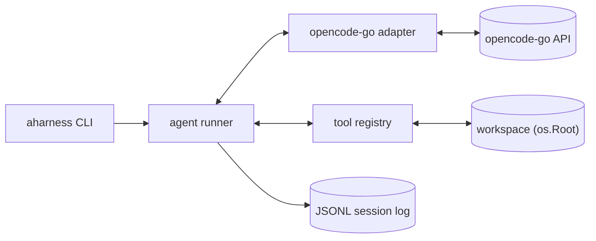

# aharness v0 build plan

- **Date:** 2026-11-09
- **Source:** [Bare-Minimum Agent Harness](agent-harness-minimum.md)
- **Target:** Go 1.27.3, module `aharness` (see [`go.mod`](../go.mod))
- **Status:** greenfield implementation plan
- **Coding standard:** [Go coding standard](coding-standard.md)

v0 is a single-process, single-agent coding harness. It accepts one task, runs a
bounded model/tool loop against a workspace, appends every event to a JSONL
session log, and exits with a final answer or a typed stop reason.

The source document defines the feature floor. This document defines the v0
slice, the component interfaces, the provider boundary, and the acceptance
tests.

## 1. Scope

### 1.1 What v0 owns

| Area | v0 implementation |
|---|---|
| Provider | One `opencode-go` adapter behind provider-neutral types. |
| Loop | Bounded turn loop with explicit terminal states; one assistant turn at a time. |
| Tools | `read_file`, `edit_file`, `search`, `run_command` behind one validated registry. |
| Transcript | Append-only JSONL event log; the model input is a projection rebuilt each turn. |
| Context | Per-call projection, tool-result truncation, deterministic compaction, token estimates. |
| Failure handling | Model retries, tool timeouts, panic pairing and typed stop, error results, repeated-failure stop. |
| Budgets | Max turns, max total tokens, session wall-clock deadline. |
| CLI | One binary with flags and environment configuration; no daemon or UI. |

### 1.2 Isolation and approvals

aharness does not provide isolation or approval; if isolation is needed, launch
it inside bwrap, Docker, or a VM.

### 1.3 Not in v0

No streaming, interactive interrupt/steering, resume/fork, model-based
summarization, subagents, RAG/embeddings, MCP/plugin systems, hooks, custom UI,
graph DSLs, planner frameworks, fine-tuning, built-in evals or an eval runner,
price tracking or dollar-cost budgets, multi-provider support, approval
workflows, snapshot/rollback, or sandbox construction.

Deliberate deviations from the source's sketch: isolation and approval are the
harness user's responsibility, not a harness feature; built-in evals are not
part of v0; and dollar-cost tracking is deferred.

### 1.4 Definition of done

v0 is complete when all of the following hold:

1. A task runs end-to-end against a real `opencode-go` model, makes changes only
   under the workspace, and returns a final answer.
2. Every model tool call receives exactly one tool result before the next model
   call; unknown tools, invalid arguments, timeouts, and panics become error
   results. A recovered panic is paired and then stops the run with
   `internal_error`.
3. The session log is valid JSONL encoded with `encoding/json/v2` and
   `jsontext`, contains the complete event history for the run (payloads
   capped), and is written outside the workspace by default.
4. Max turns, total tokens, and wall-clock limits stop the run with a typed
   status and a final summary event.
5. A long synthetic history compacts below the context limit while preserving
   the task, the last turns, and tool-call/tool-result pairing.
6. Both initial models (`crouton-alpha-free` and `deepseek-v4.1-flash`) complete
   the smoke task, and provider credentials never appear in logs or child
   environments.
7. The tooling gates in the coding standard's §10 pass: `goimports`, `go vet`,
   `golangci-lint`, `go test -race -count=1`, `go build -trimpath`, and
   `govulncheck`.

## 2. Provider and model

v0 supports one provider: `opencode-go`. The initial models are
`crouton-alpha-free` and `deepseek-v4.1-flash`. `-model` (or
`AHARNESS_MODEL`) is required; there is no automatic fallback, routing, or
provider matrix.

The harness opens network connections only through the `opencode-go` adapter;
tools may use whatever network the host allows. Provider-specific request and
response shapes stay behind the concrete `model.OpenCode` adapter. Provider
credentials are read from `AHARNESS_PROVIDER_TOKEN` when set, kept in memory,
redacted from logs, and excluded from tool environments. Credential handling
stays in this adapter; v0 does not scan unrelated host configuration or
discover credentials implicitly.

### 2.1 Wire format and SDKs

The v0 adapter speaks the OpenAI Chat Completions dialect over plain HTTP:
`POST https://opencode.ai/inference/go/openai/v1/chat/completions`. Both initial
models use this endpoint even though their native APIs differ; Console
translates every text model across every API, so v0 does not implement the
Responses, Anthropic, or Gemini dialects. If a model misbehaves through
translation, add its native endpoint behind the same adapter; do not change the
loop. Chat Completions is the wire format, not the internal schema; the core
`model` types remain provider-neutral (Section 2.2).

Do not use an OpenCode SDK at this boundary. The published Go SDKs
(`opencode-sdk-go` and its community forks) are generated clients for the
OpenCode server REST API; adopting one would move the loop, tools, and session
state into OpenCode, which is the architecture v0 rejects. There is no official
Go SDK for the OpenCode Go inference endpoint: it is OpenAI-compatible HTTP, and
the stdlib adapter is smaller than the mapping layer an SDK would require. An
inference SDK would also own retries, error bodies, and decoding, hiding the
`model_retry` events and redaction the session log depends on. The available Go
clients also fit poorly as dependencies: the Stainless-generated client targets
an older server API, and the community fork that tracks upstream has no license.

The adapter is constructed with the base URL, provider token, session ID, and
harness version. It sends `Authorization: Bearer <token>`,
`Content-Type: application/json`, `x-opencode-session: <session-id>`, and a
self-identifying `User-Agent: aharness/<version>`. OpenCode Go requires the
session header; the value is the run's UUIDv7 session ID. The base URL is a
constructor argument so tests can point the adapter at an `httptest` server.

### 2.2 Provider abstraction

Support many providers through adapters, not a feature superset. The core
`model.Request`/`model.Response` types cover only what the loop needs: text,
tool calls and results, a normalized finish reason, usage, and normalized
errors. The concrete adapter owns the wire format, authentication, tool-schema
quirks, and the mapping of finish reasons, usage, and errors. It uses one
`http.Client` with a timeout, `http.NewRequestWithContext`, and a capped
response body; it never uses `http.DefaultClient`. Provider error bodies are
capped and redacted before logging.

Do not build one union schema for OpenAI Responses, OpenAI Chat, Anthropic, and
Gemini. Their semantics differ in system prompts, tool-call correlation, content
blocks, safety handling, and streaming events; a union would push
provider-specific optional fields and invalid states into the loop. OpenAI Chat is
a dialect, not a neutral standard, so it is not the internal schema either.

| Layer | Owns |
|---|---|
| Core `model` types | Text, tool calls/results, normalized finish reason, usage, normalized errors. |
| `model.OpenCode` adapter | Wire format, auth, tool-schema translation, finish/usage/error mapping. |

v0 has no opaque provider options or capability flags. Add adapter-specific
knobs only with the second adapter, and keep them out of the loop.

v0 ships only the `opencode-go` adapter. Add `openai-chat`,
`openai-responses`, `anthropic`, or `gemini` adapters when a real provider
requires them. Share HTTP, retry, and fixture plumbing; do not share a
universal request/response schema beyond the small core.

## 3. Architecture



One process, one loop, no daemon, no worker pool. The runner owns turn state and
is the only component that advances the loop. Tools do not call the model. The
model adapter does not touch the workspace. The event log is append-only and is
the only persisted truth.

### 3.1 Package layout

| Path | Responsibility |
|---|---|
| `cmd/aharness/` | Flags, environment parsing, config validation, wiring, signal handling, exit codes. |
| `internal/agent/` | Runner, turn execution, stop policy, retry policy, repeated-failure detection, projection/compaction. |
| `internal/model/` | Provider-neutral types; concrete `opencode-go` adapter; typed transport errors. |
| `internal/tools/` | Registry, argument validation, result shape, workspace containment policy, the four tool implementations. |
| `internal/session/` | Event envelope, JSONL append-only store, session metadata, replay-ready reader. |

The five-package split is normative per the [coding
standard](coding-standard.md). `config` lives in `cmd`, projection lives in
`agent`, and workspace policy lives in `tools`. `session` remains a leaf; event
payloads are `json.RawMessage`, decoded by their producers. `cmd` is wiring and
I/O only; `agent` is the only orchestrator, and `model`, `tools`, and `session`
MUST NOT import `agent` or `cmd`. Add a package only when a second consumer or a
clear boundary justifies it; do not add `pkg/`, `util`, `common`, or `types`.

Dependencies stay deliberately small: Go standard library only at runtime. Typed
structs and explicit checks validate tool arguments; a JSON Schema validator is
not needed in v0. The provider adapter uses `net/http` with the OpenAI Chat
Completions dialect; no provider SDK is used (Section 2.1). Dev tools
(`goimports`, `golangci-lint`, `govulncheck`) are not runtime dependencies.

### 3.2 Core contracts

- `model.OpenCode` — concrete adapter with
  `Complete(ctx, model.Request) (model.Response, error)`. `model.Request`
  carries the projected messages, tool schemas, `max_output_tokens`, and model
  name. `model.Response` carries assistant text, zero or more tool calls
  (provider call ID, name, raw JSON arguments), a normalized finish reason
  (`stop`, `length`, `tool_calls`, `content_filter`, or `other`), and usage.
- `tools.Registry` — concrete registry with `Schemas() []tools.Schema` and
  `Execute(ctx, name string, args json.RawMessage) tools.Result`. The dispatcher
  validates arguments and converts errors into `tools.Result`; a panic is
  paired with a result and then stops the run with `internal_error`.
- `session.Store` — concrete append-only store with `Append(Event) error`,
  `Events() []Event`, and `Close() error`. One writer.
- `agent.Project(events []session.Event, limits Limits) (Projection, error)` —
  pure function of events plus limits; no hidden state.

The agent MAY define unexported consumer interfaces (`completer`, `toolset`,
`eventStore`) so loop tests use fakes. Production wires the concrete
`*model.OpenCode`, `*tools.Registry`, and `*session.Store`. Because the packages
are `internal`, do not export interfaces solely for tests.

## 4. Agent loop

### 4.1 Turn sequence

1. Create the session store and append `session_start` with the workspace, state
   directory, provider, model, limits, prompt version, toolset version, and
   harness version. Secrets are redacted. Append `user_message` with the task
   text and its source (`-task` or `-task-file`).
2. Check the session wall-clock deadline and cumulative token budget.
3. Rebuild the model input from the event log through `agent.Project`.
4. Call the model with retries (Section 8). Append `model_response`, including
   text, tool calls, finish reason, usage, latency, and attempt number.
5. If there are no tool calls, act on the normalized finish reason: `stop` (or
   absent) terminates with `completed`; `length` appends a `user_message` with
   source `continuation-hint` and continues, but a second `length` without tool
   calls terminates with `token_limit`; `content_filter` terminates with
   `provider_error`; any other value terminates with `protocol_error`.
6. For each tool call, in response order: resolve the tool, validate arguments,
   execute with a timeout, and append exactly one `tool_result` carrying a
   stable `code`. A failure is still a result with the original call ID. A
   recovered panic is paired before the run stops with `internal_error`.
7. Increment the turn counter and repeat from step 2. Stop when a limit is
   reached, a fatal error occurs, or a signal arrives.
8. On any termination, append exactly one `final` event with the terminal status
   and any final text, then append `session_end` with status, totals, and final
   usage. Best-effort, including on signal.

The loop never batches multiple assistant turns, never skips a tool call, and
never sends a tool result without a preceding call. If a model response contains
multiple tool calls, v0 executes them sequentially in the order returned. It does
not rely on provider-side `parallel_tool_calls` support; correctness must not
depend on that flag.

### 4.2 Terminal states

| Status | Meaning | Exit code |
|---|---|---|
| `completed` | Model returned a final message with no tool calls and a `stop`/absent finish reason. | 0 |
| `max_turns` | Turn limit reached. | 2 |
| `token_limit` | Cumulative token budget reached, or repeated output-length truncation. | 2 |
| `time_limit` | Session wall-clock deadline reached. | 2 |
| `provider_error` | Non-retryable provider failure after retries. | 3 |
| `protocol_error` | Model response cannot be paired or parsed safely. | 4 |
| `stuck` | Repeated identical tool failures (same tool, canonical arguments, stable result code) crossed the threshold. | 4 |
| `interrupted` | SIGINT/SIGTERM; child process group killed. | 130 |
| `internal_error` | Config, disk, harness invariant failure, or a recovered tool panic. | 1 |

Every terminal state produces exactly one `final` event with the status and any
final text, followed by a `session_end` event with a human-readable reason and
totals. The final assistant text, if any, is printed to stdout; progress and the
trace path go to stderr.

### 4.3 System prompt

The system prompt is versioned (`prompt-v0`) and recorded in `session_start`. It
must state, briefly:

- The workspace root, and that tools are the only way to act.
- Search and read before editing; keep changes minimal; run the relevant tests.
- Commands run with the harness's privileges; the harness adds no sandbox or
  approval step.
- Tool errors are data; adapt rather than escalate.
- Stop by replying without a tool call when the task is complete or blocked.

Tool-specific guidance belongs in tool descriptions, not duplicated in the
system prompt. Any prompt change bumps the version and should be checked against
raw traces.

## 5. Tools

All tools share these rules:

- Canonicalize the workspace to an absolute path once at startup, then open
  `os.OpenRoot(workspace)` and reuse it. Normalize tool paths relative to the
  workspace root; convert absolute inputs with `filepath.Rel`, then require
  `filepath.IsLocal`.
- `os.Root` enforces containment: it rejects `..`, absolute names, and symlink
  escapes. It rejects absolute symlinks even if they point inside. It is an
  accident guard, not a sandbox; bind mounts, `/proc`, and device files remain
  reachable.
- Writes to any path with a `.git` component are rejected by the edit tool,
  including `sub/.git/config`. This is an accident guard, not a security
  boundary.
- Symlink policy: `read_file` MAY follow in-root symlinks; `search` does not
  descend into symlinked directories and requires a real directory root;
  `edit_file` rejects a symlink anywhere in the path.
- File tools restrict reach to the workspace. This is not isolation; the shell
  still runs with the harness's privileges.
- `run_command` executes with the harness's privileges. It does not create a
  sandbox; use external isolation when commands are untrusted.
- Invalid arguments, missing files, ambiguous edits, timeouts, and non-zero
  command exits are model-visible results, not loop exceptions. Every result
  carries a stable `code` (`invalid_args`, `not_found`, `ambiguous`,
  `outside_workspace`, `git_protected`, `binary_file`, `too_large`, `timeout`,
  `canceled`, `panic`, `spawn_failed`, `internal`). A non-zero command exit is
  `ok=true` with an `exit_code`; `ok=false` is reserved for dispatch, validation,
  timeout, panic, spawn failures, and file restrictions such as binary or too
  large.
- Tool results are capped before entering the transcript. Head and tail are kept
  with an explicit `[truncated N bytes]` marker; the full raw output is not sent
  to the model. Command output is sanitized to valid UTF-8 before encoding.
- Tool calls are never automatically retried. Side effects are not idempotent;
  the model decides whether to retry after seeing the error.

| Tool | Inputs | Behavior and limits |
|---|---|---|
| `read_file` | `path`, `offset` (1-based, default 1), `limit` (default 100, max 500) | Returns numbered lines plus a `lines X–Y of Z` header; line counting splits on `\n` (a trailing newline adds no line), and bytes are preserved. Rejects binary/non-UTF-8 files and files over 2 MiB. Result cap 32 KiB. |
| `edit_file` | `path`, `old_string`, `new_string`, `replace_all` (default false) | Requires a unique exact byte match unless `replace_all`; zero or multiple matches are actionable errors; `old_string == new_string` is an error. Rejects a symlink anywhere in the path. Writes atomically via an `O_EXCL` temp file in the same directory plus rename; preserves mode with fchmod; preserves bytes, including CRLF. Creates a file only when it does not exist and `old_string` is empty, using mode 0644 and requiring the parent directory to exist; an existing file with an empty `old_string` is an error. Rejects edits over 2 MiB. Returns a short diff summary. |
| `search` | `pattern` (Go RE2 regex), `path` (default `.`), `glob` (optional, matched against workspace-relative paths), `case_sensitive` (default false), `max_results` (default 100, max 200) | Walks the workspace, skipping `.git`, binary files, and files over 1 MiB. Returns `path:line: text`, with long lines clipped, and marks capped results. Requires a real directory root. Invalid regex, invalid glob, and no matches are distinct results. `path.Match` globs do not support `**`. |
| `run_command` | `command`, `cwd` (default workspace root), `timeout_ms` (default 120000, max 600000) | Runs `/bin/sh -c` in its own process group with `Setpgid`, a `Cancel` that kills the group, and `WaitDelay`; stdin is nil. Captures stdout and stderr separately, sanitizes to valid UTF-8, and caps at 64 KiB combined with head+tail. Returns `exit_code`, `timed_out`, and labeled streams. Non-zero exit is a normal result (`ok=true`). On timeout or cancellation, kills the whole process group. Rejects `cwd` outside the workspace. |

`run_command` receives an explicit allowlist, never `os.Environ`: `PATH`,
`LANG`, `LC_ALL`, `TMPDIR`, `TERM`, and validated caller-provided cache
variables. `HOME` and `TMPDIR` point at harness-owned directories under the
state dir, not the user's home. An explicit denylist for
`AHARNESS_PROVIDER_TOKEN` and common secret names is defense in depth. The child
never inherits provider credentials or unrelated host variables. This is
hygiene, not isolation; a child process can still inspect the harness process.
Use external isolation when that matters.

The tool descriptions and JSON schemas are versioned prompt material, not
afterthoughts. Schemas are hand-written `json.RawMessage` constants; tests
assert that each schema and its argument struct agree. `read_file` returns line
numbers so the model can reference what it saw; `search` returns locations so the
model can page; `edit_file` errors state whether the match was absent or
ambiguous. These ACI choices are the highest-leverage prompt work in v0.

## 6. Context budget

The event log is append-only. The model input is a lossy projection rebuilt from
it on every turn. Compaction never mutates the log.

### 6.1 Projection invariants

1. The system prompt is always first.
2. The original task is always retained.
3. The last four turns are retained verbatim.
4. Every assistant tool call is followed by its matching tool result. Tool-call
   IDs are never dropped, and a result is never emitted without its call.
5. Older tool-result bodies may be replaced by a one-line stub; the call ID,
   tool name, and original byte count remain.
6. The projection fits the configured input budget with room reserved for the
   next output.
7. If the projection cannot fit after compaction, the run stops with
   `token_limit` before the model call.

### 6.2 Budget policy

- Before each call, estimate input tokens from the projected messages and tool
  schemas. Use a conservative `ceil(bytes/4)` estimate plus per-message overhead;
  treat provider-reported usage as authoritative for totals after each response.
- The per-call limit is `max_context_tokens - max_output_tokens - safety_margin`,
  where `safety_margin` defaults to 5% of `max_context_tokens` (minimum 1,000
  tokens) to absorb estimator error.
- Tool results are truncated at capture, then elided from old turns in the
  projection. The initial task, system prompt, and recent turns are never
  elided.
- Compaction is deterministic: elide oldest tool-result bodies first, in order,
  until the estimate fits. Log a `compaction` event with before/after estimates
  and the number of elided results.
- Model-based summarization is deferred. Dropping old tool output satisfies the
  source's Tier 1 requirement and is easier to reason about.
- Cumulative totals include every model response's input and output tokens,
  including retries. The session logs token usage; dollar-cost tracking is out
  of scope in v0.

## 7. Session log

- **Location:** `-state-dir` or `AHARNESS_STATE_DIR`, defaulting to
  `$XDG_STATE_HOME/aharness` (fallback `~/.local/state/aharness`). The log is
  `<state>/sessions/<session-id>.jsonl`.
- **Creation:** create the state directory with mode 0700 and the session file
  with `O_CREATE|O_WRONLY|O_APPEND|O_EXCL`, mode 0600. If the state directory is
  not writable, start-up fails with a clear error. The default is outside the
  workspace; avoid pointing it into the workspace, where the log becomes part of
  the task diff.
- **Format:** one JSON object per line, encoded with `encoding/json/v2` through
  `jsontext.NewEncoder` (`jsonv2.MarshalEncode`). Common fields:
  `v` (schema version), `seq` (monotonic), `ts` (RFC3339Nano), `session`,
  `turn`, `type`, `role` (message events only), and `data`. Use `omitzero` for
  zero scalars; v2 `omitempty` means “encodes as empty JSON”.
- **Durability:** `jsontext.Encoder` flushes each top-level value; call
  `f.Sync()` at least at turn boundaries and on exit. One writer. The reader
  accepts a valid final line without a trailing newline, ignores only a
  torn/invalid final line, validates `seq` monotonicity on replay, and never
  rewrites the log.
- **Session ID:** `uuid.NewV7().String()` from the Go 1.27 standard library. No
  reuse.
- **Truth:** the log is the durable record; the context window is a projection.
  The log contains enough information to rebuild every model input except the
  exact provider wire format. With `AHARNESS_LOG_REQUESTS=1`, an additional
  `model_request` event stores the exact projected messages, capped at 1 MiB.
  It is off by default. Secrets are redacted; the log never contains full
  environments, HTTP headers, or credentials. Tool arguments and results appear
  only as capped event payloads.

| Event type | Payload |
|---|---|
| `session_start` | Prompt version, toolset version, workspace, state dir, provider, model, limits, harness version. |
| `user_message` | Task text or corrective hint, plus source (`-task`, `-task-file`, `stuck-hint`, or `continuation-hint`). |
| `model_request` | Debug only (`AHARNESS_LOG_REQUESTS=1`): exact projected messages, capped at 1 MiB. |
| `model_response` | Assistant text, tool calls (ID, name, arguments), finish reason, token usage, latency, attempt. |
| `model_retry` | Attempt, error class, HTTP status, delay. |
| `tool_result` | Call ID, tool name, ok/error, stable code, output, exit code, duration, truncated flag. |
| `compaction` | Before/after token estimate, elided result count, policy. |
| `limit` | Limit kind, configured value, observed value. |
| `error` | Fatal error class and message; no secrets. |
| `final` | Terminal status and final text, if any; exactly one per run. |
| `session_end` | Status, reason, turn count, total token usage, duration. |

The log is for debugging and resume-readiness, not a tamper-proof audit trail.
A shell running as the same user can reach the state directory. Separating the
log from the shell would require a separate UID or process boundary and is out
of scope for v0.

## 8. Failure handling

| Failure | Policy |
|---|---|
| HTTP 429, 5xx, connection reset before response | Retry up to 5 attempts with exponential backoff plus jitter; honor `Retry-After` up to 60 seconds. Log each retry. Backoff sleeps are context-aware. All retries count toward the session deadline and token totals. |
| HTTP 4xx other than 429, auth failure, invalid request | No retry. Append `error`, end with `provider_error`. |
| Malformed or schema-invalid provider JSON (including duplicate object names or invalid UTF-8) | Append `error`; stop with `protocol_error`. Do not retry. |
| Context-length error from provider | Rebuild with the same deterministic compactor against a target 10% below the failed per-call limit, log `compaction` with policy `provider-overflow`, and retry once. If no further tool results can be elided or the retry fails, stop with `token_limit`. |
| Model call timeout | Counts as a retryable transport failure up to the attempt limit. |
| Unknown tool or invalid arguments | One `tool_result` with `ok=false`, a stable `code` (`invalid_args` or `not_found`), and a short corrective message naming the tool and the problem. |
| Tool timeout | Kill the process group, return a result with `ok=false`, `timed_out=true`, and `code=timeout`. |
| Tool panic | Recover at the dispatcher boundary, append a result with `code=panic` and a capped stack, then stop with `internal_error`. Pairing completes before the stop. |
| Tool process fails to start | Return an error result with `code=spawn_failed` and the spawn error. |
| Model response with a tool call missing its ID | Append `error`; stop with `protocol_error`. Do not invent an ID. |
| Repeated identical tool failure | Counts only `ok=false` results; "identical" means the same tool, canonical arguments, and stable result code. The message is for display, not identity. After 3 consecutive identical failures, append a `user_message` event with source `stuck-hint` and include it in the next projection. After 5, stop with `stuck`. |
| Session turn/token/time limit | Append `limit`, then terminate; the terminal path emits `final` and `session_end` with the corresponding status. |
| SIGINT/SIGTERM | Kill the running child's process group; write final events with a fresh 5-second context; terminate with `interrupted`, exit 130. |
| Disk write failure for the log | Fail fast with `internal_error`; the run cannot be made durable. |

Model requests are retried; tool executions are not. This distinction prevents
duplicate file edits and commands after a transient failure.

Errors wrap with `%w`; branch with `errors.Is`/`errors.As`; never match error
strings. Error strings are lowercase and have no trailing punctuation.

## 9. CLI and configuration

```
aharness -task "..." -model deepseek-v4.1-flash
aharness -task-file task.md -model crouton-alpha-free -workspace /tmp/repo
```

- Use the standard `flag` package; no CLI framework in v0.
- Precedence: defaults, then environment, then flags. Parse environment errors
  as config errors; validate the effective config once before the loop.
- Exactly one of `-task` or `-task-file` is required. `-task-file` is read once
  before the loop; it may be outside the workspace.
- `-workspace` defaults to `AHARNESS_WORKSPACE`, then the current directory.
  Resolve it to an absolute path, require an existing directory, and open the
  root once.
- `-state-dir` defaults to `AHARNESS_STATE_DIR`, then
  `$XDG_STATE_HOME/aharness`, then `~/.local/state/aharness`. Reject a relative
  `XDG_STATE_HOME`. The harness creates the directory with mode 0700 if needed;
  it must be writable.
- `-model` or `AHARNESS_MODEL` is required. Accepted values:
  `crouton-alpha-free`, `deepseek-v4.1-flash`. The provider is fixed to
  `opencode-go` in v0.
- Provider auth: `AHARNESS_PROVIDER_TOKEN`, read once at startup when set. Never
  logged and never passed to tools. The adapter sends the run's session ID in
  the required `x-opencode-session` header and identifies itself as
  `aharness/<version>` in `User-Agent` (Section 2.1).
- `-version` prints build info from `runtime/debug.ReadBuildInfo` (module
  version, Go version, VCS revision/modified) and exits 0.
- `-max-turns`, `-max-total-tokens`, `-max-context-tokens`, `-session-timeout`,
  and `-max-output-tokens` override defaults. Validate positive values and
  `max-output-tokens < max-context-tokens` with the safety margin.
  `AHARNESS_MAX_CONTEXT_TOKENS` sets the per-call context window; it must match
  the model.
- Output contract: final assistant text on stdout only; one `log/slog` progress
  line per model call and per tool call plus the trace path on stderr. Usage
  errors exit 2. `main` calls `os.Exit(run())`; library code never exits.
- No config file in v0; flags and environment are enough. No interactive mode.

Defaults are deliberately conservative and easy to change:

| Setting | Default |
|---|---|
| Max turns | 30 |
| Max context tokens | 200,000 (set to the model window) |
| Max output tokens per call | 8,192 |
| Max total tokens | 2,000,000 |
| Max session wall clock | 60 minutes |
| Model call timeout | 300 seconds |
| `run_command` timeout | 120 seconds (max 600) |
| Tool result cap | 32 KiB file tools; 64 KiB command output |
| `read_file` window | 100 lines (max 500) |
| `search` results | 100 (max 200) |

## 10. Milestones

| Milestone | Deliverables | Exit criteria |
|---|---|---|
| **M0 — Foundation** | Five-package layout; config parsing in `cmd`; workspace policy in `tools`; session event types plus JSONL store using `encoding/json/v2` and `jsontext`; UUIDv7 session IDs; fake model; CLI wiring; `-version`; signal handling; `.golangci.yml` with the standard's targeted linters. | `goimports -l .`, `go vet ./...`, `golangci-lint run`, `go test -race -count=1 ./...`, `mkdir -p bin && go build -trimpath -o bin/aharness ./cmd/aharness`, and `govulncheck ./...` pass. A scripted run writes a valid session log and exits 0 without network access. |
| **M1 — Loop and tools** | Runner with terminal states; concrete tool registry and four tools; argument validation; `os.Root` containment plus symlink policy; result codes; pairing; sequential multi-call handling; repeated-failure stop based on codes; panic pairing then `internal_error`. | A scripted model reads, edits, searches, runs a command, and finishes. Unknown/invalid/timeout/panic cases each produce exactly one error result; a panic also stops with `internal_error`. Path traversal, absolute-path conversion, and symlink escapes are rejected; `.git` components are blocked. |
| **M2 — Provider and context** | Concrete `opencode-go` adapter over OpenAI Chat Completions; both initial models; required `x-opencode-session` and `User-Agent` headers; retry/backoff; token usage accounting; `agent.Project`; truncation; deterministic compaction; provider error mapping; strict JSON decoding. | Mock-provider tests cover 429→success, 401 fast-fail, malformed/duplicate-key/invalid-UTF-8 JSON, and context overflow→compaction. Both model IDs complete a tool-call round trip through the adapter. A real `opencode-go` model completes a sample task. A forced large history compacts below the limit and preserves pairing. |
| **M3 — Hardening** | Process-group `Cancel`/`WaitDelay`; explicit environment allowlist with harness-owned `HOME`/`TMPDIR`; UTF-8 sanitization; session durability; signal cleanup; secret sentinel tests; startup config logging; manual smoke procedure. | Kill/timeout tests pass. SIGTERM leaves no child process. Provider token is absent from child environments and logs. The log lands in the configured state directory with modes 0700/0600. A smoke run with each model completes the sample task and produces a usable trace. |

Every milestone is gated by the coding standard's §10 checks; do not defer lint,
vet, race, or vulnerability checks to M3. Run `go fix ./...` before review and
use `go doc -ex` for examples; do not run `go fix` as a CI check.

Do not pull Tier 2 features forward to unblock a milestone. If a milestone
cannot pass, fix the interface instead of adding features.

## 11. Test plan

### 11.1 Unit tests

- Workspace containment: `..`, absolute-path conversion, absolute path outside,
  symlink-to-outside, absolute symlink, in-root symlink read, symlink component
  in an edit, `.git` component (including `sub/.git`), new file in a symlinked
  parent, symlinked search root.
- `edit_file`: unique match, zero matches, multiple matches, `replace_all`,
  create-only-when-absent, atomic write, mode preservation, `fchmod`, old==new,
  CRLF preservation, symlink rejection.
- `read_file`: paging, line counting (empty/trailing newline), binary rejection,
  size cap, truncation marker, byte preservation.
- `search`: regex errors, glob errors, skip rules, result cap/capped flag,
  long-line clip, `**` unsupported, real-directory root.
- `run_command`: non-zero exit as data, timeout process-group kill, `WaitDelay`
  on inherited pipes, output cap, UTF-8 sanitization, cwd escape rejection,
  environment allowlist (`HOME`/`TMPDIR`/token), nil stdin.
- Context: budget invariants, pairing, compaction determinism, initial-task and
  recent-turn retention through `agent.Project`.
- Session: JSONL round-trip, valid final line without newline, torn/invalid line
  tolerance, append-only behavior, 0700/0600 modes, UUIDv7 IDs, secret
  redaction, `json/v2` strictness.
- Loop: scripted model sequences for all terminal states; every call paired;
  panic paired then `internal_error`; code-based stuck detection.
- Fuzz: JSONL reader (torn/truncated/invalid UTF-8/duplicate keys) and tool
  argument decoding.

Tests follow the coding standard: table-driven where cases share logic; no
assert or mock frameworks; fakes at consumer interfaces; `httptest` for the
provider adapter; got-before-want failure messages with `t.Helper`; test error
identity with `errors.Is`/`errors.As`, not strings; `t.Context`,
`t.TempDir`, and the `t.Chdir`/`t.Setenv` parallel restrictions; no real network
or `time.Sleep`-based waiting. Inside a `synctest` bubble, do not call `t.Run`,
`t.Parallel`, or `t.Deadline`. Golden session logs are decoded and compared
semantically; do not test wiring, forwarding, or trivial getters; coverage is a
diagnostic, not a gate.

### 11.2 Integration tests

- Build the binary and run it against a fake `opencode-go` server in a temp
  workspace and temp state directory.
- Assert the persisted log, stdout final text, stderr progress, and exit code.
- Exercise both model IDs through the Chat Completions path and verify the
  adapter sends the selected model, `x-opencode-session`, and a self-identifying
  `User-Agent`; include a tool-call round trip for each model so translation
  quirks surface.
- Cover 429→success, 401 fast-fail, malformed/duplicate-key/invalid-UTF-8 JSON,
  and context overflow.
- Run the suite with `-race -count=1` and `govulncheck ./...`; no leaked
  goroutines or child processes. Use `synctest` for retry/deadline tests; use
  real short timeouts for subprocess tests.
- CI runs the standard's §10 gates in one Linux job, with `gcc` installed for
  `-race`; fuzzing MAY run on a schedule.
- CI also runs `go mod tidy`/`go mod verify`; a dirty `go.mod` or `go.sum`
  fails.

### 11.3 Manual smoke

Run the built binary against the real `opencode-go` provider with each model on a
small temporary repository. Verify one read, one edit, one search, and one test
command, then inspect the raw session log. Optionally repeat the run inside an
external sandbox to confirm the harness behaves the same with or without
isolation.

This is a manual check, not a built-in eval suite. External benchmarking and
eval infrastructure are out of scope for v0.

## 12. Decisions and risks

### 12.1 Decisions

| # | Decision | Rationale | Reversal risk |
|---|---|---|---|
| D1 | Go standard library only at runtime, including Go 1.27 `os.Root`, `uuid`, and `encoding/json/v2`; a test-only `go-cmp` exception is allowed by the coding standard. | Small, auditable, no dependency supply chain. | Low; concrete types and package boundaries isolate most code. |
| D2 | One `opencode-go` adapter over OpenAI Chat Completions with two initial models. | Matches the required provider; one wire dialect covers both models; avoids a premature provider matrix. | Medium; provider behavior is behind `model.OpenCode`, but prompts/tool-call mapping are adapter-specific. |
| D3 | Tools execute sequentially; no provider-side parallel guarantee. | Simpler correctness and deterministic logs; avoids concurrent writes. | Low; dispatcher can fan out later. |
| D4 | Deterministic compaction only, no summarization model call. | Predictable, cheap, testable; satisfies Tier 1. | Low; summarization can replace a policy function later. |
| D5 | No built-in isolation or approval. | The harness owns the loop, not the boundary; external isolation supplies it when needed. | High if built-in isolation is later required; it changes the process and tool contract. |
| D6 | Session log defaults to the XDG state directory. | Keeps the log out of the workspace diff without requiring an external mount. | Low; `-state-dir` overrides it. |
| D7 | No resume/fork in v0; event log is resume-ready. | Tier 2; smaller loop. | Low; the log format already records enough state. |
| D8 | No built-in evals or eval runner. | The harness ships the loop, not an evaluation platform. | Low; external tooling can consume the session log. |
| D9 | No dollar-cost tracking in v0. | Model-specific price tables go stale and should not be a user-supplied environment contract; token limits are enough. | Low; add a price table and budget policy later if needed. |
| D10 | Five-package layout; config in `cmd`, projection in `agent`, workspace policy in `tools`. | Fewer packages and interfaces; safety logic stays in focused files with tests. | Low; split when a second consumer appears. |
| D11 | A recovered tool panic is paired with a result, then the run stops with `internal_error`. | A panic is a bug; continuing risks corrupted state. | Low; can change to a counted continuation if evidence supports it. |
| D12 | No OpenCode SDK; a stdlib adapter speaks OpenAI Chat Completions for both initial models. | The available Go SDKs target the OpenCode server API, not the inference endpoint; adopting one would move the loop, tools, and session state into OpenCode. The inference API is OpenAI-compatible HTTP, and owning retries, decoding, and redaction keeps them visible in the event log. | Low; if aharness becomes an OpenCode client, use the server SDK there. Revisit if OpenCode publishes a supported Go inference SDK. |

### 12.2 Risks

| Risk | Mitigation |
|---|---|
| Running against an untrusted repository without external isolation exposes the host. | Operator responsibility; launch inside external isolation. The harness makes no isolation claim. |
| Provider token is readable by a child through the process environment or `/proc`. | Env scrubbing is hygiene, not isolation; use external isolation when that matters. Never log the token. |
| The workspace is a real repository, so in-place mistakes are real. | Use version control or a disposable copy; the harness does not create worktrees. |
| `os.Root` is mistaken for isolation. | It is an accident guard; it does not block bind mounts, `/proc`, or device files. Use external isolation. |
| JSON v2 strictness rejects duplicate object names or invalid UTF-8 from providers or tools. | Sanitize command output; map malformed provider JSON to `protocol_error`; do not fall back to v1 silently. |
| Log tampering by a same-UID shell. | Accepted v0 limitation; separate UID/VM if audit integrity is required. |
| Context estimator drift causes provider overflow. | Conservative estimate, reserved output, provider-usage reconciliation, one compaction retry. |
| Huge tool output or huge edits exhaust memory or context. | Caps at capture, projection, and log-field level; explicit truncation markers. |
| Search performance on large repositories. | Go walk with skip rules and result cap; shell out to `rg` only if measurements justify it. |
| Provider schema, tool-call format, or Chat Completions translation drift. | Adapter tests with recorded fixtures and per-model tool-call round trips; typed errors; fall back to a model's native endpoint behind the same adapter. |
| Child process outlives the harness. | Process groups, `Cancel`, and `WaitDelay` on timeout/signal; a deliberately backgrounded grandchild on normal exit MAY survive, so use external isolation for hard containment. |
| Model context window is unknown. | Configure `-max-context-tokens` explicitly; do not guess silently. |

### 12.3 Open prerequisites

1. **Provider integration:** confirm that Chat Completions translation preserves
   tool calls for both initial models, and confirm the exact credential source
   behind `AHARNESS_PROVIDER_TOKEN`. The base URL, dialect, and headers are fixed
   in Section 2.1; do not add a provider SDK.
2. **Model limits:** confirm the context window for `crouton-alpha-free` and
   `deepseek-v4.1-flash`.
3. **State directory:** confirm the XDG default is writable on the target
   systems, or document the required `-state-dir`.

## 13. Follow-on order

After v0 is reliable: streaming and interrupt/steering; resume/fork from the
event log; hooks; model-based compaction; then subagents, RAG, or MCP/plugins only
with evidence that the single loop is the bottleneck. External evaluation and
benchmarking are separate from the harness.
